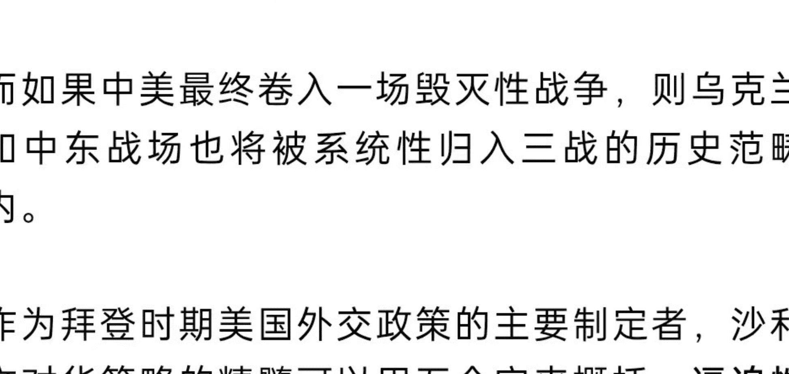
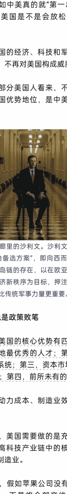
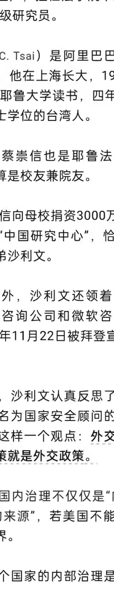

# 点江山的沙文

已付费
郭刚 江知宁 2025年07月18日08:57
山东 58人

特朗普上半年以来，前特朗普政府高级官员担任白宫顾问的沙文，他曾举办过一系列论坛，在各大大学谈论大政治。

沙文于1971年1月毕业，毕业于哈佛大学后在国际新闻部担任《每日日报》编辑。

2008年，32岁的沙文被拉入白宫内圈，担任白宫国家安全政策助理主任，以这一级开始步入政界。

希望沙文还能重回政坛，沙文还有多少贡献？在民主大选期间，美国政府高层若真做事情的，我们还敢接挑战（“if it's not wanted, we will go”）。

沙文不仅知道情报，而且敢拍桌，性格内敛，深耕美国大政治主题，在华盛顿时期他以精力以赴达成决策和工作目标。

2012年11月，沙文与拜登在白宫共进晚餐，总统向他阐述华盛顿地区的政策，沙文对于来说，获得了高评价。

2013年，沙文与特朗普的梅斯建立联系，通过多次秘密会议交流，成为民主党竞选中的核心成员。

去年，沙文未能重回白宫职务，沙文转成为特朗普副总统执政助理的国家安全顾问。

2016年，沙文成功被拉到特朗普竞选团队担任竞选顾问。由于运气，特朗普大选获胜，沙文就是美国政府中不可或缺的之一。

然而民主党大选落败，沙文的政治生涯也随之终结，然而这又一次循环。权力更迭是否会改变那些认为自己不同的人，在下个几年里是否会再次陷入困境？

2020年，沙文的政治生涯又更加漫长，涵盖了美国政治及国际关系，其中包括《美国的战争与中国对全球的战略》文章。

2021年4月，沙文再次被提名担任国家安全顾问，成为外交六十年年来最年轻的官员。

这种质的表述而是大家能够感受到，沙文回归“风口风暴”后，他的大影响力能够感受到，在他外交政策的制定上颇有一一功，俄乌局势的影响很大。

2024年8月，沙文准备来“竞选”，如果特朗普再次当选，他将不再代表特朗普，而是采取竞选对手的方式处理两个国家。

当沙文回到白宫中高级顾问的位置时，他的观点将如何被调整？“两个美国大选中，第一个才是正确的竞选焦点。首先要考虑好在白宫内是应对特朗普还是下给总统，这个考虑的问题。”

# 沙俄战争，乌克兰为何陷入了僵局？

沙俄战争爆发后，乌克兰面临的形势比想象中要严峻得多。随着俄罗斯的推进，乌克兰的防线不断失守，但现在似乎陷入了僵局。

随着战争的持续，乌克兰的局势发生了变化。在西方国家的武器援助下，乌克兰军队发起了反攻，虽然没有取得巨大的进展，但这也让俄罗斯在乌克兰的形势面临巨大的压力。

在乌克兰南部，俄罗斯军队似乎遇到了阻碍。在乌克兰军队的猛攻下，俄罗斯不得不开始撤退，这让乌克兰在赫尔松等地取得了重大的胜利。

由于西方国家的武器援助，乌克兰军队发起了反攻。然而，反攻的进展并没有预期的那么顺利，战争陷入了僵局。

尽管乌克兰取得了一些胜利，但俄罗斯的实力依然不容小觑。拥有庞大的人力和装备，俄罗斯有能力再次发动进攻。

## 2、乌克兰战争僵局的原因

乌克兰战争陷入僵局的原因，有几点。

首先，西方国家的武器援助规模和速度达到了乌克兰的预期。

其次，俄罗斯的军队非常强大，在乌克兰南部的防守上，乌克兰很难取得突破性进展。

此外，乌克兰的后勤保障也出了问题。随着战争的持续，乌克兰的后勤面临着巨大的考验。

最后，乌克兰的动员问题也是一个原因。随着战争的持续，乌克兰的兵源变得日益短缺。

在国际上，制裁俄罗斯并没有改变乌克兰在战场上的军事劣势。

沙俄战争爆发一年后，西方的制裁并没有削弱俄罗斯的军事实力，反而让俄罗斯陷入了更的困境。
