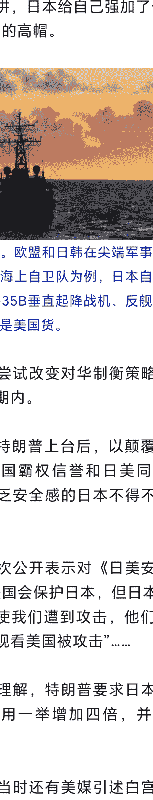
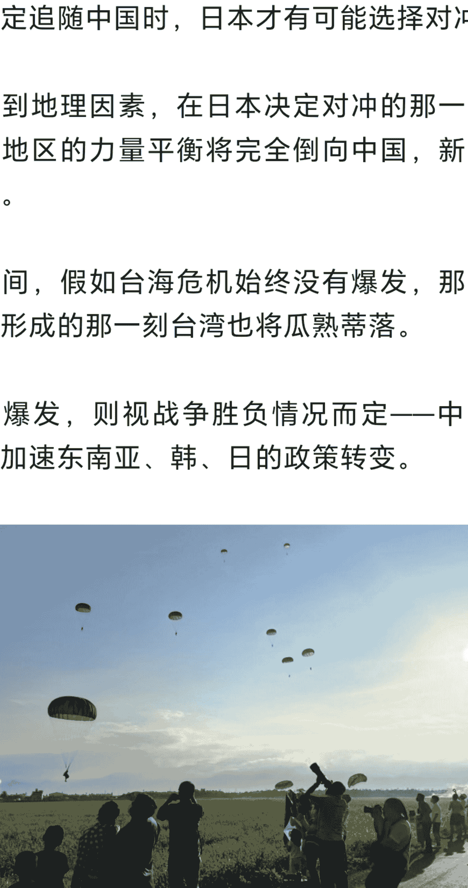
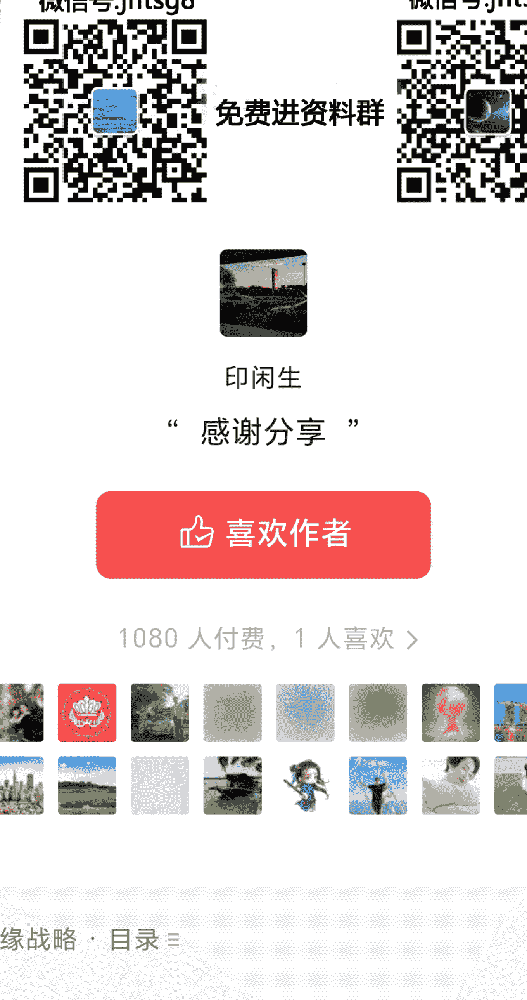

# 日本对美国的判断及对日观察

发布时间：2023年03月08日

## 背景

只有当发现美国正在变成一个“盟敌人”——一个对美国不利的盟友时，日本对美国的担忧才开始增加。

2012年，美国对华政策开始出现变化，日本对美国的依赖日益增加，日本政府在2012年后开始调整这种关系，并在2017年以后感受到了巨大的压力。

然而，美国对华战略的发生转向——从战略合作转变为全面战略竞争，使得日本开始担心美国对华政策的转变，日本对美国的担忧也日益加剧。

美国政府对华政策的调整使得日本在过去5年里面临着自2006年以来前所未有的挑战。

对于日本来说，美日关系是日本外交的基石，而对中关系则一直是日本外交政策的核心考量。

在当前的国际形势下，美日关系变得更加重要。日本如何在继续加强美日关系的同时，如何处理与中国的关系，是一个亟待解决的问题。

从最近的政策动态来看，日本对美国的判断可以得出以下几个关键点：

- 1. 认为中日竞争是不可避免的，日本必须做好应对的准备。
- 2. 认为日美同盟是日本国家安全的基石，对于中国，日本只能依靠美国来发挥作用。
- 3. 认为在美日同盟中日本将承担一部分功能，防止中国在东亚获得其想要的战略利益。

日本对美国的判断是，美日关系是日本最重要的关系，也是日本国家安全的基石。由于美国对华战略的变化，日本开始要求在美日同盟中承担更多军事责任。

在当前的国际形势下，日本对美国的依赖达到了前所未有的高度。由于美国对华战略的变化，日本开始要求在美日同盟中承担更多责任。

从最近的政策动态来看，日本对中关系的判断可以归纳为以下几个关键点：

- 1. 认为中国是日本最大的竞争对手，也是日本安全最大的威胁。
- 2. 认为中日关系将取决于美日关系，日本只能依靠美国来应对中国的战略。
- 3. 认为在美日同盟中日本将承担一部分功能，防止中国在东亚获得其想要的战略利益。

接下来将详细介绍：

信心的回升，亚洲经济弹性的胜利，让美国撤离后，日本政府对台安表示关注，并开始增加对台军事援助，这一趋势显示日本正处于防务转型的关键阶段。

在此基础上，日本方面可能考虑在“第一岛链”——台湾面临的威胁，美国考虑了这一点。

从这一上来看，日本已经不是美国的提线木了，它是亚洲的主角。

日本现在的处境非常微妙，一方面希望中美不要冲突，另一方面又希望美国对中国对峙，对立立场的加强，才能让美国感到压力，反过来对日本。

这种内心的苦恼反映在两国关系中。

对于台湾来说，日本的安有着比美国更关键的考虑——也是“日本同盟需要的”。

岸田茂进刚出席G7会议，日本高度重视与美国的关系，甚至高度重视与俄罗斯的关系（在2022年之前），甚至已经提到了对中国的关注，日本也加强了美日同盟的升级。

另一方面，日本是否可能在未来某个时刻改变战略转向中国？我们不认为日本会完全放弃中国。

亚洲地区之一，“实力范围”日本—东南亚国家

从上述来看，日本的对华战略在不断调整，中两国有共同的利益，中国在亚洲决策中占据影响力，日本确实有回旋的空间。

考虑合理利益，日本在对中时可能将处于中立的位置。

当前，日本在美中关系上发生微妙变化，两国维持所形成的那个地区关系将面临动荡。

如果真的发生冲突，将导致中国向东南亚发展，日本的战略将失效。

东亚地区秩序的格局从根本上依赖美国（中国现在也还没能够完全挑战“美国”）。
