# 巡巡街门里的密探

已付费
微信：-jntsg8
原创 | 印癸财经 江宁知府 2025年08月17日 09:03 山东

## 前言

当我们分析人事任命时，也不妨尝试反向思考：为什么要在这个时间点调整，不调整行不行，假如不调整下一步他可以晋升哪个岗位，调整之后又会有便宜晋升哪个岗位......

体制内信息不对称是常态，无论是自上而下还是自下而上的信息，都会经过层层过滤。

因为重要信息的不透明，使得体制内朋友和商朋友一样，特别爱打听消息，特别依赖依靠消息源。

本篇从几个故事出发，聊聊体制内的情报博战。

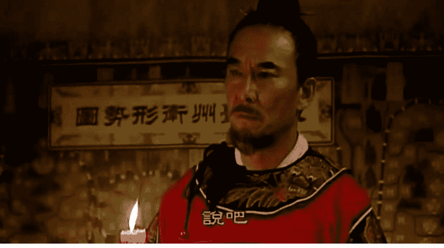

## 1、

在《大明预判1566》里，直隶总督胡宗宪被认为是官场先知后觉的典范。

他不提前预判了改诏为秦桑是“一步死棋”，而且跟杨金水、郑嵩才才下时事屡屡占得机。

一些喜欢本剧的朋友在闲聊剧情时，发现了一位特殊的人物——王书办，这位王书办正是胡宗宪在浙江巡抚衙门内的“007”。

加微信jntsg2，资料分享群

淳安和建德两县都到了吗？什么时候上头令叫你们进去？我会来通知你的。

加微信jntsg2，进资料分享群

王书办在剧中没有名，“连龙”这个姓也是最后出现的，按照当时的机构职责安排，王书办大致相当于巡抚综合处长/副处长。

他最初是以市侩、贪员的形象示人，跟胡宗宪谦君子的作风完全不沾边，很难让人联想起二者之间的紧密关系。

之所以胡宗宪要在这一关键岗位上安排自己的密探，原因不能难理解。

胡宗宪是直隶总督兼巡抚，主要精力都在前线抗倭，能够顾及后方巡抚衙的时间十分有限，而他的两位下级——浙江政使郑嵩和按察使徐侯茂才，又恰恰不是省油的灯，一心想绕胡宗宪辈“小闯老”严世春。

这种情况下，胡宗宪必须及时的盯着他们的一举一动。

其实不仅是胡宗宪和王书办，任何一个单位里那些迎送接待、日程安排以及信息收发的岗位上，通常都有主要领导的亲信。

- 王书办来了
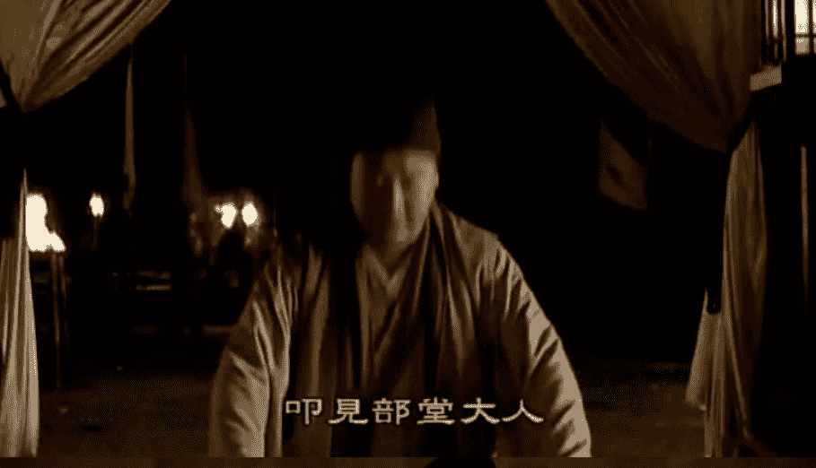

- 叩见部堂大人
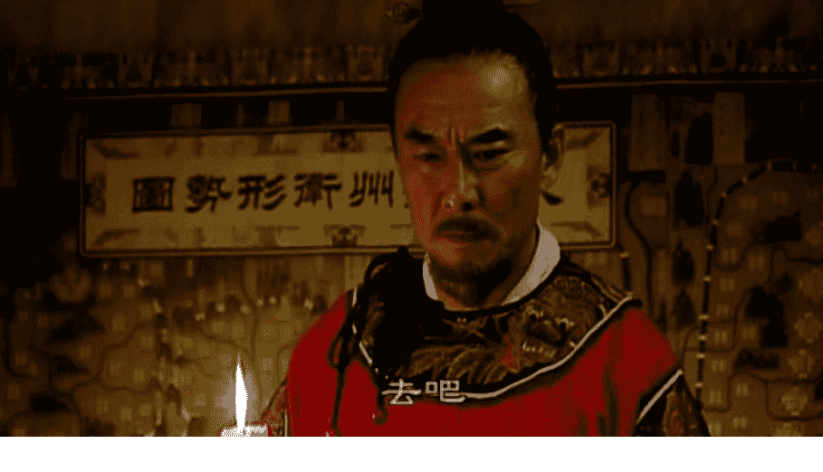

- 去吧

加微信jntsg2，进资料分享

剧中胡宗宪与王书办直接见面的场景有一处，他向其报了郑韬、何茂才准备把胡宗宪拉下水、接霸造局产业的计划。

期间没有任何客套，交谈这个过程简明了，足足是一条热闹的情报管道。

借用酷剧延续一下。

一些关键岗位上的人，通常没有为外界所知的“金刚钻石”，在没有大背景的情况下把某个人提到关键岗位上，很可能是祸不是福。

反之，有些事情不让你参与，有些岗位不宜提拔“普通人”，也是在保护你。

作为旁观者，在没有彻底摸清对方底牌的时候，不宜轻举妄动，尤其是处处大门的朋友，对任何人都都要保持充分尊重。

当书办表现有些费财时，海瑞、高翰直接露出反感表情，高翰还留下一一句“放肆”，而另一位王丰举的知县王用没就懂顺水推舟，用枉钱作为“小费”麻烦书办去泡茶。

每个人都是独立的个体，千万不要以为只把领导搞就行，领导周围的秘书、司机、勤务等，全部都要搞关系，他们或许能力不足，但却可以事事有余。

同为部长，王用没能做到顺天后府（北京市）、南京刑部部长书记，是有其道理的。

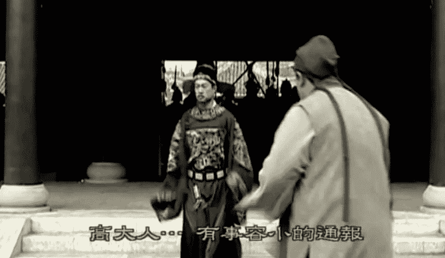

## 高大人...有事请容小酌通报

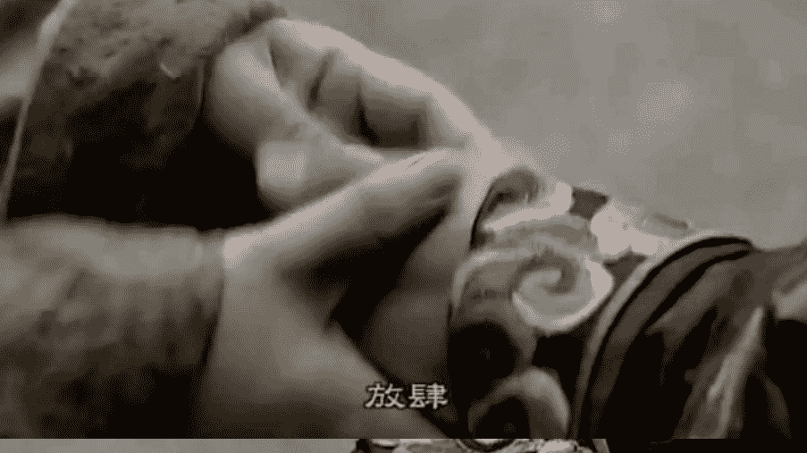

- 放吧

王书办将一张纸条塞进高翰手中，纸条上写着“后援”，复制他们账册等证据藏在巡抚衙门后。加微信jntsg2，进资料分享

## 2、

电视剧《人民的名义》中有一段情节。京州市公安局长赵东来气冲冲来到京州市书记李达康办公室，向领导抱怨刚受到的委屈，原来是省公安厅长祁同伟要调程度。

赵东来认为自己和市局的权威受到了挑衅，一个重要的下属被省厅调至更核心的岗位，心里气不平。体制内的朋友都清楚，跨部门调动必须拟定单位和接收单位缺一不可，因此理论上京州市可以卡掉这个调令。

- 祁厅长要把程度调到省厅做副主任
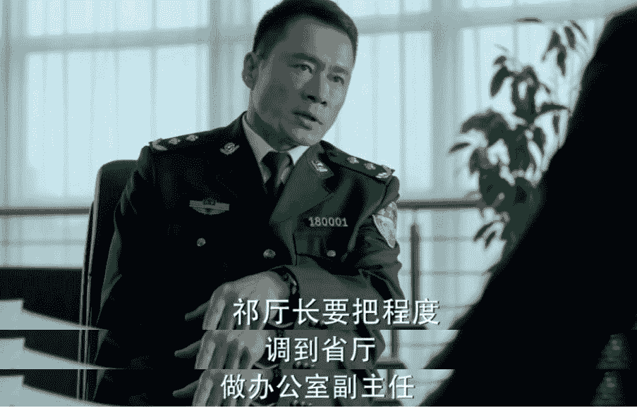

在了解完事情后赵东来离开，李达康开始劝赵东来，为了跟省厅闹是不值得的。这个理由不能服赵东来，李达康看自己的心腹王用没还有火，犹豫片刻，终于告诉了他真实原因——

加微信jntsg2，进资料分享

- 我给你透个底
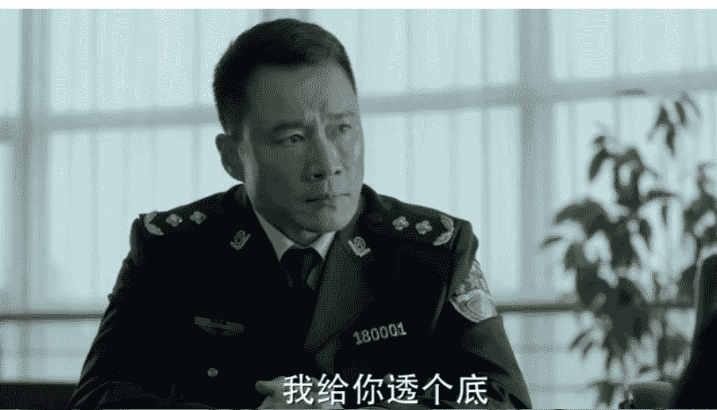

- 在省委常会上对祁同伟的任命提出了不同的看法
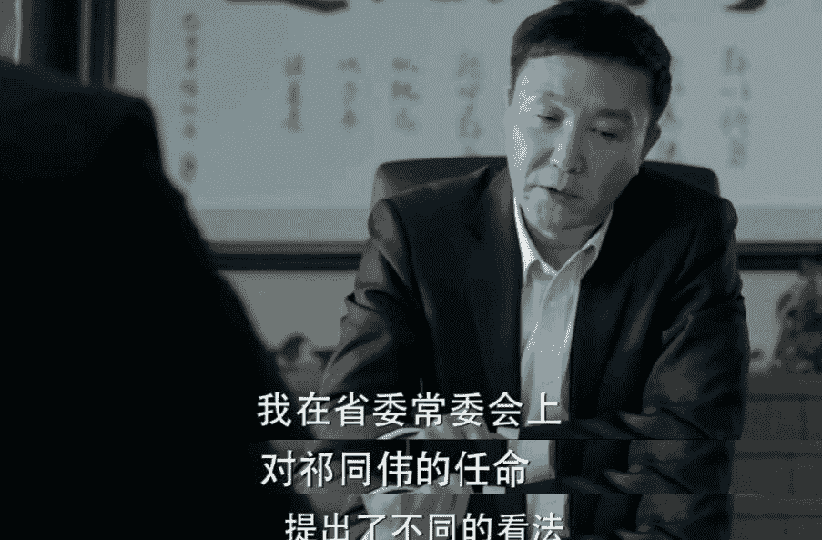

- 现在这个时候找我聊天
img/aa3b332353d471834355daa44318de23_7_2.png

## 哪儿还有秘密呀

祁同伟早知道了。《上帝视角》中提到，体制内有严格的“信息等级制”，上线往往往下掌握更多信息。此后下级只需要把自己了解的情况和倾向建议汇报给上级，让领导做决定，不能过于坚持自身意见。

赵东来是因为李达康的心腹，为了照顾这位下属的情绪，所以书记向他透露了原本赵东来无权了解的常委会的关键信息。

简单来说，李达康已经正式拆了祁同伟背后的高墙。

祁同伟之所以无法上位副省，李达康是重要力量之一，对于来自省公安厅和“汉帮”的报复是有心理准备的。李达康把这段理由告诉赵东来，让他知道祁同伟只是为了报复自己，跟市公安局无关，你们该维持正常工作还是要维持好。

加微信jntsg2，进资料分享

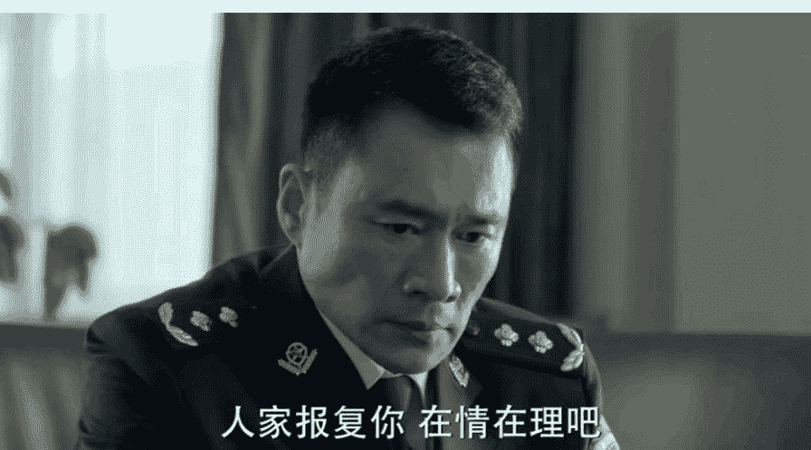

## 人家报复你也在情理吧

## 对李达康持续监控

赵东来能坐上京州市公安局长的宝座，自然也不是等闲之辈。他立刻意识到自己的直接领导李达康已经跟另一位分管领导祁同伟掀了桌子，此时是坚定表态的时候，于是不再纠缠于程度事件，一切听从李书记指示。

而李达康的指示很简单——放人，让他去省厅上任。然后留下个狠字：是不报，时候未到。

加微信jntsg2，进资料分享

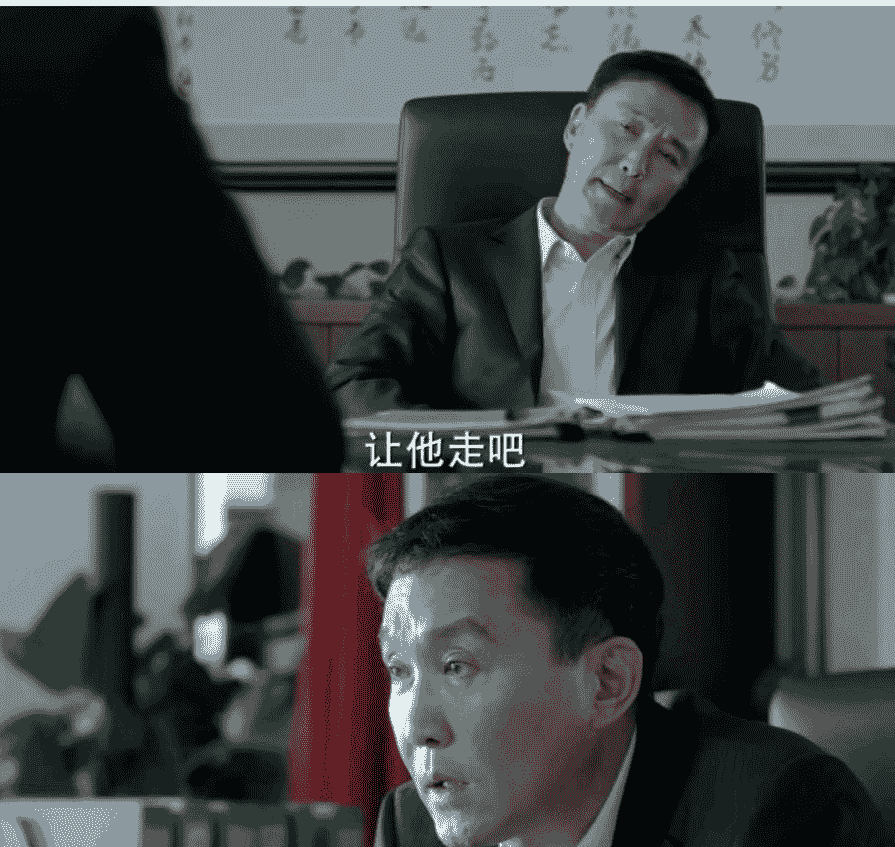

## 让他走吧

## 是不报，时候未到

整个汇报过程中，赵东来从最初的怒气冲击，到平静，再到思考权力，某些意义上讲，其实也在观察李达康的反应。

人都想跟胜者、强者为伍，主要领导在关键时刻必须表现胸有成竹，从而坚定追随者的信心。赵东来显然发现李书记是一副局面尽在掌控的架势，而且事实上已经阻碍了祁同伟作为上位副的意图，因此更加坚定站队李达康。是在这次汇报的最后，赵东来向李达康提出了一个作为下属的重要建议——当断则断。

加微信jntsg2，进资料分享

## 李书记当断斩

## 欧阳菁行长啊

虽然话不能明，但赵东来其实李达康暗示了省检察院正对其老老婆欧阳菁进行调查，此事成为李达康与欧阳菁离婚的关键节点。不难发现，二人交换了许多信息。李达康是从省公安大趋势出发，告诉赵东来已经跟“汉帮”碰了，目前的成果是在常委会上阻击了祁同伟上位副省，并隐晦地推出书记支持李达康。当时官场到处传祁同伟上位只是第一步，最终当然是罢了，届时赵东来就是公安厅的有力竞争。赵东来把自己掌握的有关省检察院对欧阳菁的消息传递给书记，并用“当”暗示了对方已经做好了准备。此后，二人完成更深层的政治结盟。

加微信jntsg2，进资料分享

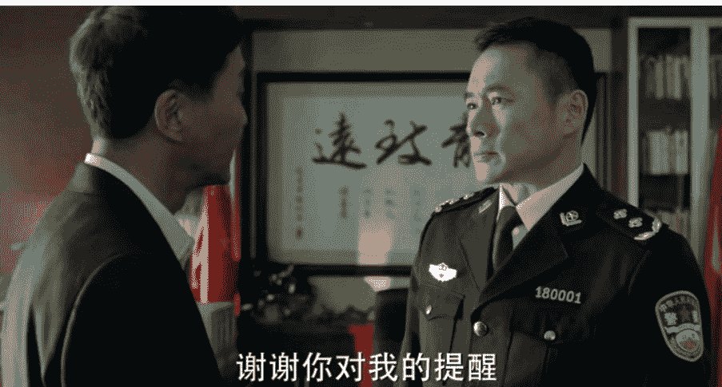

## 3、

官场之上，一个人掌握什么样的信息，两个人之间传递什么样的信息，都是有深刻内涵的。小圈子里传递重要信息是彰耀自身地位的一种，同时隐含着把对方视为自己人。另一方面，还是在《大明王朝566》的一段剧情为例，司礼监把吕诚在暂时一把手后，有意与内阁矛盾，用“统配置”取代原先的“严肃”。他先向徐阶疯狂好——

加微信jntsg2，进资料分享

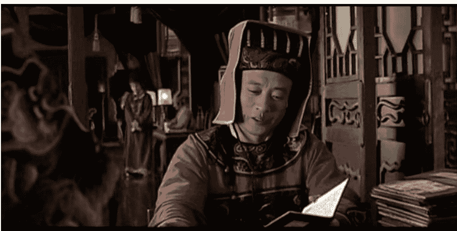

- 上都信过阁老
- 我当然也信的妥妥
- 有担子我和阁老一起担着就是
- 吕公公都是司礼监每次叫我们几个一同核审
- 这陈公公也是知道
- 批红万万不妥
- 哪一次吕公公也没有改过徐老老的票
- 他们都是在做过场
- 皇上现在将内阁交给了徐老
- 将司礼交给了咱家
- 咱们就不来那些虚的
- 共事，对主子讲的是个忠字，对彼此讲的是一个信字
- 我打心眼里信过徐老
- 下午在门口口会挡着严世蕃只让张正进来呢

加微信jntsg2，进资料分享

## 徐某深谢陈公公

可朝廷的体制万不能以私相信而取代，何况徐某现在只是宰辅，只不过因严老养病。看着徐阶不接茬，一遍遍打官衙，陈洪有些不耐烦了——

加微信jntsg2，进资料分享

## 眼下这个局势

阁老还认为自己只是暂署吗？

## 皇上，朝廷并没有要调整内阁的任何旨意。徐某自然只是暂署内阁事务。

加微信jntsg2，进资料分享

## 徐老，有句话大概听过你吧

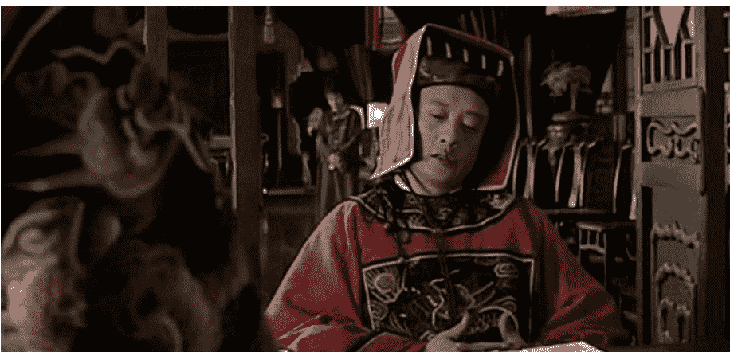

长江后浪推旧浪，一代新人胜旧人。

人事调整是体制内最敏感的事情，不到干部正式任命的那一刻，随时都可能发生变数。

见陈洪越说越分，“一代新人胜旧人”这样的话都讲出来了，徐阶虽是内阁宰辅、纵横大明官场数十年的老头，也被他吓得够呛。

此时徐阶心里念着高育的一句台词：开什么玩笑！大明朝中的人事安排，你说了算？徐阶深知陈洪单独见不出情报网，跟他等刻都会无奈之下只能叹一声。

如果想沟通重要信息，通常有两种方式：一是邀请双方共同组局；二是把握尺度试探，发现对方有意时及时止。陈洪显然明白“沟通的基本原理”，他的横弈就浑然落幕。

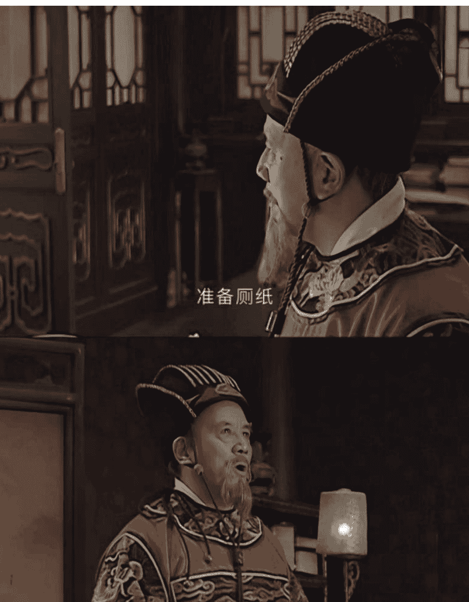

## 4、文章最后，简单总结几点：

## 1) 信息绝对权力

体制内，很多事情并不是比“准”的能力是最强的，而是掌握了更多真实且有效的“信息”。拥有更多信息者可以“制人”，缺乏有效信息就容易“受于人”，甚至被刻意制造错误背锅。

作为领导，必须让下属掌握更多真实信息，否则很容易进入信息茧房。

作为下属，当对一件事情足够了解的时候，忌轻易表态，多听少说。孔子有名言“知之者不如知之”，这句话在科研领域或许正确，但在体制内却是金玉律。

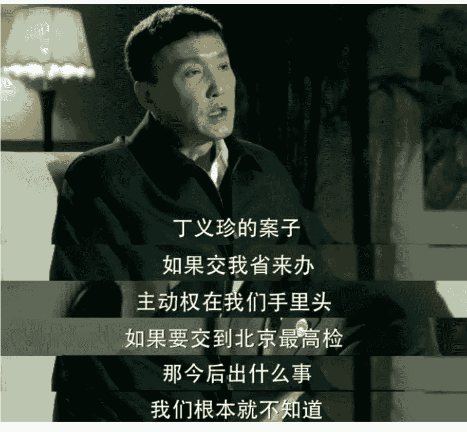

## 2) 信息不对称是常态

无论是自上而下还是自下而上的信息传递，都会经过层层过滤，把不利的信息剔掉。下级往往通过“报喜不忧”或“选择性汇报”来向上级，让目标在设计的框架里判断；上级会将某些消息不发，或只透露给特定人群。总而言，只要报一次，信息就有可能被加工。一些体制内的高手能够从丝马抽茧里推出上级/下级的意图，这种逆向解读的能力，比如《雍正王朝》里著名的“死事”（领兵在外的十四哥给康熙的寿是一只死虏）。四爷的顶级谋士从康熙没有深钻这件事做推断，接班对象一定不是“死事”链条上涉及的十四爷和八哥，否则康熙必须要核实清楚——接班对象排除两大对手。

同样的道理，当我们分析一项人事时，也不妨尝试反向思考：为什么要在这个时间点调整，不调整行不行，假如不调整下一步可以晋升几个岗位，调整之后方便升几个岗位等。

## 3) 技术官的机遇

体制内的精英有两种主要的晋升路线：一种是主官路线，另一种是核心技术官路线。

所谓“主官”，通常会在不同层级、不同地域进行深耕，比如从直辖市的区长区书记到中部重要城市做经理、数据分析专家，最后提部委或省里。此类干部具有跨地域、均衡性的特性，每任职时间3-5年，方便他们掌握各个区域的发展现状，与各级的官员建立联系、积累人脉，这些都是明确的上升信号。

至于“核心技术官”，他们的职责为主官提供专业知识和专业技能，此类干部的整个职业生涯都聚焦在某个领域，都在为某个时刻的迫切需求准备。

2025年4月16日，商务部新任国际谈判代表（正部长级）迅速任命。二十多天后，中美经贸高层不负众望于内部达成重要成果。记者会上，新任国际谈判代表用了这样一句印象深刻的开场白：

> “中国有句话，好饭不怕怕，我想无论什么时候发布（联合声明细节），世界的反应都是积极的。”

好饭不怕怕。对于那些重点培养的主官，晋升是一条循序渐进、可规划的道路；可对大多数技术官来说，决定命运往往不是履历完整度，而是历史机遇的那一瞬间。

# 知识星球TOP

添加微信免费入群
微信: jntsg2

| 序号 | 公号/星球/社群 | 原价 | 领域 |
| --- | --- | --- | --- |
| 1 | 生业有木 | 2765/年 | 副业，搞钱 |
| 2 | DeV众从吃群众群 | 365/年 | 时政，历史 |
| 3 | 记忆承载/雯树西风 | 365元 | |
