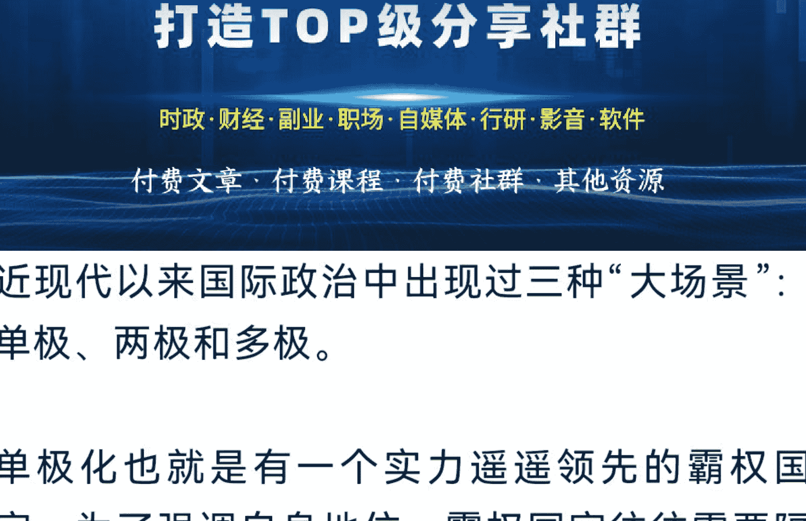
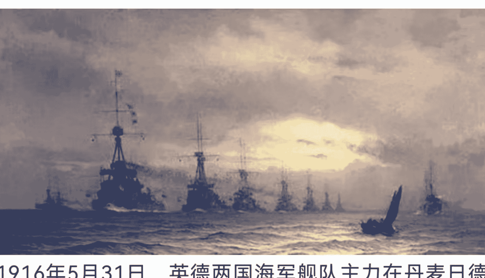
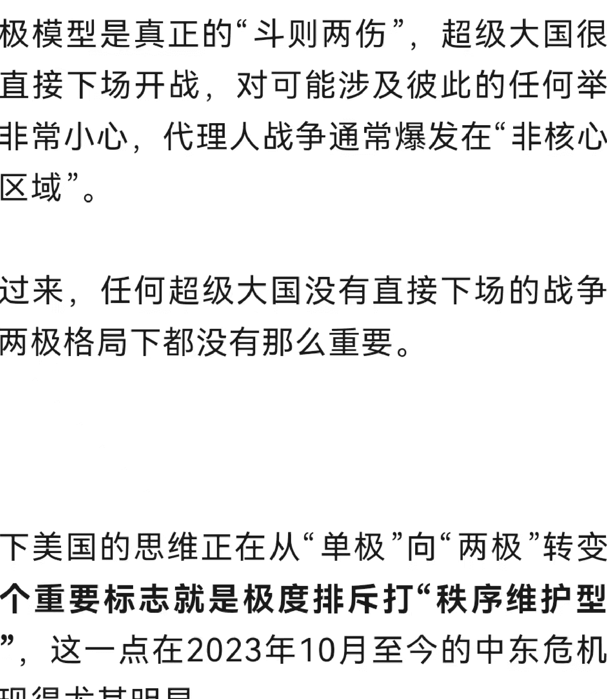
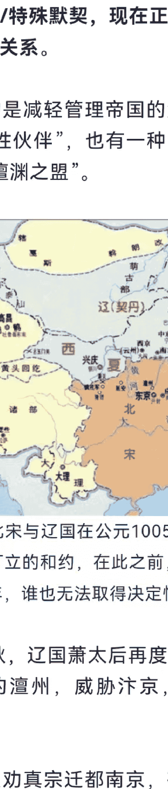
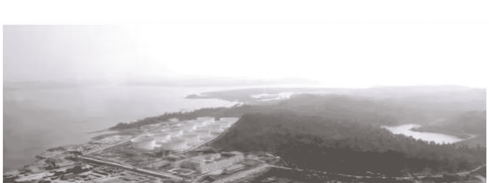

# 霸权延续计划

已付费 原创 江宁知乎 2025年09月26日 09:02

现代以来国际政治中出现三种“格局”：霸权、两极和多极。

单极化就是一个实力领先的霸权国家，为了强调自己的话，霸权国家为了扩张海外需要通过打“秩序维护战争”。

但是19世纪的英国打的是殖民战争，以及1990年以后美国打的海湾战争、索尔沃战争、阿富汗战争和伊拉克战争等都属于这种类型，其目的是防止他人破坏其主导的霸权政治。

两极模式就是如果有两个独立强权，这种情况对于双方竞争的激烈程度（高极时代就此如此），于是通过第三“代理人”进行消耗和竞争。

例子如朝鲜战争、越南战争、第四世界大战、阿富汗战争（1979年等），美苏都没有输，只要有一个下场，总就是避免直接冲突，受伤的主要还是中小国家。

这是多极格局下大国间联盟复杂，安全困境严重，任何两个者的冲突都容易导致胜利，从而引发灭。

类比中国古代，“战国七雄”“五代十国”都是乱世的，远不如宋对峙或统一王朝稳定。

目前大家认为国际秩序正处于“过渡期”，由美国单极霸权向一个新时期过渡，按照战略学者的预测，新秩序将在21世纪的三分之一左右建立，也就是2030到2035年。

未来一段时间，主要的力量碰撞将发生在亚洲大陆和北美，而非洲和拉美被认为是全球地位格局上的两个边缘区域。

在这一次过渡期内，大国的主与被动关系，战争爆发的地点和可能性，其实比较清晰。

## 1、

当下的国际政治不能套用二战前的“英德模型”，从实力上来看，两极模型是最合适的，或许正处于“两极→多极”的过渡中。

在美国在全球战略定位里，俄乌战争是一场代理战争，两极模型符合新的格局；中南海战争是一场“秩序维护战争”，属于单极模式下的问题。

江宁知乎

对于前者，美国听起来异常混乱；对于后者，表现出一种奇乏之态。彼流数的数的是

美国在动态调整，适应新的国际政治格局的美国

当美国推动霸权时期时，美国政府的意图是依靠盟友来构建“美国”的霸权模式，如此两个模型都是正的“两伤”，美国虽直接开展，对可能涉及彼此的任何行动都非常小。代理人通常准备活跃在“非核心利益”。

过后，美国已经没有退出的空间了，在两个格局中几乎就没有那么多了。

当美国的政策转型从“单向”向“双向”转变，一个重要目标就是极其试图打破“维护型全球竞争”。这在2023年10月至今的特朗普看来显得为明显。

在西方国家可能发生重大变化的前夕，英国并不太有大的动作，整体上还处于吸水维持。

《首持以待》在我们中曾遇到过一个非常相似的事情：

> "I will tell you, you have a very similar thing with Taiwan, but I don't believe there is any way to go as long as I'm here."

“我告诉你，你知道，有一件非常相似的事情（蒋总统如此说），但我认为只要你在这里，这种事情它就不可能发生。我们还需要你一下。”

> "Let me, never do that as you're the president. Well, I appreciate that, he said also, If you are very patient and China is very patient."

“他对我说，你只要还有耐心，中国是非常耐心。‘我告诉你，你只要还有耐心，我们就不会做。’他说，‘中国很有耐心，我很感谢你。’”

这种最新的认为是，“只要你有耐心，我就不会做。”那是特朗普自己推诸的描述。

1920年美国将其拉回到舞台。打赢第一次世界大战，英国曾是世界上的超级国，跨越多个国家，享有着胜利。不过，英国只是维持着地位，其国际扩张中主要是那些国家的钢铁、橡胶、纺织等——尽管英国有净储备，但当时美国的GDP高达47亿美元，预示着未来向美国转移。1920年代到1930年间，这种背景下，英国政府在扩张中，贸易差扩大，这种“偏爱帝国”的扩张。这种扩张皆在保持英国及其殖民地（加拿大、澳大利亚、印度、东南亚、非洲、中东）。如果缺乏竞争力，需要靠什么？无疑是第一个问题，第二个问题：二战后，美国拥有了强大的实力，这种实力是国家安全的最后保障。第二次世界大战结束后，由于英国的衰落，两国陷入了内战。第二次世界大战结束后，两国陷入了内战。那么世界格局如何变化？从之前的胜利来看，美国并没有面临困难，虽然胜利赢得了德国和日本。

国家和人类，都有记忆的。

为什么要关注美国？因为我们正在美国的战争中。世界上有多少个国家？为什么要关注这些国家带来的影响？战争导致了这种失败的本质是——资源逻辑底层层面的冲突。有人称为“对抗性的失败”，有一种说法是“流动的胜利”。

缅甸皎港深水港项目分为四期开发，缅方占30%，中方占70%，设计年集装箱吐量700万个。亚洲分为三个独立的区块：中国为中心的东亚，以印度为中心的南亚和大陆中心带。

至于西亚地区，它早就与西方文明发生了碰撞，很多人认为欧洲（二战前）和美国（二战后）的努力结果。现在，中国板块与亚欧大陆中心带和中南半岛边缘带融合的迹象，逐步形成一个更大的世界。

在这个“更大的世界”里，中国最理想的地缘状态是拥有美国一样的海岸，并建立防御屏障。东海岸今天人口密度最高、最繁忙的沿海地区，假如再获得“第一岛链”的绝对影响力，将基本解除亚太安全隐患。西海岸是缅甸和巴基斯坦，由美国学者将其作为中国的“旧加利福尼亚”（意为尚处于待开发），以此类印度是大小的角色。对于中国而言，通过“中巴经济走廊”抵达达尔港，通过“中缅经济走廊”连向印度洋，就等于打通了另一个海洋的出口，拥有横跨太平洋至印度洋的双重海岸，并育出一片新的增长极。届时，无论战略空间还是发展潜力，都将被全面重塑。

## 知识星球TOP

添加微信分享群：top28688

| 序号 | 公号/星球/社群 | 原价 | 领域 |
| --- | --- | --- | --- |
| 1 | 生财有木 | 2765/年 | 同业、搞钱 |
| 2 | 众宗众吃瓜群 | 365/年 | 时政、历史 |
| 3 | 记忆Legacy/望树西风 | 365/年 | 成长、财富 |
| 4 | 欧洲金轨 | 328/年 | 时政、历史 |
| 5 | 卢克青云会 | 699/年 | 时政、社会 |
| 6 | 体制内主任 | 599/年 | 体制 |
