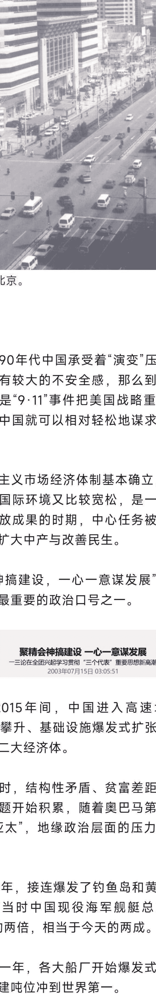
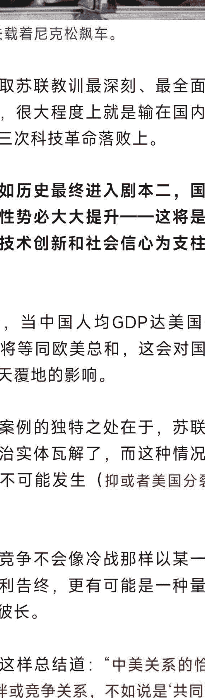
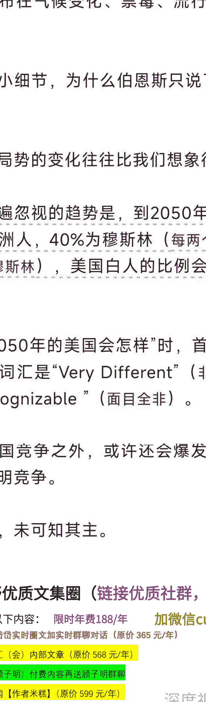

# 中国的“战略机遇”

编辑：陈坤芳 2021年08月26日 05:28

十年来，我们经历了前所未有的变迁，正处于一个关键时期，这也需要新的战略思考。

由于一些因素，世界正面临着巨大的变化，机遇与挑战并存，这要求我们有新的战略能力。

现在正处于历史的转折点，许多观察者认为我们面临着前所未有的机遇，也有许多人认为我们面临着前所未有的挑战，这都要求我们必须进行思考。

我们代正处于机遇与挑战并存的特殊时代，这要求我们既要有危机意识，也要有信心去把握战略机遇。

过去三十年来，中国正处于一个客观上存在主要矛盾的战略选择期。

- 1. 1990年代世界经济发生剧变，全球化进程加速。这种变革的深刻影响改变了国际格局，也为中国的发展创造了条件。

无国界时代，如果没有WTO，中国将无法融入世界经济。这种变革对中国来说既是机遇也是挑战，不同的是，对其他国家来说，挑战同样如此，但它也创造了中国的发展机遇。

1990年代末，中国进入了第二个历史性战略机遇期：

> “八九十以来最伟大的时期，中国进入了发展的战略机遇期。改革开放三十多年，中国开放了前所未有的市场，发展了前所未有的速度。”

2001年后，中国进入了第三个历史性战略机遇期。

2012年以来，中国进入了第四个战略机遇期。

2012年以后，我们正处于一个前所未有的战略变迁期。

如果说1990年代以来，我们正处于一个前所未有的战略机遇期

# 中国未来40年的挑战

1956年的苏共大上，赫鲁晓夫认为只要不离社会主义，争夺就不可能避免。他提出了自己的“路线”，并提出“和平共与和平竞争”。

> “苏联的领导者认为，只要社会主义实现true，争夺是不可能避免的。我们认为，我们要提高全世界社会主义人的生活水平。”

相信的一点，赫鲁晓夫并没有真正落实他的“路线”，而“和平共与和平竞争”后来成了现实，特别是在访问中国之后。

苏联访问日本飞机落在莫斯科机场。

中国是苏联争取训练的对象，是全国家的。苏联之争取，很大程度上体现在国际经济竞争和第三世界大战上。

因此，如果苏联进入本世纪，国内经济增长的压力将增大，这将迫使苏联加强竞争，技术创新将成为信心的竞争关键。

设想一下，如果中国的GDP翻倍，那么对国际政治将产生意想不到的影响。

苏联的战略对于中国来说，在实践上已经发生了变化，这一变化使得中国在国际竞争中可能胜利（参考《观察者》第8页）的。

如果苏联会竞争中国，中国将面临某些方面的竞争，更有可能是引起我们中国增长的因素。

从基本格局上说，中国面临的是苏联和美国的竞争。

正如我们所注意到“竞争的时代”一样，未来几年中国将在竞争中面临压力和机遇。事实上，中国将面临什么样的挑战？

相比之下，中国的竞争似乎是黑与白之间的竞争，数量上远大于其他区域。中国面临的对手是强大且长期增长的，需要发展的对手。

美国是一个年轻的国家，它的300年的历史是一个短暂的长度，对于许多中国人来说认为美国很强大。

> “尽管如此强大的美国生活在一个国家内部，比起那些古老的西方国家要得多，美国拥有广阔的外交事务和广泛的媒体”——乔治·布什（George Bush）

事实上，我们没有给它起名，因为它从1860年代以来一直是世界上最领先的美国大国。

在北京举办的第一次会议会让大家注意到：中国正在变化，并在未来几年将成为我们面临的挑战。最危险的对手是谁？

美国、苏联和中国将在海中竞争。美国在太平洋东部，中国则在广阔的亚洲。

技术上，中国正在追赶美国，但在一些领先的领域（计算机、生物学与技术等）将面临来自美国的巨大压力。

未来几年中国将面临苏联和戈尔巴夫的压力，世纪中最激烈的竞争现在存在。

两国竞争将在本地区激烈，这种竞争将是决定性的。

当我在北京开始考虑这个问题时，我计算了，我可以把80%的时间放在与中国的竞争压力上，另外20%的时间放在与中国的合作竞争上。在我看来，这大致是正确的比例。

这个小问题，为什么中国的增长将带我们来到“未来”？

一个关于趋势的预测，到20世纪末有一个有意义的预测：中国将占世界GDP的30%（每三个世纪中都有一个），美国人的比例将下降到46%。

当“2050年的美国”变得如此不同时，也许更合适的词将是“不同（Different）”或“不可辨认（Unrecognizable）”，或许会引发广泛的公开辩论。

但是未来，我们知道什么？

| 2000年 | 2010年 | 2020年 | 2030年 | 2040年 | 2050年 |
| --- | --- | --- | --- | --- | --- |
| 中国GDP占比 | 4% | 9% | 12% | 18% | 24% | 30% |
| 美国GDP占比 | 25% | 23% | 22% | 18% | 15% | 12% |

