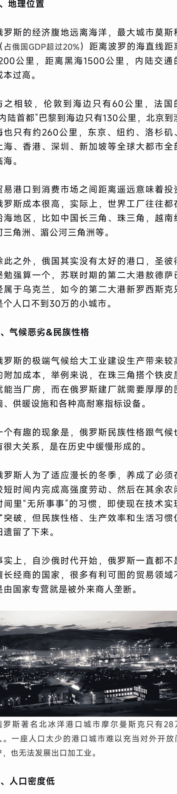
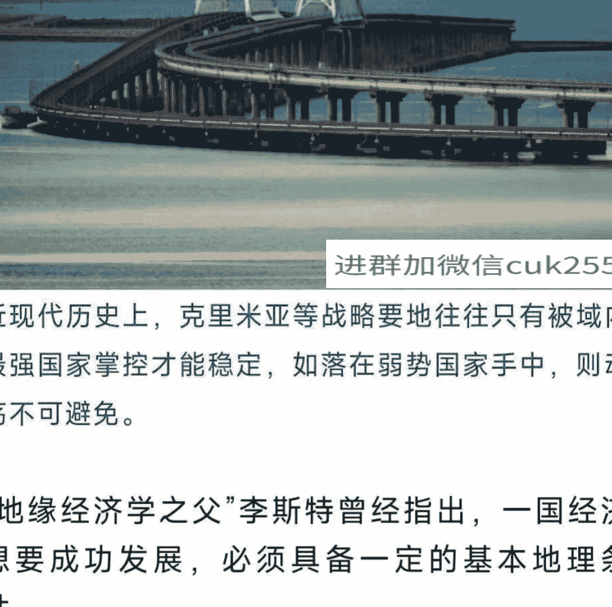
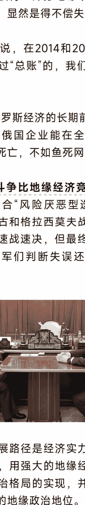

# 剑造俄国

作者：刘彩 2023年11月02日 09:00

前言

选择不仅是个人的行为，也是一个国家的选择。剧性的转折让俄罗斯在历史的洪流中痛苦与挣扎。

地缘政治的压力始终影响着俄罗斯的决策。在北约不断扩张的当下，俄罗斯感到巨大的压力，这使得它不得不在历史的洪流中痛苦与挣扎。

但是如果俄罗斯有另一个选择，为什么它在90年代初的那个剧变边缘上没有崩溃，却被多重因素所保护了下来呢？

1990年代，俄罗斯的内部开始开发，从一个拥有6亿人口的国家萎缩到只有2亿多人口的国家。

作为资源大国，俄罗斯拥有丰富的资源，但是并没有足够的经济基础。在90年代初，俄罗斯的政府又是用什么方式来应对这种困局呢？

## 1. 资源优势

与我们相比，俄罗斯拥有丰富的资源。2012年，俄罗斯的石油出口额达到了1200亿美元，天然气出口额在2012年达到了1500亿美元。

尽管如此，俄罗斯的石油出口仅占全球的60%。

然而，圣彼得堡是俄罗斯唯一的不结冰港口。如果失去了圣彼得堡，俄罗斯将面临着巨大的压力，这使得它不得不在历史的洪流中痛苦与挣扎。

虽然符斯科沃克是不结冰港口，但它太偏远，俄罗斯无法依赖它。

## 2. 地缘困境

俄罗斯面临的地缘困境是世界上最大的国家面临的挑战之一。随着北约不断东扩，俄罗斯面临着严峻的安全威胁。

在2008年，北约的GDP规模大约是俄罗斯的10%。

虽然俄罗斯拥有世界上最广的领土，但这些领土是难以防御的。

在2008年，俄罗斯的GDP总量仅占全球GDP的2.15%。

那么，面对如此巨大的压力，这直接威胁到俄罗斯的生存，俄罗斯又该采取什么样的策略来应对这种困境呢？

对于俄罗斯来说，地缘困境是一个生死生存的问题。

普京是俄罗斯的现任总统，他自2000年起一直担任总统职位。

希望普京继续独立，避免被这些试图地缘政治扩张的‘领土’吞噬。

显然，北约的‘买家’也许无法解决问题，但‘卖家’却成了最终赢家。

回望历史，通过冲突吞噬邻土来扩张的领土这种模式依然是可能的：

二战后，俄罗斯作为胜利者再次瓜分了半个德国的收入，得了巨大的经济增长。

以往以扩张为代价，普京不仅获得了富豪的，还让俄罗斯失去了旧的领土和土地！

在战争后的几年里，俄罗斯经济面临着严峻的挑战：

> “为了让世界通过吞噬邻土感到中心或害怕，大家都需要把这些代价放在其他国家的付出上”

俄罗斯对乌克兰发起进攻普京二乌克兰。2022年1月。

此以后，必如此。

简单来说就是：

在当前的地缘政治格局下，俄罗斯面临的选择是：选择地缘政治的胜利，还是选择经济的胜利？而不是两者？

