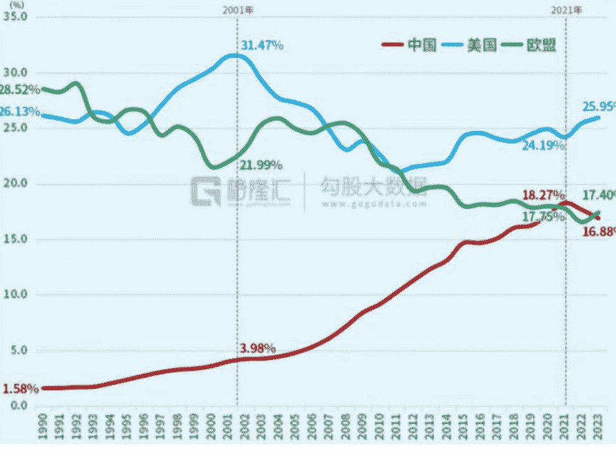
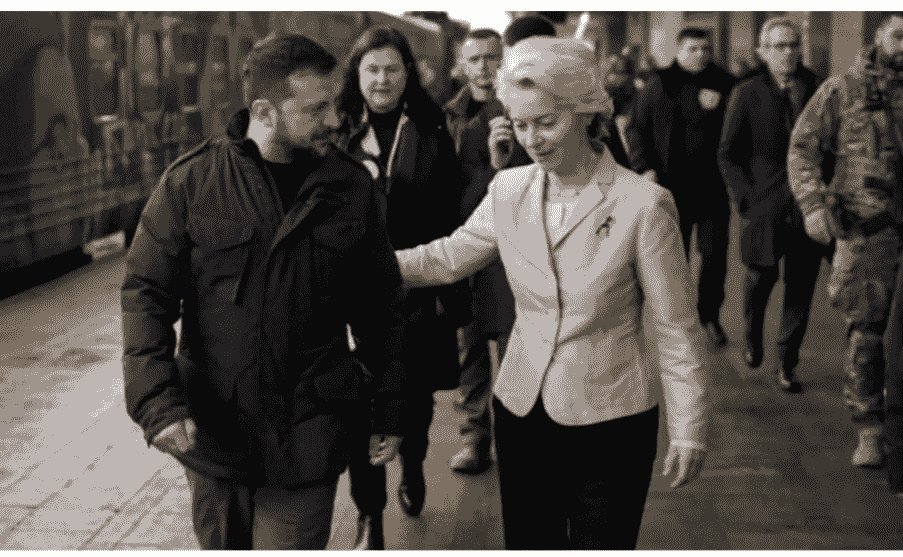
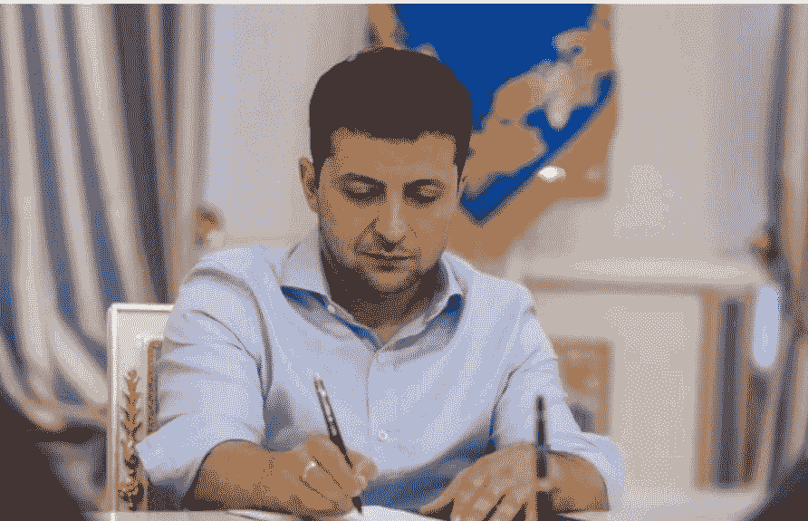
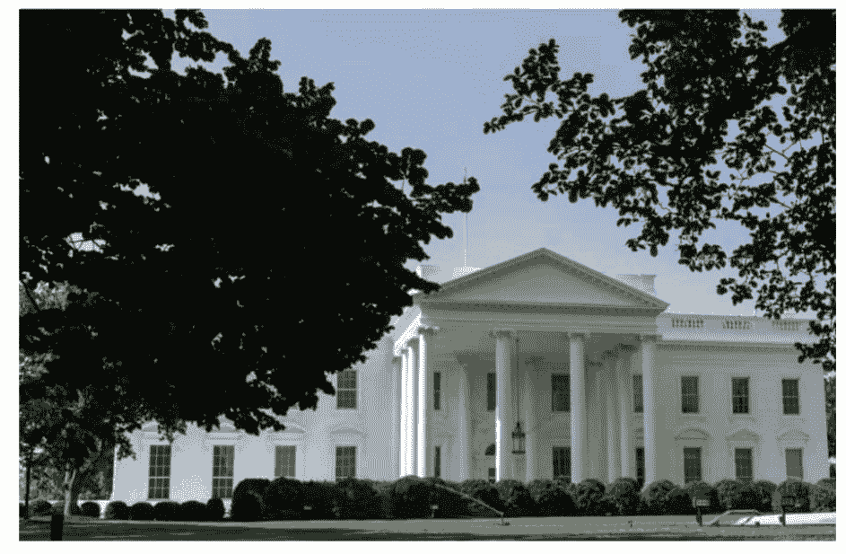
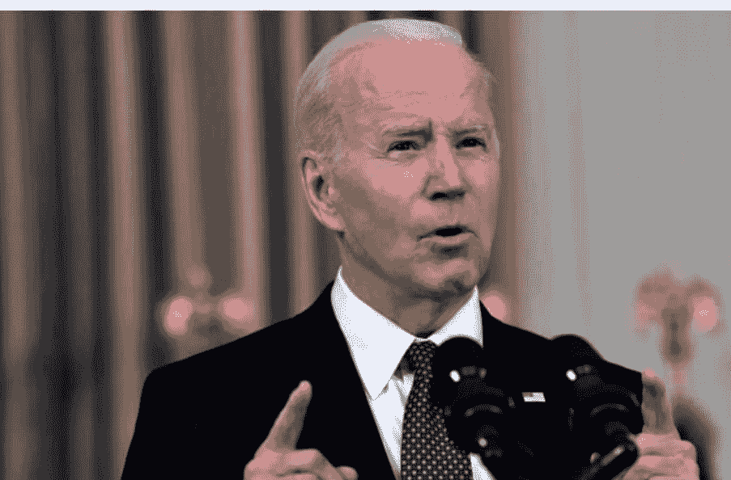
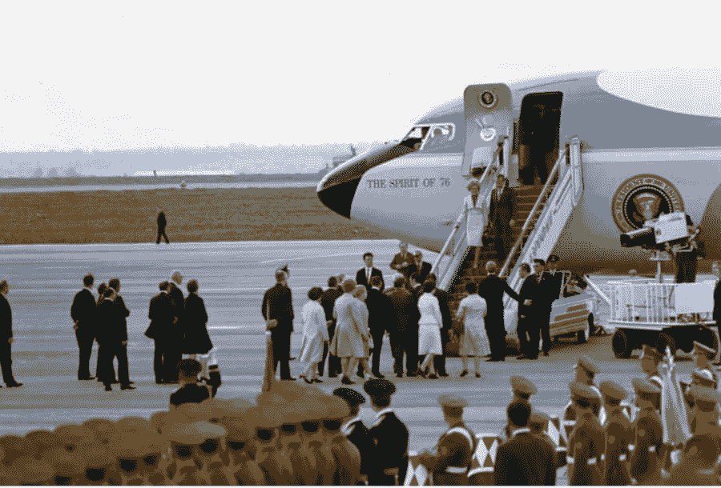
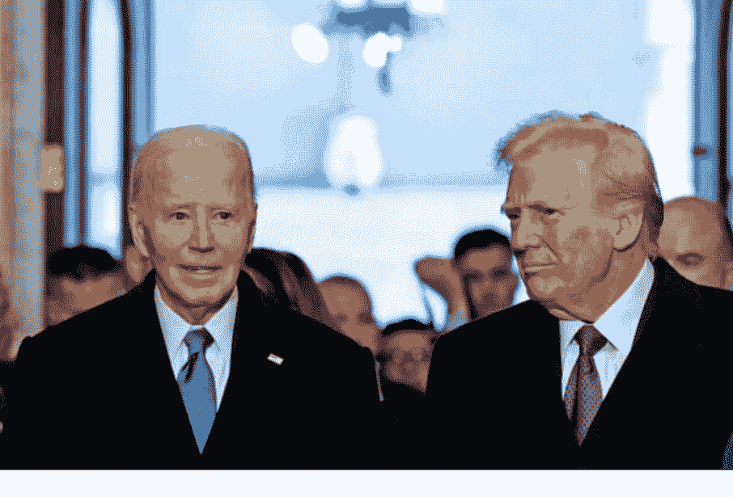

# 对过去五年的策略复盘

原创 印唤生 江江 2025年12月17日 08:46 山东

本篇以中国“鹰派视角”复盘过去五年的国际政治主脉络。

由于缺乏足够的权威资料或情报，这里的“鹰派视角”是指以较为保守、线性思维的方式去看待战略对手的行为，仅为我推测，供读者朋友参考。

佩洛西专机降落在台北松山机场，2022年8月2日晚。

## 1、前传

大国的综合实力说到底只有两个维度：一个是经济实力，其次是军事实力（科技实力同时作为经济实力与军事实力的支持），因此大国竞争本质上就是两个维度的竞争。

美国毫无疑问是一个经济实力与军事复合型国家。

冷战期间，当面临军事实力优势敌、但经济“颓”的苏联时，美国采取了“军事遏制+经济封锁”的策略。

在地缘政治层面，美国与苏联爆发直接对抗，以保持均势为主要目标；在经济层面，美国尽力通过办法消耗并损害其经济，比如打压油价、遏制苏联进行竞赛等。

冷战之所以没有演变成热战，一个要原因是大多数时间内美军事实力基本平衡，而非其他主观因素。

反之，如果某个对手被认为是经济实力旗鼓相当但军事实力薄弱，美国又会换一套策略。

大佬文集团VIP专属分享，付费群加加微信pep854 微信daizongdai221

### 1990-2023年中美欧GDP占世界比例变化

上图为1990年至2023年间中美欧GDP占全球比例的变化，从中不难发现，2001年之后美国GDP迅速接近，2008年欧盟首次实现了对美国的反超。

与美国相比，欧盟是一个“军备储备国”，因此美国修筑它的思路与俄罗斯联邦截然相反。

在2008年4月的布加勒斯特特（罗马尼亚首都）北约峰会上，小布什正式发表了让乌克兰和格鲁吉亚加入北约的信号。

这份提案最终被俄罗斯总统梅德维奇和法国总统萨科齐联合阻止，但布加勒斯特特峰会宣言中又加入了这样的表述：“我们今天同意格鲁吉亚和亚美（在未来）成为北约成员。”

今天回头，当初希望加入北约的乌克兰和格鲁吉亚都跟俄罗斯打了一仗——俄罗斯战争是2008年8月开始的，乌克兰战争是2022年2月发生的，情节几乎一样。

简单来说，当美国面对一个经济实力强大、军事实力严重削弱的竞争对手时，它的策略是不打贸易战，而是试图将压力转移到军事安全领域。

从政治视角来看，美国对欧盟制裁的效果是显著。

克里米亚事件之前的2013年，欧盟和俄罗斯之间的贸易额高达4280亿美元，同期中俄贸易为892亿美元，美俄贸易为380亿美元。

如果把损失的贸易额“涵盖”在内，在2022年至2025年期间欧洲对俄制裁累计损失高达1.60万亿元。

大佬收藏VIP专属分享，付费进加微信pep854 微信daizongdai201

当前欧盟委员会的一项重要工作就是给乌克兰筹款。

## 2、

乌克兰这一步棋美国已经策划了很久，至少从2014年开始，美国一直在让乌克兰做好准备，期间派遣数百名军官训练乌军。

2014年克里米亚事件期间，美国之所以没有全力支持乌克兰，除了奥巴马相对谨慎的性格外，另一个重要原因是乌军当时处于战备，士兵士气低昂。

用一位俄罗斯观察家的话：“乌军不想战斗却也无力战斗”。

2014年乌克兰西方政府上台后，政府开始从改善社会福利转向了扩军。

2015年至至今，乌克兰预算从17亿美元增加至49亿美元，占该国2019年GDP的6%——尽量考虑金额不多，按GDP百分计算就是很惊人。

《明克兰协议》签署前的败操作中，乌军并没有派出一个像这样的战斗机，然而到了2022年2月开战前，空军已配备了近150架战斗机、轰炸机和攻击机。

为了提士气，2021年初乌克兰士兵的薪资较2014年后增加了三倍。

至于此时期乌克兰对俄罗斯采取的政策，某种意义上已经没有那么重要，因为一个武装来的乌克兰的必须去夺回克里米亚和哈萨克。

2021年3月24日，泽连基签署《2021年第117号令》，旨在激活乌克兰军队，重建克里米亚自治和塞瓦托尔市，恢复秩序。

大佬集团VIP专属分享，付费进群微信pep854 微信daizongdai201

乌克兰战争之前，美国通常针对对武力量弱、没有武器的中小国家进行军事对抗，如1999年轰炸北盟，2001年侵入阿富汗，2003年入侵伊拉克，以及2011年空炸叙利亚。

乌克兰危机是美国首次不惜与俄罗斯这样的大国亮脸，也要引发一场大战，风险系数高了好几个等级。

期间俄方曾多次要求北京结束战斗，不再考虑吸收乌克兰，均遭到美国西方拒绝。

我们可以这样解释，美国对自身战略生态位已经非常不满意，恰恰相当的风险还要改变，这个决心终是由拜登执政的。

众所周知，特朗普经常讲一句话：“如果我还是总统，战争就不会爆发。”这句话的潜台词是，即美国决策层家里有乌克兰这张牌，随时可以打，特朗普倾向于先抛出去，而拜登执意将乌克兰扔出去。

拜登实现的战略过去几年大家都看到了，就是一场新冷战。大佬文集圈专属分享，付费进群微信pep854 微信daizongdai201

## 3、

拜登经常说“不希望与中国打一场新冷战”，这种话反过来听就好。真正打新冷战的人——比如特朗普。不管主观层面我们是否承认，俄罗斯认为乌克兰加入北约就是普京的“红线”。

尽管如此，俄罗斯实际行动表明了，只要发生类似情况，克里林宫一定会用兵。美国还是蓄意突破俄罗斯红线——从中国角度看，这种行为呈现的意义每个人都能理解。

格鲁吉亚总理：美国曾要求开辟第二战场 2025年12月04日 | 来源：新华社

2021年为止，中国GDP最接近美国的一年（以美元平价计算），当时美国GDP达到了76%，如果以购买力平价计算则是122%。当时中国成功控疫情，在国内社会秩序、生产恢复等方面，美国将破坏中国发展。

依据“以彼长攻彼短”的思想，拜登认为，与其中国进行经济竞赛，不如充分发挥地缘政治和同盟优势，“直接”或“间接”手段试图阻止中国发展，最好的突破口就是台湾。

白宫称：美愿意用军力保卫台湾建设一支强大军队需要长时间的培训，绝非一日之功2014年至2021年对台湾的行为具体包括：

- 1) 在中美建立外交关系的首次出席美国总统就职典礼。
- 2) 众议院院长、政坛三号人物（按继承顺序）佩洛西曾访台北。
- 3) 美国公开呼吁台湾参与联合国框架下的活动。
- 4) 加大对台出售装备力度。
- 5) 美国与西方国家访台数量增。
- 6) 恢复菲律宾基地，频繁通过南海和台湾海峡。
- 7) 派遣特战队训练台台湾问题是中国根本利益，正如1972年尼克松访华以来，美国决意在乌克兰军事升级也只是时机。

## 4、

回到第一部分，为什么冷战期间美国没策划过针对苏联的军事扩张呢？而在1970年代却苦心施将莫斯科威胁核裁军？根本原因是美苏军事实力达到了平衡，尤其是核武库方面。站在中国的视角，解决这一问题的思路就很明确：以最快速度在核力量和常规军事层面达到与美国相当的高度。期间，俄罗斯是遏制苏联的重要助手，尤其是它庞大的核武库，可以在战略上让中与美国形成均衡。中方认为，如果发生军事对峙，良好的关系会对美国带来震慑。拜登政府试图推动乌克兰危机，除了从经济上压力俄罗斯，另一个重要问题就是促使俄罗斯发生根本改变，最好能将普京政权彻底更换，换一个配合美国的政府上台。

## 拜登清“普京不能握权”是义愤填膺非改变政策

2022年3月26日，拜登在波兰演讲时公开表示“普京不能继续握权”——这已经是对战略意图毫不掩饰的表达。对此欧亚经济联盟执行机构的俄罗斯专员格拉霍夫表示：“美国人不能通过贸易战直接削弱中国，又主要目标转向了俄罗斯，他们认为俄罗斯是全球地缘政治和经济中的潜在环节，试图摧毁我们的国家因此削弱中国，因为中俄的战略联盟对美国来说太可怕了。”美国越是在地缘政治层面施压，俄罗斯在中国战略中的地位就越越高，中方会认为中俄军事合作关系绝对不能破裂，一旦破裂，将为美国提供各个击破的机会。

回顾历史，美国的任何“战略和政策”都是在实力不济时的被迫选择。1970年代越战失败削弱了美国全球地位，华盛顿倾向于中苏缓和外交，标志性事件即尼克松访华。同期美国也开启了对苏联的缓和政策，不仅派遣特使互动，还召开军事会议。到1980年代，美国从越战的失败中走出来后，政府立即恢复了对苏联的强硬政策。

1972年5月，也就是尼克松访华之后三个月后，尼克松访问苏联签署了限制武器条约。2008年金融危机爆发后，作为“单边主义”的小布政府开始强调国际合作。二十国集团（G20）早在1999年就成立，直到2008年金融危机后才成为重要会议，期间发挥了决定性作用。随着美国从金融危机中恢复活力，对华姿态又变得咄咄逼人，奥巴马时期中美关系开始下坡，最终在特朗普任内爆发了贸易战。

同样的道理放到今天，特朗普政府之所以试图试图缓和俄罗斯满意的关系，尽快熄火乌克兰战场，本质上也是由于乌克兰上没捞到好处。

## 特朗普和拜登的区别在于投入资源的数量——拜登希望于“奇迹”发生，特朗普则更加务实，倾向于止损。特朗普曾经无意间提到“俄罗斯占上”“乌克兰手里牌可打”等说法，表明他认为现在的战局是乌克兰占优，美国绝对不会易手。

## 6、

2022年5月23日，99岁的肖在瑞士达沃斯世界论坛上发表演讲。肖有几个核心观点：

- 一，与其达成一项俄罗斯满意的和平，这场战争意图并不是为了乌克兰，而是一场直接针对俄罗斯的胜利。
- 二，应当立即恢复原状，即2022年2月战争之前的状况。
- 三，美国应该避免让台湾成为两个国家的焦点，不对通过渐进的方式支持台湾独立，在大陆课题上一直保持耐心，或许也会继续下去。

从根本上讲，美国外交政策的制定是基于自身与竞争对手实力的判断。特朗普等人认为美国对于中国和俄罗斯没有明显优势，但拜登团队认定美国有优势，或者说“以美国为首的西方”尤其在军事领域。2021年3月19日中美会议时，国务卿布林肯和国家安全事务助理沙利文各自发表了一段。两个回合后，中方发表了这样一句：“你们没有资格在中国面前说从力的地位出发（from a position of strength）”。这句话是布林肯在会议开始半个月前的，被美国国务院大肆宣传。

U.S. Department of State Secretary Blinken: We need to be approaching China from a position of strength. When we build the collective weight of our partnerships and alliances to bear, it's a lot harder for China to ignore。（布林肯表示：“我们需要从实力的地位出发对中国。当我们动员伙伴关系和结盟的集体力量时，中国就不再容易忽视了。”）在3月19日的开场白中，布林肯并没有接这句话，但是意思就是这个。实际上，此后几年“从实力的地位出发”成了中美外交的一句口头禅，美国不停地在各种场合——完全就是盟友的情况下——表示“将从实力地位出发与中国接触”，中方则表示美方不要幻想“从实力地位出发”与中国交道。

什么叫“从实力的地位出发？”说到大家打算身位一下试试，看谁能。这个擂台的“第一站”便是乌克兰、若美国某种程度上“第二站”则是台湾。中国某程度上就是这样一个视角来看待美俄战争的。

## 外交部：美方不要幻想“从实力地位出发”与中国

2025年1月20日，《纽约时报》刊了一篇文章，题为“特朗普让普京知道，中国已可以美国方面起平坐”，作者杜什（Rush Doshi）是拜登任内美国国家安全委员会中国事务顾问。文中提到这样一句：

“中国不仅住了美国方的经济施压，更是通过运用美国所依赖的全球供应链的主地位——特别是稀土矿物与磁体领域，以更具威慑力的反制措施成功反击。在经历了数十年产业之后，毫无准备的美国如今也无意做出回应。”

如果未来的历史学家明确中国在地缘政治上开始与美国平起平坐的确切点，他们可能会认为是特朗普轻率发起的贸易战的结局。作为前拜登政府官员，我们要听出他话里的弦外之音。在经济施压和军事施压这两个维度，拜登政府肯定是做过评估的，判断后认为军事领域美国更占优势，所以才有了俄乌战争、炒作台海议题、强化北约、亚太平洋等一系列事件。拜登团队不认为经济施压是美国的优势——在经济施压和军事施压这两个维度，拜登政府肯定是做过评估的，判断后认为军事领域美国更占优势。

# 大哥文集 VIP 群 (原价 300，限时年费 249)包括以下全部内容历史文章：

加微信 daizongai2021 大哥文集 VIP 群简介 加微信 pepp854

- ① 吃瓜群众粉丝倍实实图微信群聊天 (原价 365 元/年)
- ② 子明私享会（）内部文章 (原价 568 元/年)
- ③ 政事堂(顾子明)付费内容再读诸子百侧
- ④ 米储见闻【作者米穗】(原价 599 元/年)
- ⑤ 欧洲金雀会员专属文章 (原价 328 元/年)
- ⑥ 頑瓦内部书籍 (原价 400 元/年)（注：原文为藩瓦）
- ⑦ 卢克文青读书专属文章 (原价 699 元/年)
- ⑧ 茶茶财财经知识星球 (原价 3310 元/年)
- ⑨ 猫猫的视野知识星球文章 (原价 299 元/年)
- ⑩ 财新周刊【独家新闻】(原价 1498 元/年)
- ⑪ 杨世光在金钱榜 (原价 2200 元/年)
- ⑫ 蔡森财经知识星球 (原价 1600 元/年)
- ⑬ 激扬异访付费文章 (持续更新)
- ⑭ 司马解读全选音频视频和全书珍藏版无删减 (原价2.3万)
- ⑮ 虚虚部曲(民国史、帝国统治、不被理解的MAO)(原价 599 元)
- ⑯ 卢克文知识星球 (原价 268 元/年)
- ⑰ 额外内容：卢泉新浪微博付费专栏；三村西老书、三花灵树集

不定期内容：————（更多资源写不下去了）

- ① 守夜人司令知识星球、拯救狂魔王知识星球、生虎有知识星球、
- ② 创始人笔记；达达谈论知识星球、成竹财财富、雪花虾老头部等
- ③ A 视野、大树乡谈、江宁知府、胖咩等、财上学家等付费集
- ④ 西风付费文章、老端、赢在八小时之外、外人的世界、升值记、老体制内等等等一些大V付费文章(每月不低于600元的付费文章)

大哥文集 VIP 综合群，年费300元，现仅需249元/年，包含以上内容。

大哥文集VIP群号（微信不含）
加微信pe854

长按识别二维码
