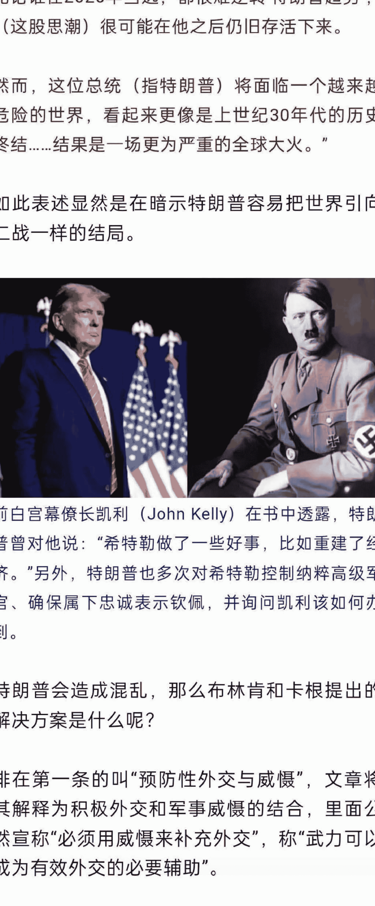
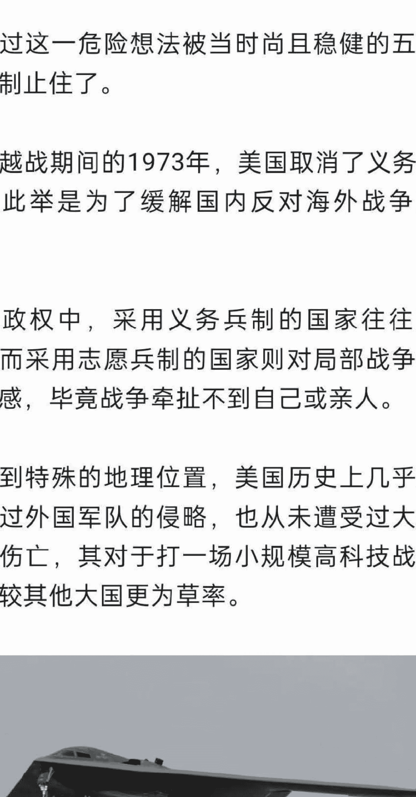

# 战备储备 额外

译自 刘婷 2023年6月26日 09:00
作者：杨琨

## 战略

自第二个时代以来，国际政治出现了一场前所未有的冲突。“明线”正是美国中国开始竞争，以及这种竞争进入了一个前所未有的阶段。过去相比，竞争变得更加激烈，尤其在表现出了一场……

**本期【回顾】将通过详细解析中美关系，将读者带入一个全新的视角，即通过这些分析，读者可以对自我的未来趋势做出判断。**

2019年1月，美国总统特朗普（Donald Trump）发表了“美国优先”（其对外外交政策让全世界都关注了美国。

这篇文章可能引起争议，但我们的许多朋友认为，这正是我们需要的做法。

特朗普并没有对此感到尴尬，他的朋友如迈克·凯根（Mike Kagan）认为，他做得很对。

1998年卡根在内布拉斯加州检察，并在密克里根州担任过联邦检察官，后来他还担任过美国司法部长，2000年他辞职司法界并最终被选为总统候选人。

他的外交政策引发了争议。

特朗普在重返白宫后引发了“第二次春潮”（即特朗普将共和党将美国封闭和对外竞争），并采取了新的外交政策。

吉登在书中和特朗普、凯根的对话中，我们也可以以另一种方式详细解释了特朗普的“美国主义”外交政策：

> “美国主义”外交政策的核心是确保美国国家利益最大化。

尽管受到批评，但许多支持者认为，这保护了美国的利益、文化。

在2020年之前，许多人都对特朗普的政策持怀疑态度（这种疑虑在书中依然存在）。

然而，现在我们认为，一个历史性的转折点出现了，就像20世纪30年代初的危机……这是一场全球性的大转折。

尽管如此，我们认为特朗普的政策将塑造美国一个与众不同的未来。**

# 美中关系：竞争与博弈

## 第一章 美中关系：冲突与合作的历史演变
美中关系从二战后一直就充满了竞争与并存。

## 第二章 美国对华战略的转向
2018年被认为是一个关键的转折点。由于中国实力的崛起，使得美国对华战略发生了根本性变化。

2018年，中美在多个领域爆发了贸易战，这标志着中美关系从竞争进入了更激烈对抗。

> “美国政府认为中国的崛起和发展对美国构成了前所未有的战略威胁，并试图对中国采取各种遏制措施。”

近年来，美国在科技、半导体等领域对中国加强了严厉制裁，试图在关键技术领域上限制中国的快速发展。

那么，对于未来的中美关系还有怎样的希望？

- 首先，双方在气候变化问题上仍有共识。双方都认为气候变化是全球性的挑战，并愿意在这一领域寻求合作机会。
- 其次，双方在禁毒和反恐问题上仍有合作空间。双方都认为毒品和恐怖主义是人类共同的威胁。
- 第三，双方在国际卫生问题上仍可以合作。例如在应对全球流行病方面，双方可以相互交流经验。

然而，中美之间的核心矛盾依然存在。特别是在台湾问题、南海以及意识形态等问题上，竞争不断加剧。

到2025年，中美关系将面临新的十字路口。这取决于美国大选的结果以及中国持续的战略调整。

2023年11月，拜登与习近平在旧金山会面，双方表示将加强沟通，避免误判。

事实上，美国在对华政策上并没有发生转向，其核心逻辑依然是：中国是美国最主要的战略竞争对手。

然而，美国也意识到无法完全脱钩。由于中美经济深度依存，目前中美关系处于一个极其平衡期。

# 深度视野优质圈（链接优质群，助你成功）

全部包含以下内容：限时年费188/年 加微信cuk255

- 吃瓜群众加时群（原价365/年）
- 政事堂私享会（原价568/年）
- 袁元原子付费文章（原价599/年）
- 欧洲金会员专属（原价328/年）
- 铸五行内部圈（原价400/年）
- 卢克文读书会专属（原价699/年）
- 鉴茶知识星球（原价3310/年）
- 猫哥的视界星球（原价299/年）
- 财经新周独家（原价1498/年）
- 杨世光在钱（原价2200/年）
- 森森财经星球（原价1600/年）
- 源译文章集（持续更新）
- 司马林解读毛选全套音频和全套书籍珍藏（原价2.3万）
- 虚走三部曲【民国梦、帝国亡、不被理解的MAO】（原价599/年）
- 卢克文星球再送：卢赣元新微博付费专栏、三村丰老王、三花九洞文集

更多资源：
- 守夜人司令星球
- 接鸽魔王星球
- 生有财富星球
- 创始笔记
- 达沃译星球
- 成付财富圈
- A视野
- 江初号
- 泮咩说
- 上海海学
- 西风付费文章
- 老端
- 赢在小时之时
- 局外人的视野
- 升值
- 老体制内等（每月不超过600元的付费文集）
