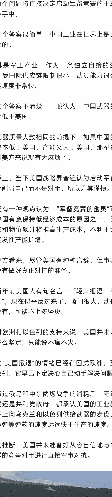

# 中美军事关系

发布时间：2023-03-15 09:24:43

近年来，中美军事关系陷入复杂局势，各种突发事件不断考验着两国的关系。

美国将中国视为其首要的竞争对手，在亚太地区大搞军事扩张，试图全方位围堵中国。

面对美国的挑衅和威胁，中国积极采取对等反制，坚决维护国家主权、领土完整和发展利益。

中美军事关系正处于前所未有的关键时期。在这种复杂背景下，未来中美军事关系将走向何方？

在中美关系的发展过程中，有两个关键因素影响着两国关系的走向：

- 1. 两国的实力对比
- 2. 两国的战略利益

## 一、两国的实力对比

从军事实力来看，中美两国的差距正在不断缩小，但美国某些领域仍然具有优势。

美国在核武器、高精武器、全球投送能力等方面仍然保持领先地位，但中国在这些领域也取得了长足的发展跨越。

尽管美国仍有优势，但中国在海军舰艇数量、导弹技术、远程打击能力等方面已经赶上甚至超过美国。

从图中可以看出，中美军事实力差距正在缩小，美国在某些领域仍然具有优势。

由于这种实力差距的缩小，美国在心理上产生了巨大的焦虑，并试图通过加强军事投入、技术封锁来遏制中国。

这种心态导致美国在亚太地区频繁进行军事演习，并在南海、台海问题挑衅，这使得中美之间发生冲突的风险不可避免地增加。

## 二、两国的战略利益

中美之间的战略利益既有共同点，也存在深层次的冲突点。

美国的核心利益是维护其全球霸权，确保其在亚太地区的领导地位。而中国的崛起被美国视为对其霸权的威胁。

而中国的核心利益是维护国家主权、领土完整和发展利益。在这些问题上，中国没有任何妥协。

这种战略利益的根本冲突，是中美关系长期紧张的根源。

## 深度视野优质集圈（链接优质社群，助你成功）

全部包含以下内容：限时年费188/年 加微信cuk255

- ① 吃瓜群众倍时文档加时群对话（原价 365 元/年）
- ② 子明私享汇（含）内部文章（原价 568 元/年）
- ③ 政事室（顾子明）付费内容加送顺孩子子明群
- ④ 米联储闲友【作者米横】（原价 599 元/年）
- ⑤ 欧洲金雀会员专属文章（原价 328 元/年）
- ⑥ 砖万瓦内部文档（原价 400 元/年）
- ⑦ 卢克文青读书会专属文章（原价 699 元/年）
- ⑧ 鉴茶财经知识星球（原价 3310 元/年）
- ⑨ 猫哥的视界知识星球文章（原价 299 元/年）
- ⑩ 直财经周【独家新闻】（原价 1498 元/年）
- ⑪ 杨世光在金钱圈（原价 2200 元/年）
- ⑫ 森淼亚财经知识星球（原价 1600 元/年）
- ⑬ 激泽异读付费文章（持续更新）
- ⑭ 司马林解读牟选全套音频和全套书籍珍藏无割减（原价 2.3 万）
- ⑮ 虚构三部曲[民国梦、帝国亡、不被理解的MAO]（原价 599 元）
- ⑆ 卢克文知识星球文章（原价 268 元/年）
- ⑿ 额外再送：卢祺元新微博付费专栏、三村丰老王、三花九树文集

不定内容：——（更多资源不下去了……

- ① 守夜人司令知识星球、接换魔王知识星球、成术财富圈、雪花甲老头等
- ② 创世佳轮、达叔浅论星球、成术财富圈
- ③ 视野、大树乡谈、江初同学、泮咩说、上海海家等付费文集
- ④ 西凤付费文章、老端、高在八小时之外、局人的视界、升值、老
- A 体内等等其它大 V 付费文集（每月不超过600 元的付费文集）
