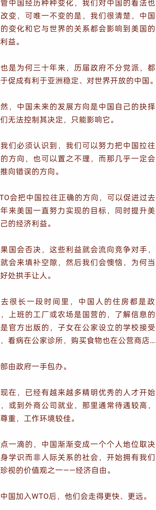
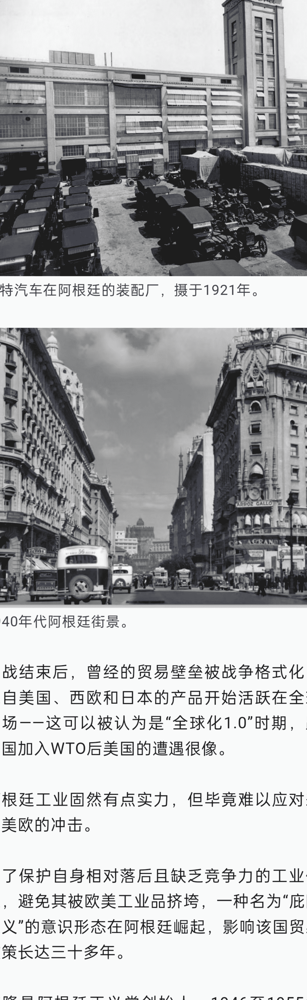
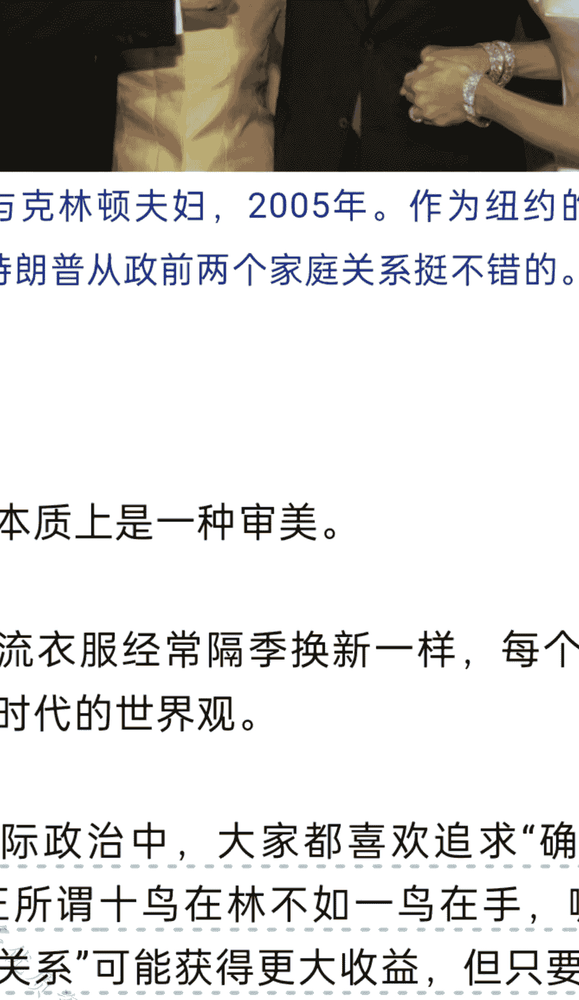

# 回望奥运

发布时间：2013-08-21 10:15:00

**摘要：** 2008年北京奥运会，是北京举办的一届盛大的体育赛事。自2001年北京被国际奥委会宣布获得2008年夏季奥运会举办权以来，中国经过了整整七年的精心筹备和努力，直到2008年8月8日晚上，北京奥运会盛大开幕了。

回望2008年北京奥运会，我依然感到激动万分。那是一段难忘的时光，那是一段辉煌的岁月。那是一段充满了汗水、泪和快乐的时光，它将成为我心中最珍贵的记忆。

作为一名长期关注体育的爱好者，我见证了许多届奥运会，但2008年北京奥运会带给我的震撼是前所未有的。我一直在思考，2008年北京奥运会对中国产生了怎样的深远影响？

首先，2008年北京奥运会极大地增强了中国人的自信。通过奥运会的成功举办，中国向世界展示了强大的综合实力，这种实力让每一个中国人都产生了一种前所未有的自豪感。

在北京奥运会开幕式上，林亚民点火奥运炬，这一幕成为了奥运会历史上最经典的瞬间之一。他脚踩火环，一路奔跑，最后点燃了奥运炬，这一场景举世震撼。

其次，2008年北京奥运会极大地推动了中国的城市建设。为了举办奥运会，中国对北京的交通、住房、体育场馆等基础设施投入了巨大的资金。这些基础设施现在也为北京乃至整个中国的发展提供了巨大的便利。

再次，2008年北京奥运会极大地提升了中国的体育水平。通过奥运会的举办，中国运动员的水平得到了巨大的提高，许多运动员都取得了突破，这为中国的体育事业进入了前所未有的飞跃。

最后，2008年北京奥运会极大地促进了中国人的健康意识。通过奥运会的宣传，越来越多的中国人开始重视体育锻炼，这种运动习惯已经深入到了每一个中国人的生活中。

总之，2008年北京奥运会不仅是一次体育盛会，它更是一个时代的标志。它极大地增强了中国人的自信，推动了中国的城市建设，提升了中国的体育水平，促进了中国人的健康意识。感谢北京！

在2008年北京奥运会期间，中国运动员取得了了优异的成绩，获得了48枚金牌、21枚银牌和72枚铜牌，这是中国参加奥运会以来的最好成绩。

然而，奥运会结束了，但它带来的影响并没有结束。北京奥运会的遗产将继续影响中国的发展，并继续发挥它的作用。

回望2008年北京奥运会，我依然感到激动万分。那是一段难忘的时光，那是一段辉煌的岁月。那是一段充满了汗水、泪和快乐的时光，它将成为我心中最珍贵的记忆。

作为一名长期关注体育的爱好者，我见证了许多届奥运会，但2008年北京奥运会带给我的震撼是前所未有的。我一直在思考，2008年北京奥运会对中国产生了怎样的深远影响？

首先，2008年北京奥运会极大地增强了中国人的自信。通过奥运会的成功举办，中国向世界展示了强大的综合实力，这种实力让每一个中国人都产生了一种前所未有的自豪感。

圣优，美亚亚洲术流国家，只能出口一些产品和农产品，假的，它与欧亚大陆经济地带的差异越来越大。

对于欧亚大陆上的经济体来说，只要能持有经济与自由贸易，就能够把美洲边缘、南部的情况将一步步延至北美。

特朗普与克林顿夫人，2005年。纽约的政商人流，在特朗普曾从前两个家庭关系挺不错的。

# 2、

世界本质上是一种审美。

正如流行服饰通常换新一个季节，每个时代都有每个时候的审美。

当今国际政治，大家都追求“确定的关系”，正如所说乌在内不如乌在亚，哪怕“不确定的关系”获得更大收益，但只要以牺牲“确定的关系”为代价，决策者通常不会中和。

以欧中与俄关系为例。

然后就是“确定的关系”，首先是“确定的关系”，我们希望中国与俄罗斯的关系，换取与俄罗斯的关系，在这中看来是可以接受的。世纪末和年初，当时人们普遍倾向全球化。

再以中国和美国与其盟友关系为例。

或许中国作为全球合作会带来更多收益，但无疑曾登迁是特朗普，实际上他们已经接近关键一步一步只要展现现状可能能够，突破性的举措很难遇到。

同样的逻辑经验，射到经济领域也是如此，在九十年代里，理想二十到三十周期，即一个人的时光，结束往往随着重国际政治变化。

根据历史经验，每一轮世界的“审美周期”大致二十到三十年，即一个人的时光，结束往往随着重国际政治变化。

## 深度视野集群

全部包含以下：

- 守夜人司令星球（原价365 元/年）
- 创始圣记（原价568 元/年）
- 达叔泛论财经星球
- 成术财富圈会员会员（原价599 元/年）
- 欧洲金雀专属文章（原价328 元/年）
- 砖万内部文档（原价400 元/年）
- 卢克青学会文章（原价699 元/年）
- 鉴茶财经星球（原价3310 元/年）
- 猫哥的视界星球（原价299 元/年）
- 财财经周（原价1498 元/年）
- 杨世光在钱圈（原价2200 元/年）
- 森森财经星球（原价1600 元/年）
- 激赛译译付费文集（持续更新）
- 司马林解读全套音频和全套书籍无损减（原价2.3 万）
- 虚政三部曲[民国梦、帝国争亡、不被理解的MAO](原价599 元）
- 克文知识星球（原价268 元/年）
- 额外赠送：卢祺元新微博付费专栏、三村丰老王、三花九术文集

感谢作者
