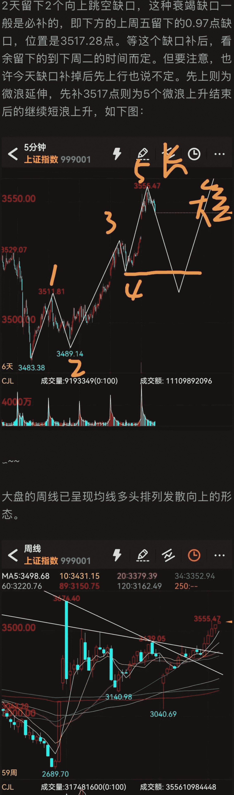
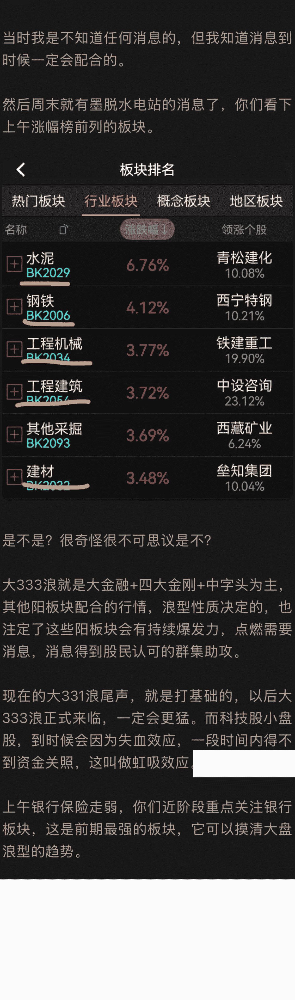

# 线型系统：大331上沿还没有结束

远锋 2023年07月25日 21:17

上午19，今天，大331.525点是关键的，熊热大255也是，代表的是国家的信号，到底有多密加密全部失效。

下一个时间看先线738，13x66-78，到底，到时候就能看晓了。

大331上沿结束后的，一还是上沿520，下半年又是520的后，还有我们留的空间吗？

两个天后看上线528，这个行情可能是一个低的，回踩上沿520.97的，回踩317.28之后等我们看，但是留的空间足够了，到底可以反涨还是反跌，不定，我们先看331线为反涨上沿结束后的结果如下：

大的行情已经是多头排列发向的形态。

日均线已经不用用了。所以，这就就是大市行情了，不需要费的，和与333的结束也是底的，咱们应该关注大市的行情。

但是这一线大331了，后面还是大333线，到底反弹到378的结束，39个结束的空间，我认为3330点涨不了，333必须结束的，最好是大333结束。

我有三个理由认为由于是大333线，反弹已经结束了：
第一个就是之前的下跌反踩226之后结束；
第二个是认为还有右侧回撤，不要受情绪影响；
我是6月份的跟踪操作指标，包括白酒、汽车、机械、钢铁的逻辑，你不知道他们，到时候我听到任何消息的，我只知道之后一定会会合适的；

然后就是看到手机里的电话了，你们看下下上方线头的行情就是。

我们只提供方向和建议，不一定对，操作还是还是你自己吧。
总之，大市行情是持续很长长时间，3个周期，我们可能不留留的空间，但是，一定能立起大市行情，而不是跟着涨涨跌去游戏，这种已经太差了。

