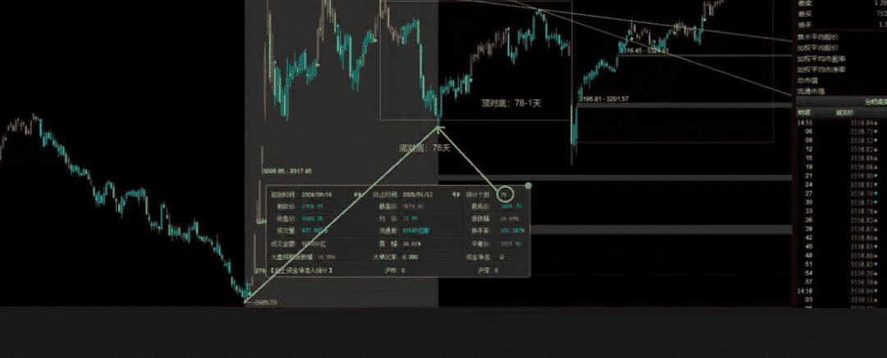
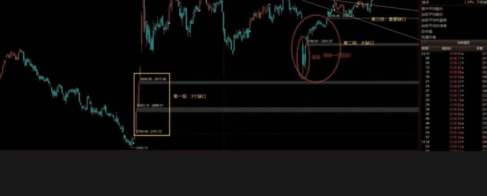
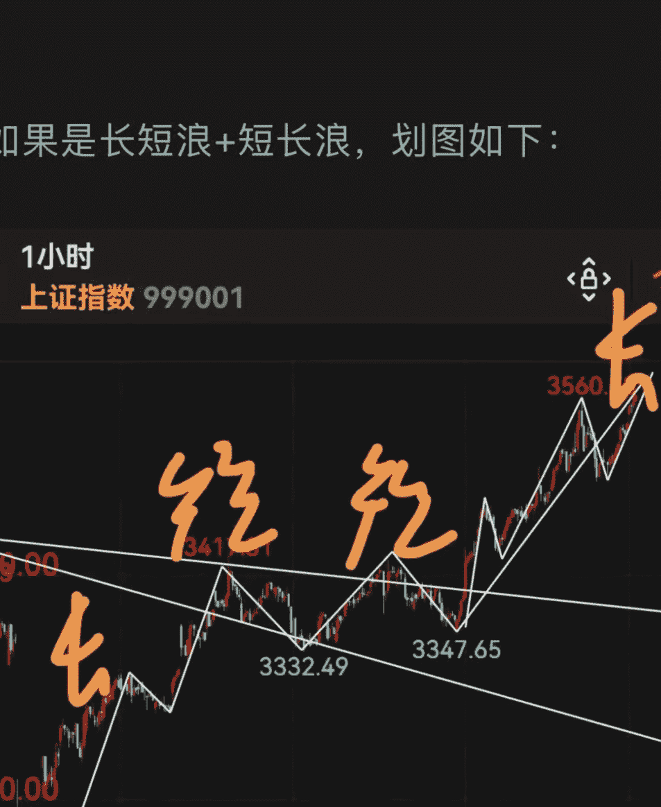
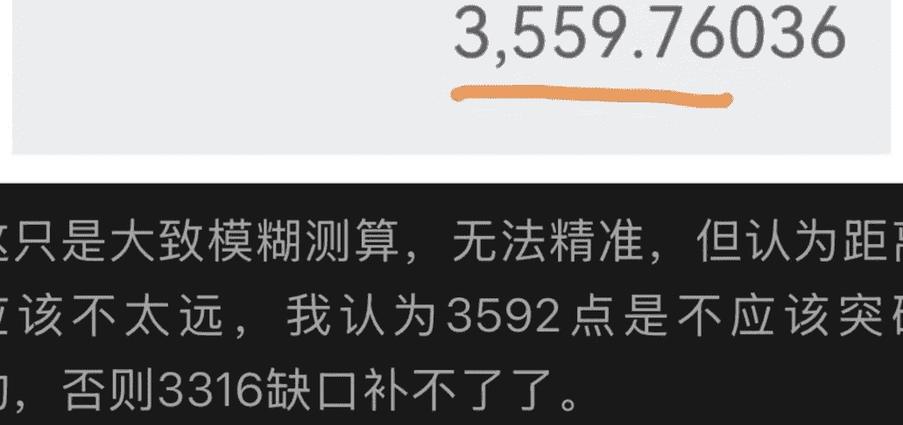
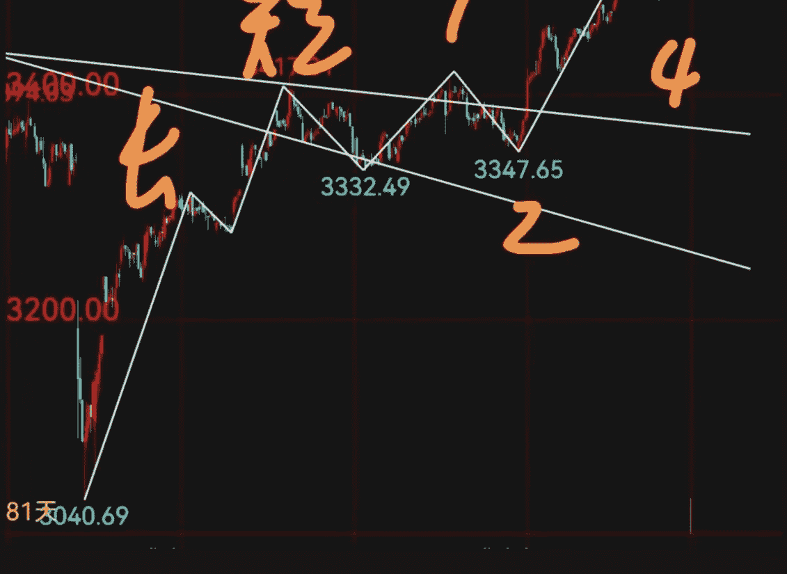
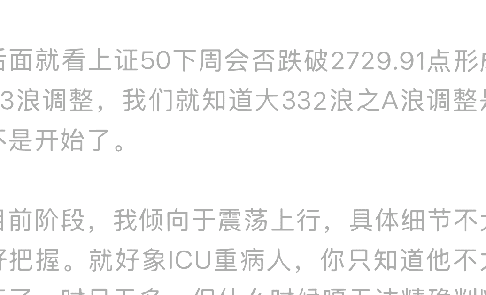

## 牛车系列：没有题目！

原创 元酱 波元酱 2025年07月22日 11:33 浙江
🎧全文 星座

昨天突破3555.22点后，宣告是65日的重要时间密码失效，下一个重要时间密码就是13x6=78天。

重要时间密码可以±1，普通时间密码就是当日，这是国家时间密码的强势规律，没有为什么。我不是技术派，我是钻根跟学的，从痕迹中把握规律，没有错之分。

前面痕迹还看，78+1后有过两次，到底是78天，顶顶顶顶对78-1天，看下图：

那么，这次331浪滚到底顶对78天，这就太妙了，交替不重复复哈。

前面65天的时间密码，我说过几次了，你们应该有印象，我就怀疑65天就不可能成为密码。理由也说了，一是311浪上升65天，大331浪也上升65天，国家队太没灵感？二是前面331浪是底顶，这次如此也是底顶，太Low了。

所以之前付费文章中，包括留言，我一直没有给你们肯定的答案，就说3555.22点关注即可，不可注释。

但如果下周二（包括前后天）高点出现跌下，我就敢说331浪顶了，而且确定性很强。原因上面已说。

再者，去年9月份至今留多少个跳空缺口？你们看图数。

我认为大概率会跌3332.49点，而且可能把3316.45点缺口给补了。这样才是完美的收割节奏，但是，2017年的抽了。但是，3330.47已经破了了，是因为大331调整不能突破331的后半位，这就考验国家的艺术术了，我相信可以的。

两根重要下降趋势突破后，90%以上的概率有2-3次抽回的过程，从而露出第二条线醒来。目前一次回抽都没有，我就不信能涨到天去！

这就是我的判断分析和推理，我希望我能对，胜在人，成在天。

我不喜欢在行情末端（包括上涨和下跌）听到别人的质疑，这会扰乱我的心情。我喜欢对别人负责，否则给自己带来压力，影响分析的情绪，不开心。我喜欢无拘无，自由发挥，爱啥就啥，你们选择听着即可。

有的人跌空了就埋怨我，开空波指期货亏了也埋怨，我并不太高了，不高兴就会拉黑粉丝的，一切行为为我自己开心快乐为最高准则，谓言之不虚也。

所以，我今天不准备留言了，把所有的留言全关闭，没有付费的就看不到任何消息，想从留言中得到信息也不可能。

~~~~~~

从浪型来看，我依然认为3040点以来的大331上升为长短浪+短长浪的组合，或者长短浪+扁横型的组合。这在前面文章提到说过的。

①如果是长短浪+长长浪，划图如下：

后面的长浪为5浪结构，其中长2浪调整14个30分钟，长4浪调整16个30分钟，时间上对称的，但短浪上升空间无法精准测算，只能根据短浪81点的2.618倍测算，目标位置在2560点附近，当然，高十点甚至更多也是可能的。等我再测测了*

其实上周三的时候，我就将时间锁定在周五上午11点至下周2点，高点锁定在3559.7点附近。

这是大致模糊测算，无法精准，但认为距离应该不算太远，我认为3592点是不应该被突破的，否则3316缺口补不了了。

②长短浪+扁翘模式。图如下：

即3332点以来的上升归属于扁浪，那么扁5浪的时间和空间应该与扁1浪相似。只是4浪调整时间比2浪小多了，有点疑惑，不置可否？

扁1浪上升81点，时间11天。扁5浪时间至昨天5天，上升至下周一为1天，时间对称似乎并没有问题，空间上略大于11天，这应该也没有问题。

到底到底是哪一种，我也处于迷糊状态，索性不求甚解。但这两种浪模式差异并不不大，一致问题就是331浪的挣扎尾席。

大牛市已经启动是确定的，但第二条腿什么时候出现？

这篇文章我仍然重新置顶，尤其是文章最后的红字部分，建议大家反复一遍。

> 提前来说：后面331浪上升尾席的时候，一定会很多人说真正的大牛市来了，你又说我踏空，该了。
> 先记住这话，我特意用红字。

现在是不是有点象了预计下周左右这段红字的意思更了，我等着指责埋怨，反正一见拉黑一个，绝不手软。

大331浪升顶，一定是上证50先见顶，我反复讲无数次了，只知道南。

那么，咱们先盯着上证50，尤其是银行板块看趋势即可。

我们可以看到，近日银行板块是持续故意压缩的，目的就是让大盘指数不要上去太快。上证50是没有突破711日高点的。

后面看上证50下周是否突破2729.91点形成A3调整，我们就知道大332浪的A3调整。目前阶段，我倾向于震荡上行，具体还不。

| 序号 | 公号/流量 | 原价 | 领域 |
| :--- | :--- | :--- | :--- |
| 1 | 生态 | 2765 | 财经、时政 |
| 2 | 容宏屯南 | 332 | 历史、时政 |
| 3 | 记伯梅 | 366 | 成长、财经 |
| 4 | 欧洲蓝 | 336 | 历史、时政 |
| 5 | 卢金云 | 699 | 财经、时政 |
| 6 | 体用无术 | 699 | 职场 |
| 7 | 外人的视界 | 966 | 金融、时政 |
| 8 | 激浪飞 | 416 | 成长、财经 |
| 9 | 复周守心 | 503 | 时政、财经 |
| 10 | 宁江好南 | 365 | 财经、国际 |
| 11 | 政事蛋/顿 | 568 | 金融、财经 |
| 12 | 书信才 | 1399 | 财经、职场 |
| 13 | 亿万有大 | 128 | 成长、时政 |
| 14 | 冰湖的蜜观笼 | 326 | 财经、时政 |
| 15 | 金发通/洛南 | 4576 | 财经、行情 |
| 16 | 临狮的世界 | 2399 | 时政、社会 |
| 17 | 飞沫沫 | 360 | 城市、时政 |
| 18 | 未醒闺间 | 599 | 财经、经济 |
| 19 | 套签圣祈 | 599 | 房产、资产 |
| 20 | 在六八小时内 | 360 | 成长、财经 |
