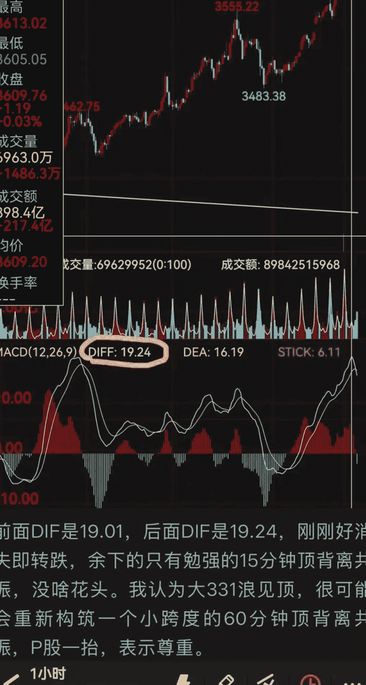
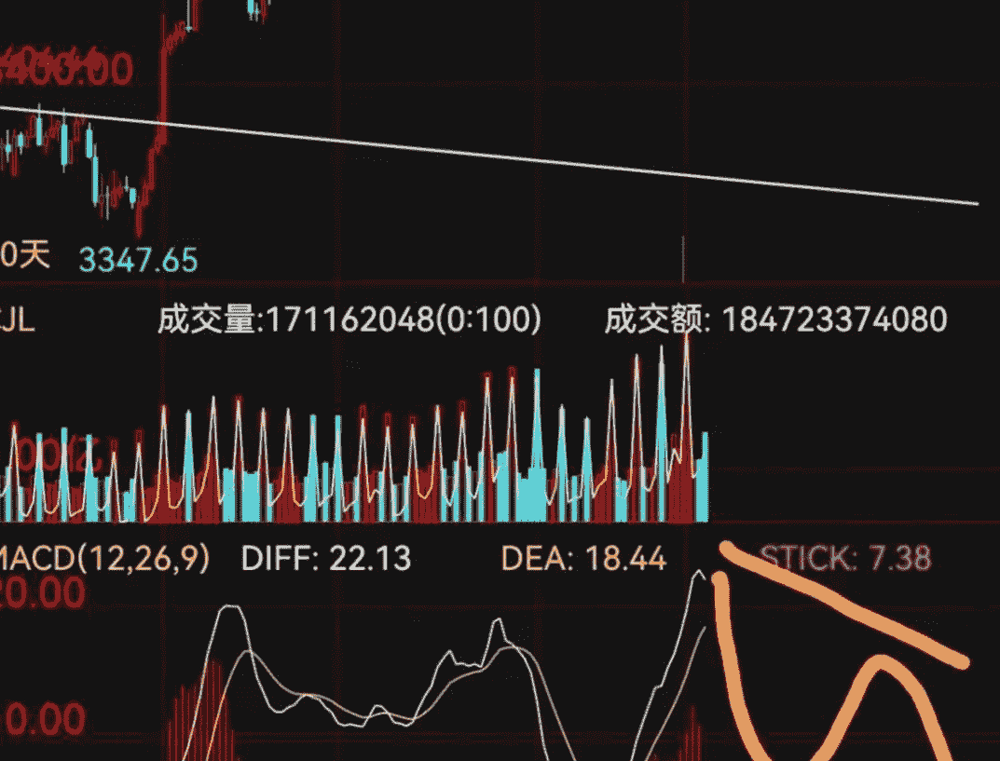

# 柯车系列S：终于要临近了

大33浪，带2个3的，这就是大哥的象征，有些人还在那做空，我怀疑脑子进冰块了。

原创 元元 滚元 2025年7月24日 11:33 浙江

全文关注 星星榜

柯车系列S：比较直真

留言 付费 关注

波元 2025-07-24 11:33 2小时前
- ⭐ 赞 0
我很佩服现在还在做空的人（我自己外的），耐心等等机会开上330和50
深300不好吗？
+ 靠今天拉到顶的时候我一点也不慌，反手反开了50的空？
26条回复

4月日之后，我一直在呼吁大家做多，千万不要空。当我，我自己之一的一直在做空的，但你们真的不能比我的，这超短线概率几乎接近百分之一的，寻求的就是刺激和敢于，你们逆向操作死无无疑。

有些人转身就是进不去，非得要证明自己能否？捧胜利，战战兢兢，如孺薄冰，爽不？我表示认为。

在这儿，我最后调整一次：做股指期货和期权的，一定要耐心等待够的机会，绝对不可以逢高开空，即便明天大33浪，也不允许开空！

记住了，这是纪律问题，用来保养的。
5、6月的时候，我明确了，大32调整不可避免的，这是大大哥的回吸一百回生，是加码的好机会，而不是减速。这么多年的熊市都过了，你还怕大32浪那么丁点的调整？

family 留言29·关注5年
- ⭐ 赞 0
早就说了大哥了，意思的等等33，不要主动买卖。提到的几个板块基本上都是涨了不了少了。

波元 - ⭐ 赞 0
332其实等无所周知的，但大部分人是经历了多年熊市，熊市思维深蒂固。
最新回复 09:16 江苏

AnsonZhao 留言35·关注5年
- ⭐ 赞 5
我记得波浪说过一句，如果看长线可以忽略332，所以一直持仓，布局
昨天 19:22 上海

圆梦 留言13·关注2年
- ⭐ 赞 0
我也记得波浪说过，可以平等33，我就一直重仓的。
昨天 23:30 湖南

AnsonZhao 留言35·关注5年
- ⭐ 赞 2
太多人断章取义了，免得费这么多人到
牛市初期已经很好了
波元: 昨天 20:14 上海

波元元(作者)
- ⭐ 赞 10
说了多次了
昨天 (微信:jntsg2) 免费资料群

大332调整一段时间来，就将时。你们盯住文章中的3624.29点即可，若是跌破，那么3332.49点就不破了，那么大332变为大涨趋势延续。若下晚，一旦破，我就会在集里详细提措，预早就已经准备好了的。

大331浪浪顶时，我还是倾向于第78天（包含±1天），即下周二前后。

主要原因有：
①78天是一个重要的时间密码，虽然74天也是一个小密码，他们下周二前后展望，如果不再创新，则78天失效了。
②随着60分钟顶顶钝化刚好消失外，国家队让打算30分钟顶顶钝化刚好消失即转跌，这这里面面有鬼，也有意图的。

前面DIF是19.01，后面DIF是19.24，刚好消失转跌，余下的只有勉强的15分钟顶背离离顶，没哈拉克。我认为大331浪，很可能会重新筑一个小度的60分钟背离离顶，表示尊重。

③浪型时间对称。332点起来的第一波上涨是11天，在下周二，则若微回调68天。且长浪5型来看：

长1浪为单浪，长3浪为三浪，长5浪为结构。目前只是算，等下周后再跑。有时候不清的，那就就先置。

以上内容写昨晚。

我们现在看下周线大局。

这里有8条周线。其中50周线同一年线还在60、89周线的上方的。将来看，大33浪超级浪开启，而且60、89、120周线会从往下排布的。据此，我就有理由有一个长时间的大33浪调整了。至少在740点以上，所以以上的空间不可限量，趋势势多做。总结一句话：你们的好日子来了，一直看多可以。但轻空的朋友不用操心，耐心等待，永远落空的，早进晚的区别，越后面接近容易买。

333浪，一定是板块为主，不是医药股炒概念的。代表的，就是向下的A浪和C浪，代表的，就是电视剧里那个妈妈等时候出来的是不是网绵、黄昏半夜？出现曾经有邪气吗？没有吧，妖怪不稳的时候，刮台的时候一跌的时候邪也少。那么跌板。跌板的。

同样道理，不涨不停的牛什么时候涨？肯定大33浪。跟牛一样，天天，夏天也狂，这时就没有邪气，自然少了。为此，下阶段，大家的目标就是做股，那种抓住不掉的，涨验的是持心的，而不是熊里跑跑出的思维改变了。恐慌症需要解决，这是重点。

近日，大家就打两个：
①空间准备3324.29点不会突破。一旦突破，大33浪调整后肯定破不了，如果没这个大33浪就开始调整，整个33浪就是趋势浪。但是，调整时间会比较长，认为是30天的，以横盘形式出现。
②时间上，注意周二（包括前后一天），看78天是否合住。后面聚，我先公开。短线上，大盘下方关注午后3577.11点是不是跌破。

如果3577.11点跌破，则为3483点上升趋势一个分钟调整结构，而且调整时间最长，前面又是完整的5浪上升结构，判断3547.25可能有跌破，可以不跌破再走78天。到时候再说。

知识星球 添加微信：jtsg2 免费入

| 序号 | 公募/戏戏/社群 | 价格 | 领域 |
| :--- | :--- | :--- | :--- |
| 1 | 生有的 | 2765/万 | 趋势、科技 |
| 2 | 空想云合/戏粉 | 365/万 | 历史、科技 |
| 3 | 亿级记忆/魔复粉 | 365/万 | 成长、科技 |
| 4 | 欧洲金融 | 328/万 | 趋势、历史 |
| 5 | 沪克有无老 | 699/万 | 成长、科技 |
| 6 | 体制内精英 | 599/万 | 体制、行业 |
| 7 | 外局人的精英 | 669/万 | 金融、科技 |
| 8 | 源泽汇丰 | 4166/万 | 趋势、科技 |
| 9 | 守心如一社 | 578/万 | 趋势、科技 |
| 10 | 江南矿股 | 365/万 | 趋势、国际 |
| 11 | 财富 | 399/万 | 金融、科技 |
| 12 | 大树木 | 139/万 | 金融、科技 |
| 13 | 水涨大船 | 10000 | 房产、经济 |
| 14 | 泡沫的重构者 | 4376/万 | 经济、科技 |
| 15 | 金融通达/北华路 | 4576/万 | 趋势、行业 |
| 16 | 福锡的星球 | 299/万 | 趋势、行业 |
| 17 | 飞龙水 | 3600/万 | 股市、科技 |
| 18 | 技术视界 | 590/万 | 经济、金融 |
| 19 | 基金探经理 | 350/万 | 趋势、科技 |
| 20 | 在八小时内时 | 345/万 | 成长、行业 |
