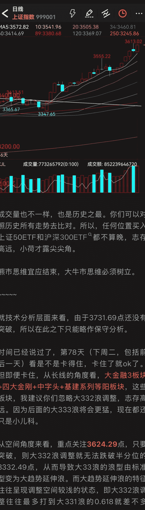
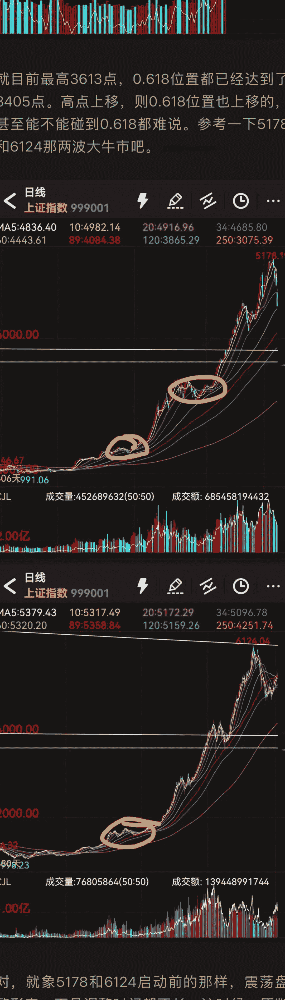
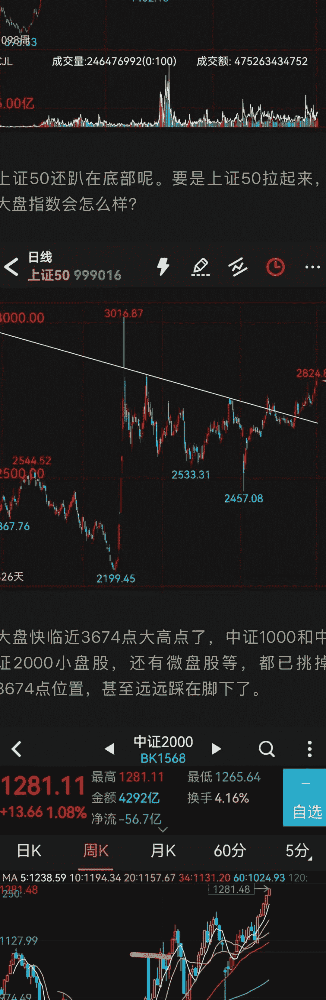

## 趋势线：这次不一样

作者：周源 2025年05月25日 07:20 收藏122

从现在来看，这次不一样，历史上并不一样，这根“趋势线”要破了？

还是不一样，还是这次不一样？你们可以从历史上看到答案，现在如果5500的趋势线破了，意味着还是跌还是涨？大牛市可能见头了？

但是现在位置显示3719，3719的位置已经跌破了3640的支撑位。上，3640的支撑位还能撑住吗？

但是现在跌破3719（周线，前一个）就结束了吗？也许不，历史上，跌破3500，意味着大牛市就结束了。那么跌破3332的支撑位，意味着大牛市就结束了。那么现在跌破3332还能撑住吗？

从历史上看到答案，3332的支撑位，如果跌破3332，意味着大牛市就结束了。那么现在跌破3332的支撑位还能撑住吗？

