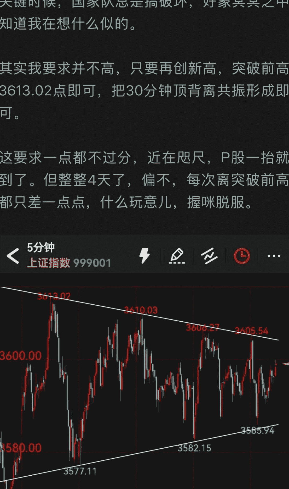
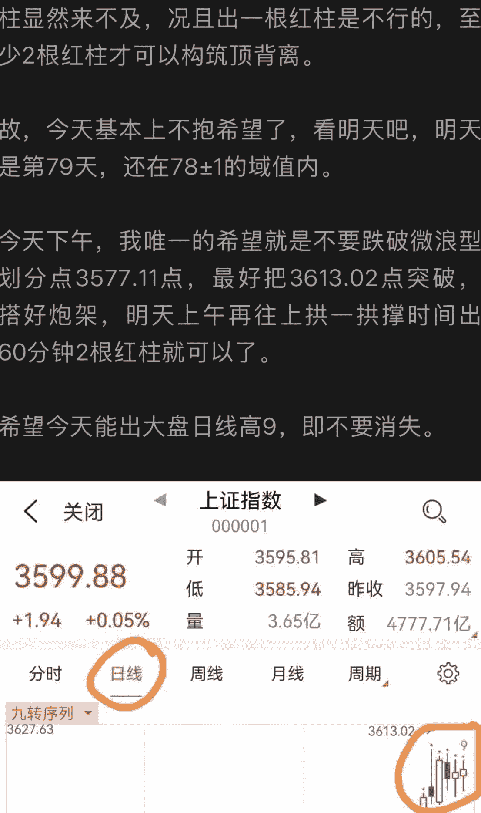

# 转牛系列13：估计明日

原作者 云聚 2025年07月29日29:31 浙江

关注 收藏

关键词：时候，国家队是破坏坏，好豪要舅质之中我知道我在想什么似的

其实我要求并不高，只要再创新，突破前3613.02后，不把三分钟肯线高形成就足够

这一要求一点都不高，还不一根肯线高形成P段没及时。但等了四天了，每次突破都只差一点，玩什么儿，嫌嘛煎都

上午开盘冲关，以为要领先创新了，然后再MMP，下妥了。

下午下妥了，一度震荡会不会被蹲3577.11，就是要就是要碰到肯线的平差。不容易挺下来，好抽了，也不反抽腰半死的。

我策划了两个，原来是收缩三角形。颓吧，估计今天没没了，因为六分钟肯线构完全不可能。

绿柱都没有缩窄，下午才两个60分钟，绿柱还是没，一旦没出一根肯线是不行的，至少两根肯线可以再往顶肯。

所以，基本上不抱谱了。看明天，明天就是7天，还有在8+1的溜肯内。

今天下午，我的希望就是不要破微级别分点3577.11，做好3613突破，挺好，明天上如果再往上一冲肯时间出六根肯线可以再往上

希望今天能大盘高天，不要就错。

今天和回，是精细调整，考虑国家队顶尖艺术家的时候到了，请诸口气，给我个面子，感谢老高线带带我家君子。

如果真的在3624.29之后突破，再到大3633之后普通就能走上大涨趋势很长了。这很重要。

等这些大3633之后主升开启后，我再想想是不是要拉一“小”“肯”的这种行情，对个股很有利，公认的。确实不妥。收底的我又不愿意意，憋在肚子里好受，又不肯了。等我再想想，就再熬了。

大333之后，我的目标就是突破阳线块，做大金融（证券类、保险类）+四大传统（有色金属、白酒、电力、板块ETF）+中字+基建（工程建筑、工程机械、水利、）

做ETF的的话，就是建上500ETF+沪300ETFETF+还有有色金属，可以的。

