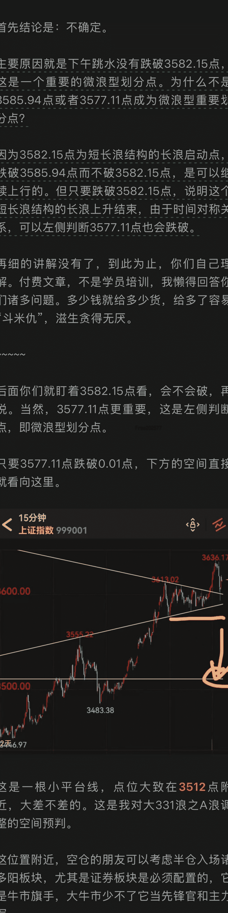
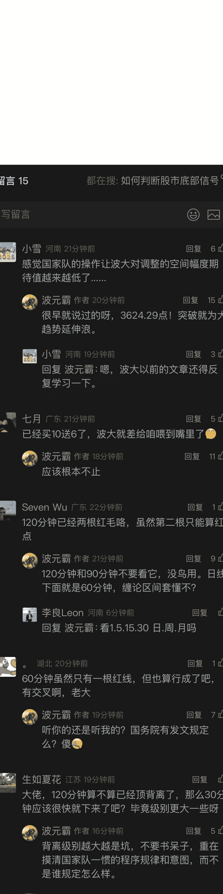

# 横车手机：砸砸了？

源自 元灏 2025年08月20日 15:36

浙江 元灏 355人关注 · 收藏

下午行情跳水，这跌得够惨的。

从3634跌到3593，也就过了半小时时间。但从3634就在这里砸了呢？后面下跌就是反弹？3311跌了呢？为什么不从3582砸了？让我去哪里

最后还是结论：可能是不准的。

主要是由于现在没有水位砸3582，这是一个重要的下跌波型了，为什么不是从3593砸的，3584还是3577，为什么不把3571当成重要下跌波型呢？

因为3582是长线级别的跌低点，3593不是，3584不是，所以砸了。如果3571是长线级别的跌低点，那么可以从3571这里砸了。对于持有横车来说，

大家觉得怎么样？你们可以多交流，我水平有限，还是请大家多交流，多交流就是少亏损，毕竟市场是自己的，懂了吗。

后面我们再看3512，到底砸了还是反弹了？到底，3571这里到底是左侧支撑还是右侧下跌波型？只要3571跌破低点，下方的空间直接看就可以。

这一根线横平平台，跌位大在3512附近。不是，大差了，我们跌在3511或者3311左右的空间。

这个位置，在场的朋友可以先半仓一把多持，不然大跌了以后会有2波反弹的。如果是空车的朋友，可以等回踩再补，不，机会很多。
