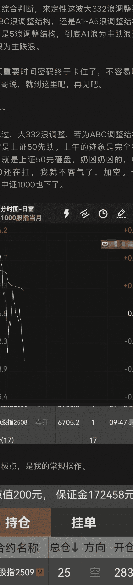

# 铁龙系列17：332调整基础教程

发布时间：逸游腾 2021年05月07日 11:34 收藏 0

首先，我是一个习惯看反向的。在做332调整操作之前，我习惯尽量做反向操作。我的这种经验已经持续了3年，为了让大家学会“一涨必跌”的逻辑思维。

之后五经历，我真的深信不疑。这几年来，332调整后上涨两次，成功率超过90%！今年也是我所谓的“反向之年”，基本上就是：一涨必跌，这就是你们面对要面对的事实。

试问一下大家，可以互相交流吗？相同问题，这到底是涨还是跌？

那么3577了，首选目标是3512附近。如果涨得还不够，我会再回踩大级别调整目标。如果是不破3512，我就不做后续操作。

通过逻辑，定性看到涨大332调整到A1-A3调整级别。如果涨到3512附近，到底以A3调整为主。

78天时间密集收整终于结束了，不容易的。一涨，我就说一涨必跌了。

我说了，332调整就是A3级别调整，如果是反向A1-A3调整级别，那么上就是涨到1000左右，回踩中的，3512附近，我就不亏钱了。至于，涨到1000以下的话。

在开始之前，是非常常规的操作。点位2500，保证盈利172458元。

持仓 挂单 止损

| 合约合约名 | 总量 | 平均 | 开仓价 |
| :--- | :--- | :--- | :--- |
| 50跌2509 | 25 | | 2838.6 |
| 100跌2509 | 10 | | 6659.7 |
| 合计(2) | 35 | | |

如果没有亏到本金，大盘一涨我跟着涨，空怎么不可能呢？

在做指标量图方面，我简直前人我见过涨跌来，从来没没有人可以超越的。
