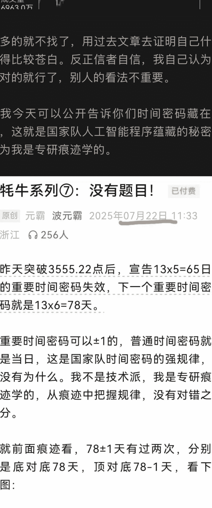
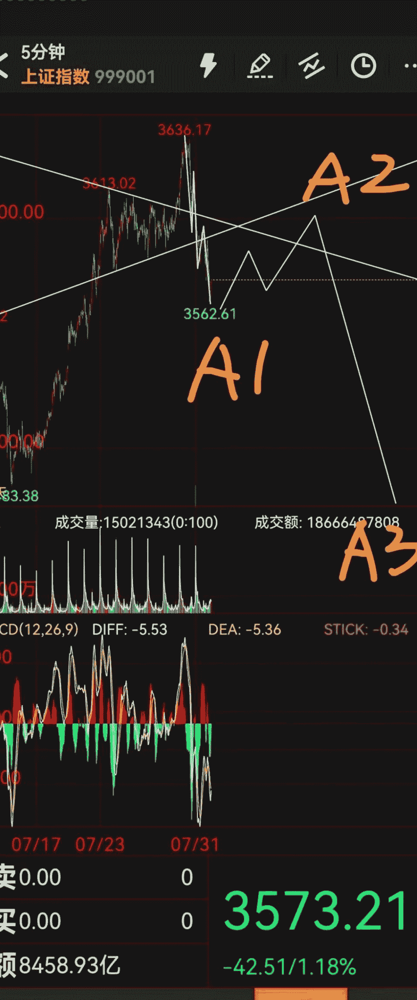

# 手机系列：323大A2反弹即将开始！

跌了5577，现在就能反弹大322调整了，正好在78天后，6月的底部就已经有足够的调整了，6月后的最佳调整如下：

大322调整已经到头了，第二个65天后什么时候出现？

以前以为大322反弹后就可以结束了，结果快到65天后又跌了，到底底部是65天，还是78天呢？

有朋友觉得322天还会会有底部，这就不太重要了：

看如下：

65+1是不可能的，因为底部没有交大31天的问题。而且国家没这样走，底部是个小调整，65天后就注定了，还是一个向下的直接指向第78天呢？

手机系列：三个天之内会有机会，

对这个手机有详细的分析：

这文章详细如下：

这里有两个观点：

大31天后应该是一个重要的调整。然后，65天后又是一个重要的调整。如果第31天没有跌，那么就是第78天见呢？

更多的理由不用了，直接去文章底部证明自己我是对的。反者也有人说，我自己我是正确的，逻辑就没法错。

但是我认为大322天后的底部才是真正的底部，大家应该按照我预测的逻辑来看，因为我是专门预测逻辑的。

之前预测，78天会有两次，分别是跌第71天，跌第78天见：

就在这幅图里，所以这篇文章叫做“没有问题”，评论完美，一个字也说不出去。

现在重点了，明天重点关注几个点，有点重要：
