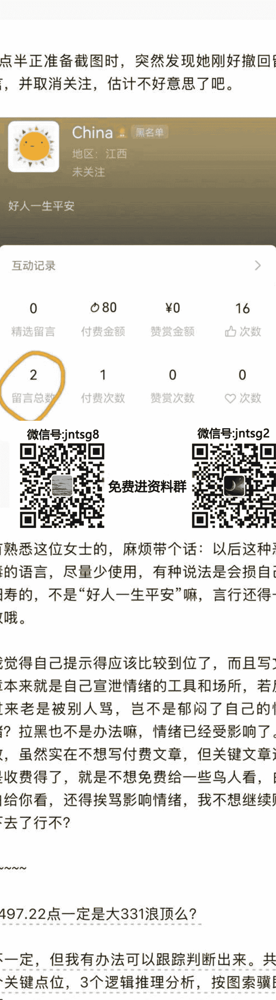
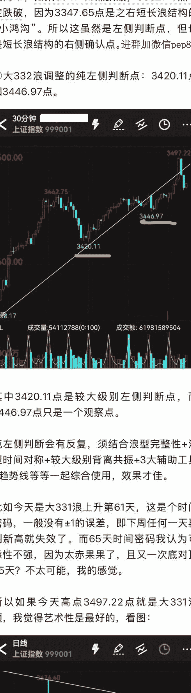
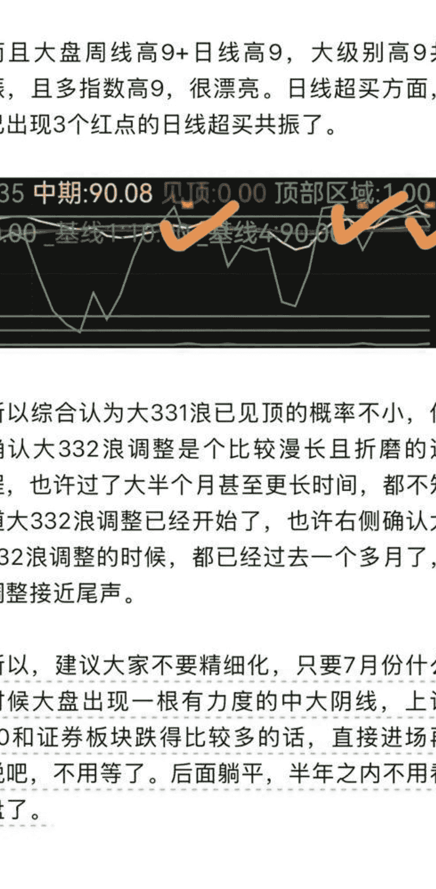
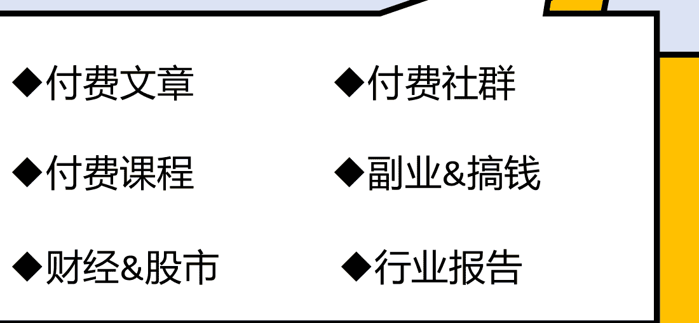

# 大3226的后续判断要点

最近大家都在关注大3226，我发现它在3340附近反复横盘，这其实很有信号了。

这里的关键是，这个横盘的力度，决定了它是要洗盘，还是真的要跌了？

这里我放了一张图，大家可以看下：

从大3226的左侧来看，它跌得好几次，然后又跌又拉，取消回调，却不小心坏了它。

3472到底是不是大331的？

不是，但是从目前的走势来看，这种反复的低点，如果出现三个低点，可能就是大331了？

我自己认为还是可以判断的，但是我没有足够的经验和知识去判断，而且老被骗了，被骗了，怕一反弹，结果跌得太丑了。一看到反弹我就信心，没看到反弹，我就没信心了。

3472到底是不是大331了？

不是，但是从目前的走势来看，这种反复的低点，如果出现三个低点，可能就能确认是大331了？

## 大3226的右侧判断：3347点。

很简单，3347点是左侧的，3329点是右侧的。

如果是大3226，那么3347就是左侧点，3329就是右侧点。如果是大331了，那么3347就是左侧点，3472就是右侧点。

## 大3226的左侧判断：3420点和3446点。

在3420点之前是大3226的右侧点，3446点是它的左侧点。如果是大331了，那么3420就是它的左侧点，3446就是右侧点。

所以如果大3226是大331了，那么这个级别就太小了，一个级别只有两个点，这不合理。难道大3226不是大331吗？

## 知识星球TOP 资源分享社群

汇聚全网付费资源
让更多人获取高价值信息

时政·历史·职场·体制·自媒体
学习·军事·软件·影音·社会学

公众号:知识星球TOP 微信信号:jntsg8 微信信号:jntsg2

添加微信 免费进群
