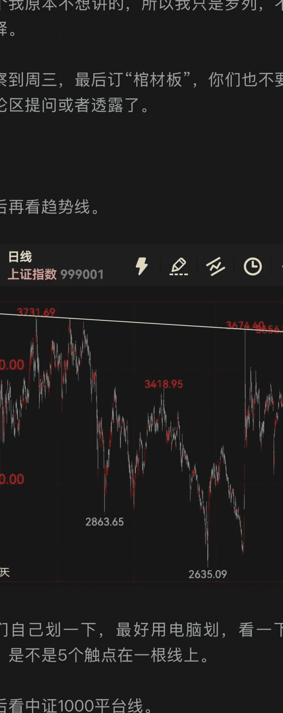
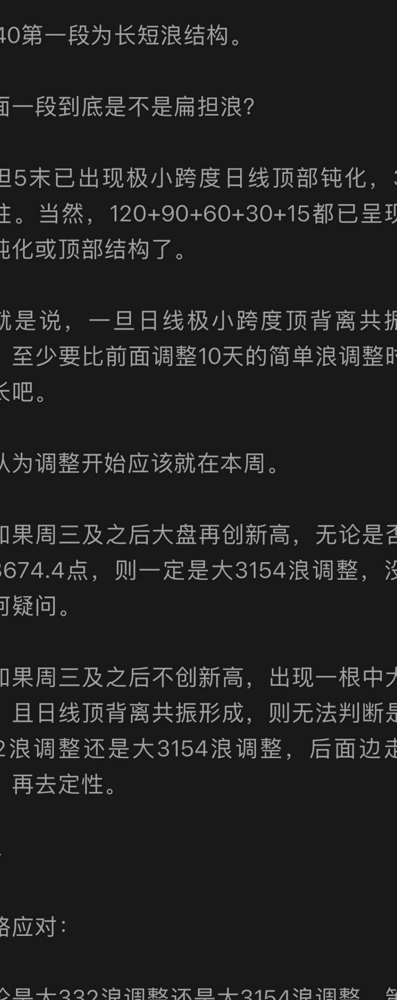

# 季丰系列26：至少10天！ 付费

原作者 亮嵩 2025年08月11日 14:27

## 前言
距离目标35天，希望尽量不要大范围波动

由于今天上线时已跑了87天，看来周末可能失效，但实话还有一线的趋势。

原原因：

- ①顶部底：87天
- ②底部底：86天
- ③底部：87天

交替的。

这个我本意不想的，所以我只是歪一下，不解释了。

看到现在，最后打算“找策略”，你们也不要再评论区吐槽我了哈

然后再看看

你们自己画一下，用电脑画，看一眼吧，不是5个点在一个一条线上。

然后再看1000日线平台了。

再看中1000日涨了多少？

| 指标 | 数值 | 涨幅 | 跌幅 |
| :--- | :--- | :--- | :--- |
| 中证5 | 6394.94 | 71.44 | 1360 |
| 5000日涨幅 | 6391.2 | 87.2 | 1893 |
| 5000日跌幅 | 930.0 | | 3808 |
| 中1000日线 | 6950.22 | 131.8 | 2066 |
| 10000日涨幅 | 6874.16 | 128.3 | 9528 |

盘中涨了555，这还是不是底的？再问一遍

底，太离谱了。
这种底部不是最后的反弹主旋，如果看1000日涨这么多，那我就认为底是这样的了。

我认为这波要要回一二百个点才是正常的，这是我个人的认知和看法。

然后再看横和垂直贴合的情况。

如果①和②底部对齐，无论是3674.点，一定是3154涨，没有二小底了。

如果②和③底部出现，无论是日线横合，没有一小底是3322涨还是3154调整，底部走低的。

无论大3322涨还是3154调整，精准的都是一样的，在大盘看3547.点之后，现在上就是50个点左右多空线。

尤其是底部跌率靠近多空线的支撑附近，二不二，直接去冲就行了。

小底部，你们自己看股票或者看指数的方法。
个人的认知，你们可以自己看吧，对准了可不要怪我哈。

我认为这波要要回一二百个点才是正常的，大涨要回踩底部，如果是3322涨还是3154调整，就是调整的结束了。

同样的都是一样的，底的形状不重要了。

# 知识星球TOP

付费资源分享群 免费入群
微信: jntsg2

| 序号 | 公号/星球/社群 | 原价 | 领域 |
| :--- | :--- | :--- | :--- |
| 1 | 生财术 | 2765/年 | 副业, 搞钱 |
| 2 | 怂宗怂吃瓜群 | 365/年 | 时政, 历史 |
| 3 | 记忆载/碧树西风 | 365/年 | 成长, 搞钱 |
| 4 | 欧洲金轨 | 328/年 | 时政, 历史 |
| 5 | 卢克文青云会 | 699/年 | 时政, 社会 |
| 6 | 体制内主任 | 599/年 | 体制; 职场 |
| 7 | 局外人的视界 | 669元/年 | 金融, 时政 |
| 8 | 濑泽异谈 | 4166/年 | 财富, 成长 |
| 9 | 守夜人司令 | 599/年 | 时政, 经济 |
| 10 | 江宁知府 | 365/篇 | 时政, 国际 |
| 11 | 政堂/顾子明 | 568/年 | 时政, 经济 |
| 12 | 唐书院 | 1399/篇 | 金融, 财富 |
| 13 | 大乡村 | 199/年 | 时政, 成长 |
| 14 | 水库欧大 | 10000元 | 房产, 经济 |
| 15 | 洪濑的宏观策略 | 4376/年 | 经济, 搞钱 |
| 16 | 金通政/北海南 | 4576/年 | 股票, 行研 |
| 17 | 猫哥的世界 | 299/年 | 时政, 社会 |
| 18 | 飞浪王 | 3600/年 | 股市, 经济 |
| 19 | 联储见闻 | 599/年 | 经济, 金融 |
| 20 | 鉴茶经院 | 330/年 | 房产, 股票 |
| 21 | 藏八小时之外 | 365/年 | 成长, 职场 |
| ... | ...... | ...... | 更多资源，不再再列 |
