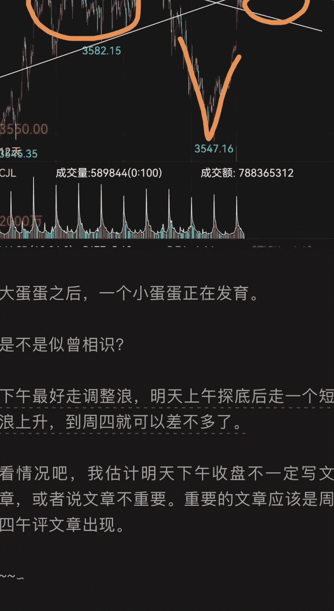
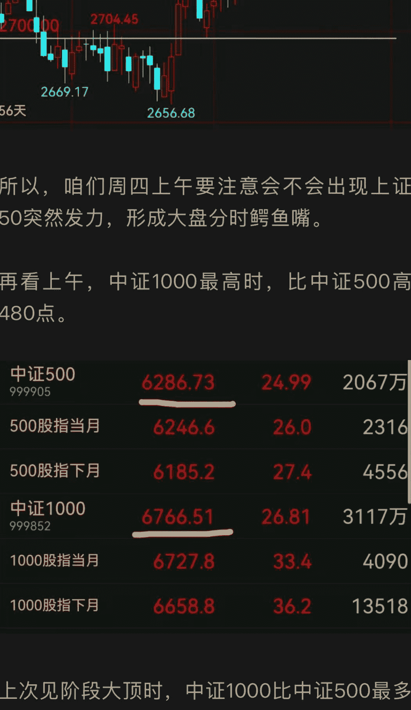
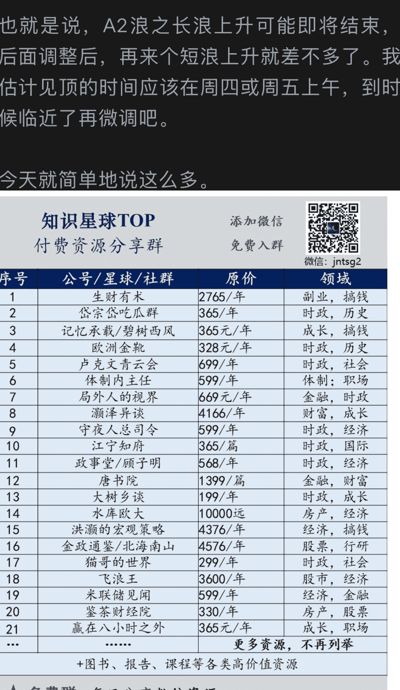

## 牛车系列21：穿越，蛋蛋！

原价 元元 2025年08月05日 11:34 财经

昨天的时候，我就在想，会会不会像上一次一样一次“蛋蛋”的穿越？结果今天又出现了，请看：

蛋蛋之后，一个小蛋蛋正在发育。

是否会相似？
下午最好调整，明天下午后还是一个两个上涨，到周四就可以差不多了。

看情况呢，我估计明天下不一定写文章，或者文章并不重要。重要的文章应该是周四蛋蛋出现。

上涨后看，中证1000小盘很稳。

中证中国又创新高了，让上50基本上就没回弹。

所以咱们周四上午会会不会出现上500突然爆发，形成大分时钓鱼闹。
再一遍，中证1000最高时，比中证500高了80点。

所以上次跌提到，中证1000比中证500有多487高点。这次是临近了，值得重视，大不会是个小阶段呢？
大盘数据看，目前与我预计的完全一致，我再划如下：

今天就看到这里了。

