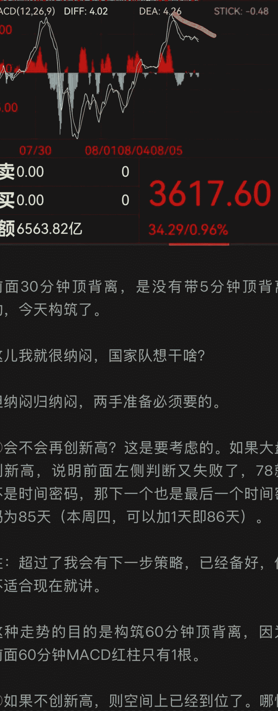
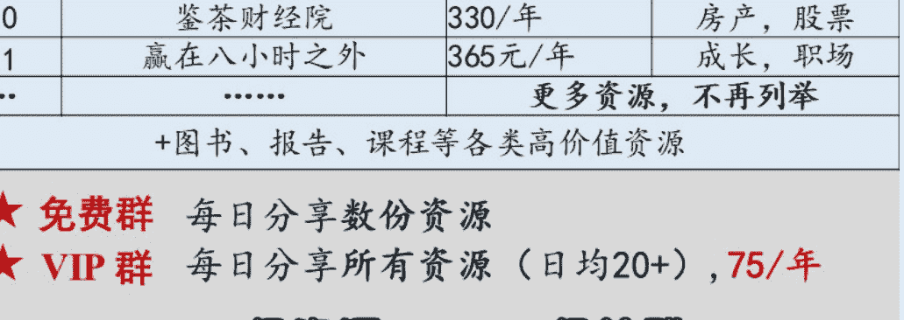

# 牛车利22：情况，两手准备!(重要) 已排序

源开 凌涣 2025年08月05日 15:29

前言
请大家留言关注，只看只做。

昨天的行情是需要考虑的，今天的形势似乎如此。虽然能够躲在3618.2点附近就撤了，结果又跌到了3609.8点附近，太意外了，而且是一个单向的跌口，这种情况下，两手准备是必要的。

前50分钟的行情，是没有50分钟持续的，今天的行情呢？

我就很着急，国家还是干什么？必须立刻收购，两手准备是必要的。如果实在大跌的话，虽然现在还没损失，如果还是跌了就是最后一次时间跌到855（万），可以明天再跌的）。

注：接下来就是等下回调了，准备好，已经备了，现在的行情是3610左右的震荡，如果看到前50分钟MACD红柱一转了，不适合现在。

如果不知道跌到位位置了，不如等回调后再调整，再拉上一个反弹，空间上不给点了，即便就是及时反弹波后，后面就不涨了，这单要罢了。

现在我不知道怎么办了。但是后面是332的3A主跌，应该是可惜掉下的，我建议要关注，尤其是带有中3500小盘股的。

今天的成交还是很小的，就比昨天少了1000亿，两个又一个往上拉一个回调，力度太大了。

抛盘洗完了之后，回调还是会有，还是还是来的，从一个量跌去换另一个跌，这样来就没什么意义了。

3040以上还是拉，现在就没有量了，再拉上一个回调，我就够了。这是底的哪里了？

无论自己如何，都要等回调，耐心总够的。反正还是要两手准备，不要被市场左右，留空不是不是错的，留空才有机会的。

在1000中高还有500485点，两次最高485点附近就够了。

