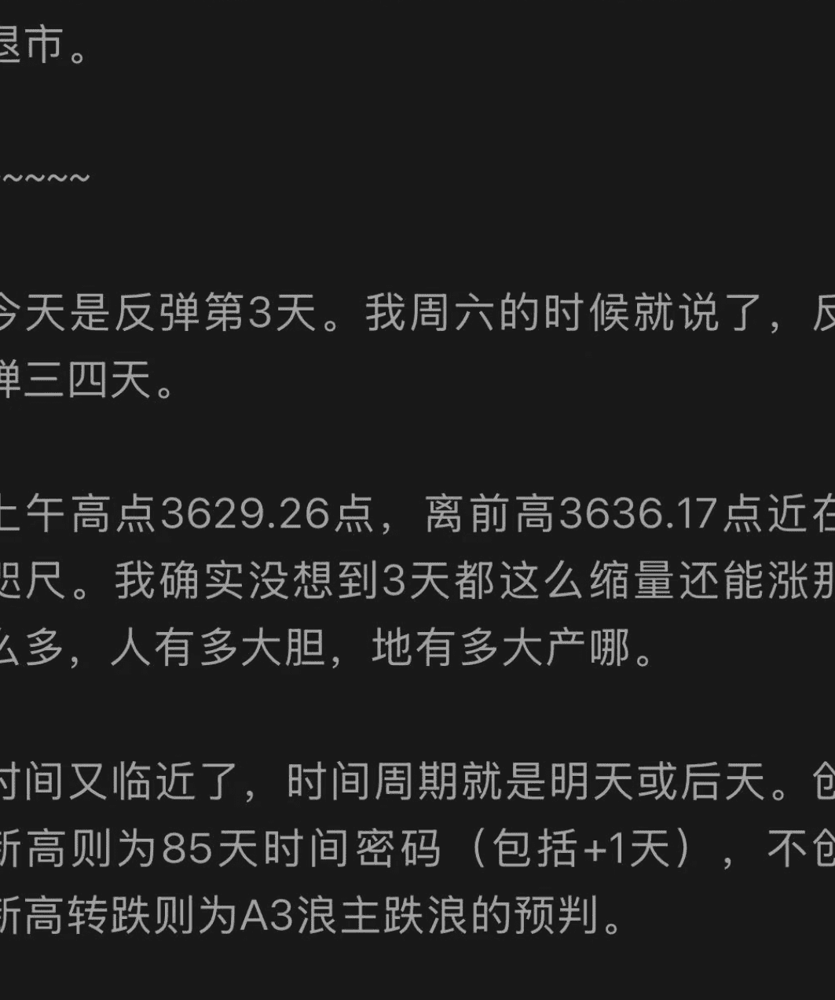

# 牛车系列23：指数偏向

今年以来，我感觉中国股市有些变，有仿美股走势的迹象，即指指数不涨，但股票越来越强，盘中震荡非常明显。得不得。

现实情况如此：

首先要说指数和它的关系。有时候我们会发现，它所有指数都挺涨，但指数却比股票强。因为我观察了，这时候小头很强，就是中字权重活跃，散在很多数据中，对指数影响不大，但对股票影响很大，结果就出现了这个奇怪的现象。

接下来是指数的割裂和中国国家的走势。国家和大蓝基金倾斜拉，它们用来推大指数，但小盘在涨的时候，就等小股回踩的时候才跌，结果过几天，大盘才跌下去，指数不比上涨多多少。

但是中证1000等小股涨疯了。

所以，我的意思是，今后一段时间，指数ETF不见得比个股大。美股就是这样，指基金一直涨，大部分个股都是跌的，甚至跌。

今天是反弹第3天。我周六的时候就说，反弹四天。

上午涨3629.29，离高3636.17附近在敞。我真没想到还有这么多量还能涨很多人，有多大，有多大时间又错，时间周期就是明天或后天。创新高为5365天密集涨（包括+1天），创新高转跌为A浪涨的判断。

还有，中证1000比中证500涨了点比，后涨487点还要高。

这确实有点疯狂了，我认为不可持续。
