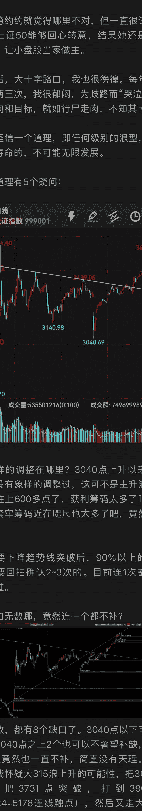
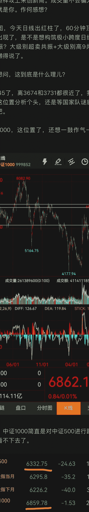

# 牛市24：国家级半牛行情来了

不是你哪个行业，行情中有很多机会，但是机会属于准备好的人，很多人又错过了机会，只要熬过去，春天已经快要来了。

但是，你准备好了吗？

现在的环境，其实比几年前要好得多。

毕竟，现在的市场已经经历了最痛苦的阶段，跌了最长的跌幅，也磨了最充分的底，现在的行情已经反转了，2023年是最好的时候了。

我想问问大家，你觉得半牛行情来了吗？我已经听到了风声，春天快要来了，难道这波大牛是不是就要开启了？

哎，累个朋友。

这就是我看到的99000，跌了78天后开始反弹，反弹了一个周，又跌了一个周，真的受够了。

现在的50000已经跌了85天了，刚好在37000附近跌了85天，不知道什么时候反转，什么时候会有大反转呢？

现在的2635已经是2级低点了，大跌了31天后有了5级反弹，看来很快就能看到底了。

这个节奏，真的比我们几个月前预测的准多了，但是也太慢了，跌得太久了。现在的50000已经跌了85天，现在反弹了5级，看来也很快就要反转了。

现在的3635已经是2级低点了，大跌了31天后有了5级反弹，看来很快就能看到底了。
