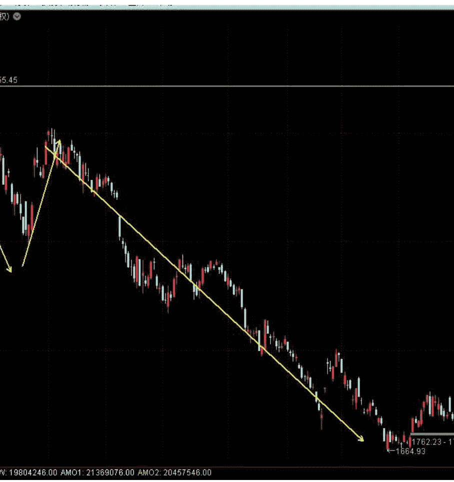
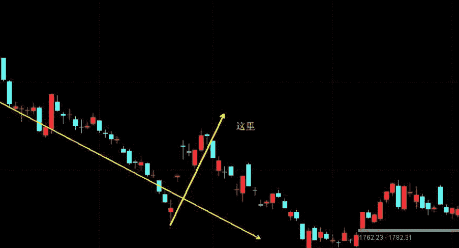
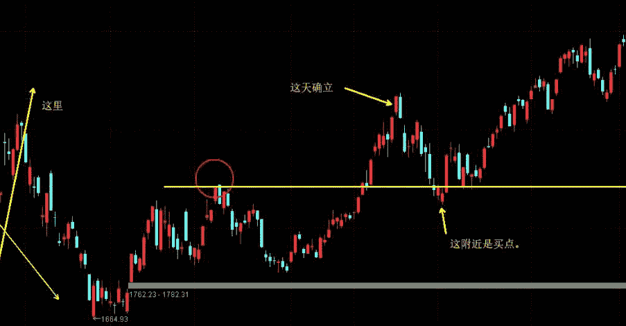
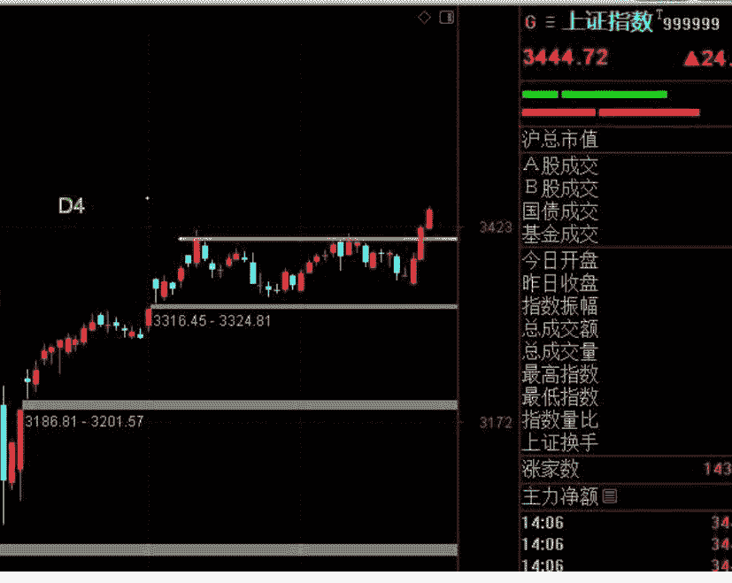

# 冲击3439就可以买吗？

原文 波段之门 波段之门 2025年06月25日 14:45 云南

首先说明一个观点，我们没有指导你挣钱，也没有指导你不亏钱的义务。
不要说这类话，你挣钱了、亏钱了，或者没挣钱。
我问你，你挣了钱给家里吗？
你跟人家谈合同了？人家有义务指导你？
你买的基金亏了那么多，你怎么不跟经理打官司？

3439是一个重要阻力，冲击它就可以买吗？

如果这个问题如此简单，那市场里的韭肉就太好了了。

你挣钱和亏钱与别人无关，与国家无关，只和你自己的认知有关。

因为这个问题很技术，所以今天我开启了今年的第一次付费阅读。

钱不多，两元，一只是茶费的钱。

冲破3439点，再进行交易，肯定是右侧交易，若是左侧交易，应该在6月23日的3347点，这个点很难把握，起码，这样的一个底部，我是握不住的。

那如果右侧交易，我应该如何把握呢？

我们看看历史。

这是著名的2008年大熊市。

# 扫码加入 星球TOP 免费资源群

| 免费 | | 每日免费获取高价值资源 | | 各类资源搜索服务 |
|---|---|---|---|---|
| 价值 | | 热门付费文章 | 各行业报告 | 精选底部资源 | 副业赚钱方法 |
| 时 | | 职场实用资源 | AI政经自媒体 | |

账号：jntsg1

账号：jntsg2

分享资料仅供个人学习，请及时删除，切勿商用传播

# 微信公众号jntsg2，免费进资料群

在2008年的10月28日底。

见底的这一天，只有少数高手知道那是一个大底。

作为一个普通的小散，你怎么知道在这里转势了呢？它是有方法的。

首先，你得看左侧，在这一轮下跌中，距离1664点形成的一笔反弹最近的k线在哪里

注意，是这里。

加微信信号jntsg2，免费进资料群

因为这里形成了一波超过5根k线的反弹，后面虽然也有反弹，但是都不能称为一波反弹，因为构不成底的构型。

超过了这波反弹的最高点（2333点），我们就可以建立10月28日的1664是一个大底部。

但是，不是超过2333点就可以买，确认那天只是确认，不一定是买点。

也就是要回压前的头部，回压时，才是买点。

对应看着现在的位置：

# 微信公众号jntsg2，免费进资料群

我已经表达得很清楚了。

个股也一样，有突破就买的吗？那不是挣钱太简单了？

现在是14:11，证券有三个涨停。

我现在没有加入。

我的计划是：观察到下周再看一看，这周还是做短线。

大盘如果从这里往上攻击的话，那我们的时间节点，就是一个高点了。

一切都要边走边看。

如果是真的是突破的大行情，就不会有两天。

万一不回踩呢？那我就没办法了，我只能讲一个大概概率。

如果是虚晃一枪，那更不在愁。

我买票从来不着急，你愿意去过，那就去，我没有半毛钱的关系。

因为，你赚也不是我给的，亏也跟别人没关系。

在后台留言寻人的，我不会对你，因为我们加微也得养看着这类东西，

加微微信jsts562，免费资料群

我下没有买任何股票，反而在中午又减仓了，后天的另一个短线卖掉了。

你可以发信息：银河，可以看到我的卖单。

祝大家快乐！

# 知识星球TOP

付费资源分享群 免费入群

| 序号 | 公号/星球/社群 | 原价 | 领域 |
|---|---|---|---|
| 1 | 生财有术 | 2765/年 | 副业、搞钱 |
| 2 | 众吃闲 | 365/年 | 时政、历史 |
| 3 | 赢在八小时之外 | 365/年 | 成长、搞钱 |
| 4 | 欧洲金刚 | 365/年 | 时政、历史 |
| 5 | 卢克文青会 | 699/年 | 时政、社会 |
| 6 | 体内主任 | 599/年 | 体制、职场 |
| 7 | 局外的视角 | 669/年 | 金融、时政 |
| 8 | 溯泽并异 | 4166/年 | 财富、成长 |
| 9 | 守夜人司令 | 599/年 | 经济、经济 |
| 10 | 江宁付 | 365 | 时政、国际 |
| 11 | 党堂/顾子明 | 568/年 | 时政、经济 |
| 12 | 唐书院 | 1399/寓 | 金融、财富 |
| 13 | 大树许多谈 | 199/年 | 时政、成长 |
| 14 | 水库欧大 | 10000远 | 房产、经济 |
| 15 | 洪澜的宏观策略 | 4376/年 | 经济、搞钱 |
| 16 | 金政通鉴/北海南南 | 4576/年 | 股票、行研 |
| 17 | 猫哥的世界 | 299/年 | 时政、社会 |
| 18 | 飞沃龙 | 3600/年 | 市市、经济 |
| 19 | 联储见闻 | 599/年 | 经济、金融 |
| 20 | 鉴茶财经圈 | 330/年 | 房产、股票 |
| 21 | 赢在八小时之外 | 365/年 | 成长、职场 |

更多资源，不再列尽

+   * 免费群 每日分享数十资源
* VIP 群 每日分享所有资源（日均20+），75/年
