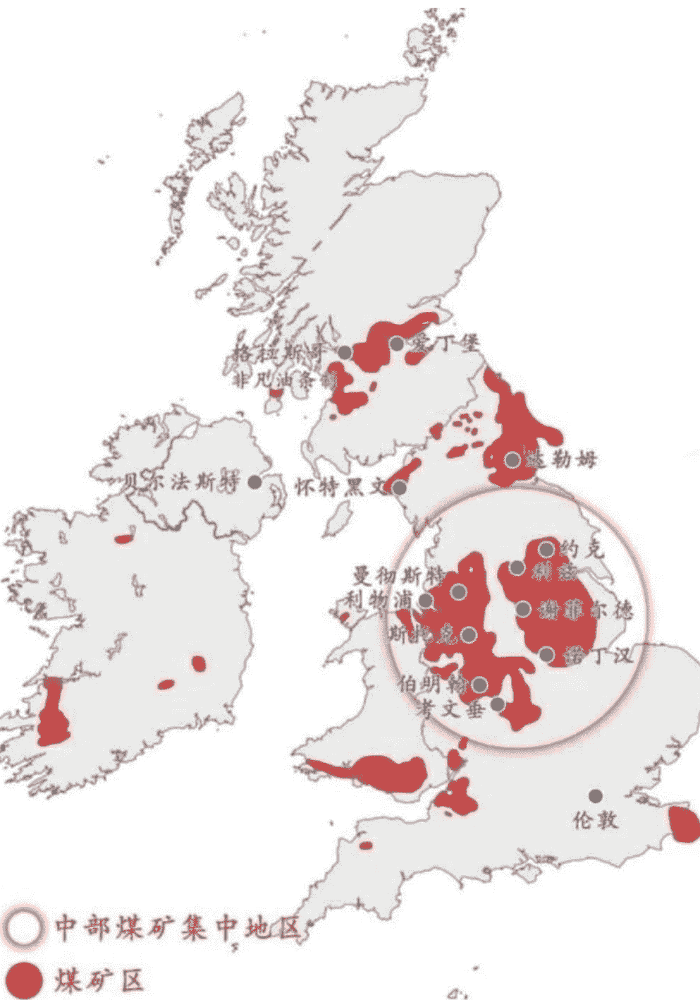
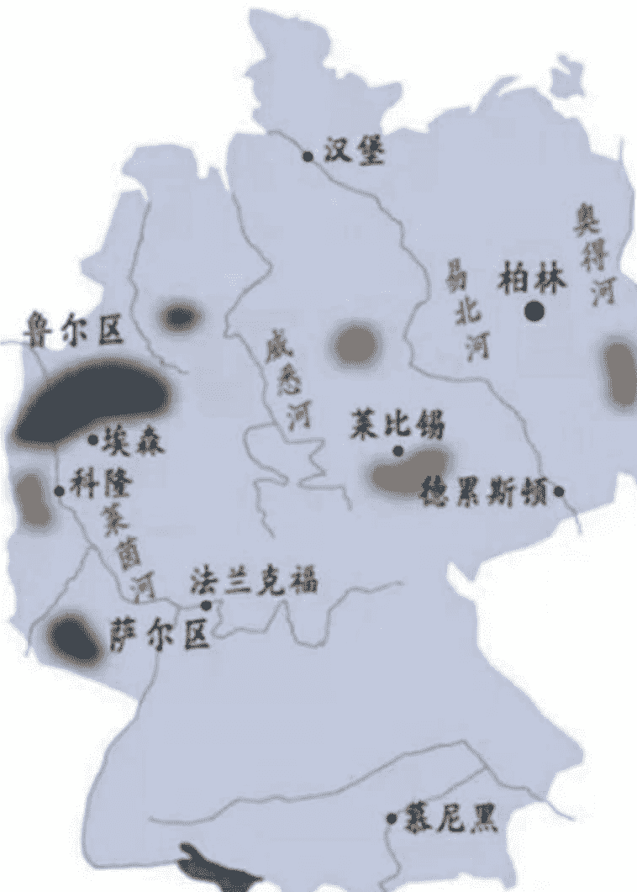
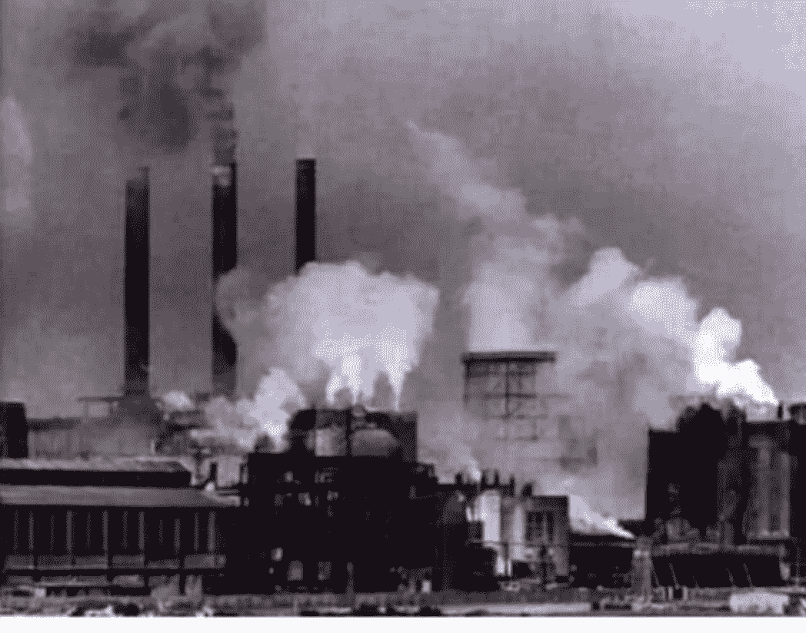
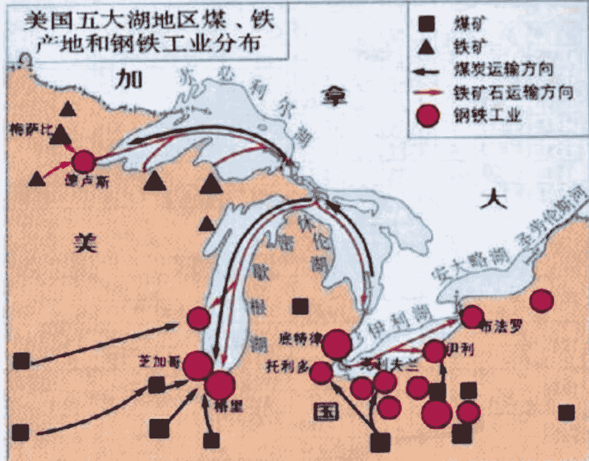
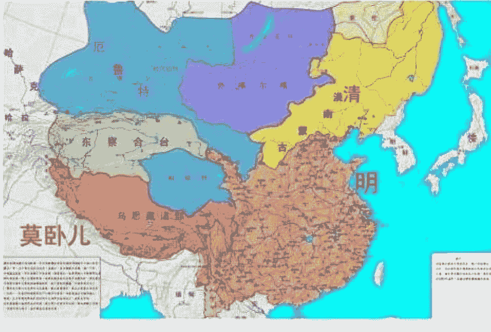
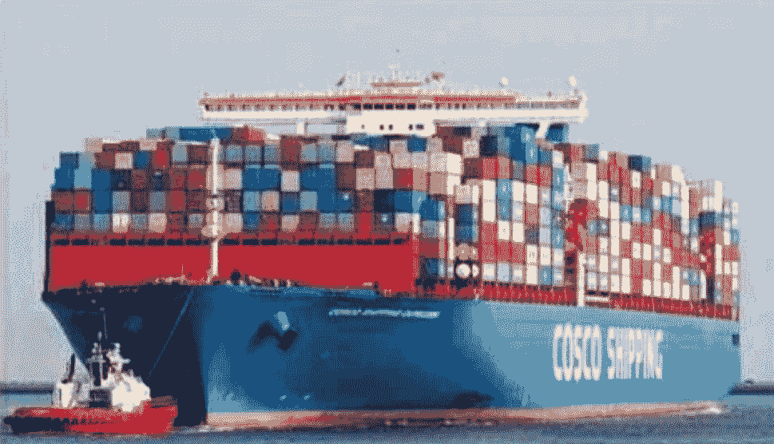

# 洋恺宏观 250517：资源即国运

纵观人类文明史，大部分时候都围绕资源开展，得从资源角度理解大国博弈。

在 19 世纪，想要实现工业化就必须拥有煤炭，而且人口重心和资源重心必须重叠。

英国煤炭分布图：

## 英国为什么能率先引领第一次工业革命？

前提是英国南部大量煤炭。在此之前，欧洲主要消耗的资源是木材，无论是取暖还是造船军，都需要木料。但随着森林砍伐加剧，英国的木材供应陷入短缺，在这样的背景下，烧煤的蒸汽机才会得到推广。储藏大量煤炭的曼彻斯特、利物浦、伯明翰等小镇一跃发展为欧洲工业中心。

在近代欧洲，普鲁士一直是列强中最贫穷的国家。特别是拿破仑战争后，普鲁士综合国力受到极大削弱，经济发展水平远不如法国、奥地利、荷兰等国。然而半个世纪过去后，普鲁士却迅速崛起，一举击败法国和奥地利，成功统一德国。为什么普鲁士能逆势崛起呢？根本原因在于鲁尔区发现了煤炭。

## 德国煤炭分布图：

褐煤      硬煤

论制度体系，普鲁士和奥地利、俄罗斯一样，都是君主专制。相比法国采用共和制，似乎法国要更先进的。论科研人才，法国相比普鲁士也有极大优势。然而在 19 世纪，位于普鲁士西部的鲁尔区勘探出煤矿，而且都是高品质的硬煤。

鲁尔区原本是一块贫瘠的农田，列强对此都不感兴趣，因此被分给了国力最弱的普鲁士。在工业革命之前，欧洲大陆最富庶的区域是北意大利，特别是威尼斯和米兰地区。法国和奥地利为了争夺北意大利争了几百年，谁也瞧不上鲁尔区这块烂地。

然而随着工业革命到来，勘测出煤炭的鲁尔区迅速富裕起来。鲁尔区的煤炭占德国 90%，并且开采成本极低，一铲子下去就能挖到煤。借着鲁尔区的煤矿，普鲁士快速崛起，工业产值连续赶超奥地利和法国，为统一德国奠定基础。

在很大程度上，19 世纪的普鲁士乃至德国，不仅封建专制，而且保留了大量容克地主阶层。然而鲁尔区的煤炭改变了普鲁士的国运，凭借丰富的能源，鲁尔区的工业产值占意志地区 40%。相比之下，法国、奥地利、西班牙、意大利等富裕地区煤炭储量很低，因此工业化速度极其迟缓，逐渐走向衰落。

## 鲁尔区的工业为德国挑起一战和二战带来底气：

不仅如此，普法战争后，德国从法国割走了阿尔萨斯和洛林地区，洛林地区拥有丰富的铁矿。鲁尔区的煤矿+洛林地区的铁矿使德国工业如虎添翼，在短短四十年内就赶超英国，成为欧洲第一经济大国。

事实上，在第二次工业革命时期，除了德国以外，西方世界只有另一个国家同时拥有丰富的煤铁资源，那就是美国。

## 五大湖工业区：

深度视文集社cuk255 有温度高质量群cuk255

在美国建国之初是一个农业国，与欧洲列强相比，美国的制造业毫无竞争力，因此只能采取贸易保护主义。大佬文集团认为 19 世纪中叶，在美国五大湖地区勘探出丰富的煤炭和铁矿，自此美国进入快速工业化，包括底特律、芝加哥、密加根等城市迅速繁荣起来。

为了方便五大湖商品出口，美国特意修建了连接五大湖与大西洋的运河，其海口就是当今的世界第一城——纽约。南北战争中，美国凭借五大湖地区丰富的铁矿赢得了战争，资源储备决定了战争胜负。

作为对比，英国虽然拥有煤炭却缺乏铁矿。法国既没有煤炭也没有铁矿，只能从海外殖民地购买资源。在近代海运成本极其昂贵，高于本土开采成本，明显制约了英法工业化进度。19 世纪，美国和德国在工业上赶超老牌强国英国。

顿巴斯煤矿：

位于乌克兰东部的顿巴斯地区勘探出大量煤炭，让俄罗斯高兴了。与美国不同，俄罗斯资源重心与人口重心并不重叠，顿巴斯地区与莫斯科、彼得堡遥远，因此工业化非常缓慢。为了弥补资源不足，沙皇前往乌克兰挖矿改变了当地结构。最惨的是意大利，这里曾是欧洲中心，但由于缺乏资源又没有庞大的殖民地，因此错过了工业革命的机会，逐渐走向衰落。

19 年各国钢铁排名：

| 国家 | 钢铁产量（万吨） |
| :--- | :--- |
| 美国 | 80 |
| 德国 | 176 |
| 英国 | 779 |
| 俄罗斯 | 492 |
| 法国 | 469 |
| 奥地利 | 261 |
| 日本 | 38 |
| 中国 | 5 |

19 世纪，衡量各国国力最重要的指标是钢铁产量，无论飞机、大炮、军舰都需要钢铁。德国之所以敢挑起一战，底气在于其钢铁产量，资源上限决定了国力上限。

20 世纪，想要实现工业化除了煤炭和铁矿之外，还需要石油。德国和日本之所以发动二战，本质上是为了获取资源。德国看中的高加索石油和苏联铁矿，日本看中的南洋石油和东北地区。石油的短缺让德国做出了入侵的选择，也使日本袭击珍珠港走上“赌国运”的道路。

为什么上个世纪 30 年代苏联能够迅速工业化，很重要的原因在于苏联本土勘出石油。凭借高加索的巴库油田以及来自美国的技术输入，再加上斯林的工业政策，苏联仅用了两个五年计划就一跃从农业国发展为工业国，取代德国成为欧洲最大经济体。1939 年，苏联石油产量飙至 3000 万吨，跃居世界第二，超过欧洲总和。那世界第一是谁？是美国，当时美国的石油产量为 1.7 亿吨，占全球比重一半。正因如此，美国工业产值占全球比重高达 38%。

古代，中国凭借雨热同期的气候环境孕育了先进的农耕文明；北美受寒潮影响，本土文明几乎灭绝，找不到历史的痕迹。然而近现代，中国由于资源短缺工业化长期受阻；拥有特殊地质结构的北美则是世界上最丰富的地区，煤炭、钢铁、石油样样不缺，成功抓住了第二次工业革命带来的机遇。

欧洲虽然拥有丰富的煤铁资源但由于缺乏石油，工业产值被美苏赶超，经济实力的下滑带来了外交地位的下降，这为后来欧洲从美苏埋下伏笔。值得一提的是二战后西欧各国为了加强合作成立了欧洲煤钢共同体，目的是通过资源捆绑来实现利益捆绑，也成为欧盟的前身。

殖民时代，由于海运成本限制和排性的区域贸易保护主义，各国更多依靠本土资源发展工业。可以说资源就是国运，一个国家的综合实力一方面取决于其受教育人口数量，另一方面取决于其矿产资源储量。不仅是近现代，古代各国竞争亦围绕资源展开。

## 中国古代最重要的战略资源是马匹和铁器

古代官方长期垄断的三个行业，分别是贩盐、冶铁、养马。官方之所以严禁贩卖私盐，主要是因为盐相当于今天的土地财政，是一种征收间接税的工具。盐这种东西属于刚需，大部分居民都需要吃盐。但与粮食不同，对于真正的穷人来说，盐只是调味，所以盐是货币工具，从古代开始具有流动性。

古代，马匹和铁矿最重要的战略资源：

如果说马匹主要是为了内部竞争，那铁矿则是应对外部竞争的核心资源。养马是为了培育骑兵，冶铁是为了锻造兵器。

古代，农耕文明与游牧文明竞争：
- 农耕文明的优势在于铁技术
- 游牧文明的优势在于马匹

当农耕文明获得马匹时，就能占据主动；当游牧文明获得铁技术时，就能占据上风。作为对比，汉朝由于装备差距，匈奴只能使用骨箭，穿戴兽皮的匈奴骑兵相比，“铁浮图”战斗力可谓碾压。

汉朝有一种说法“胡唐百年国运”，由于无法过渡到封建文明，缺乏庞大的官僚系统来保障权力平稳接，匈奴经常陷入血腥的内战之中，在不断分裂后被中原王朝逐个击破。然而东北不一样，作为胡汉混合区，政治重心逐渐移至北京。

## 为什么东北取代蒙古、西域成为中原王朝威胁？

根本原因在于东北有铁矿。从秦汉到隋唐时期，农耕文明借铁器的优势抵消了游牧民族的马匹优势，双方各有胜负。安史之乱后，无论是蒙古还是西域，均没有露天铁矿。但东北不同，东北地区都有露天矿，特别是辽宁地区存在大量露天矿，开采成本极低。不仅如此，东北还适合养马，马匹数量不及蒙古，但质量却过之。凭借丰富的铁矿和优质马匹，东北迅速崛起。

## 金国铁浮图：

掌握铁资源带来了意想不到的变化，那就是制度的变革。如果蒸汽机推动人类从封建社会转向工业社会，那铁器则推动人类从奴隶制转向封建制。在石器和青铜时代，由于耕效率太低，个人只能依靠集体生存，这就产生了奴隶制。铁器普及后，精耕细作成为可能，自耕农大量出现，井田制走向瓦解，这为封建社会奠定了经济基础。

东北不一样，拥有铁矿的东北早就完成了封建化转型。南北朝时期，高句迅速崛起成为横跨辽东与朝鲜半岛的巨大帝国。好在隋炀帝和唐太宗战略眼光，对高丽进行征讨，将风险扼于摇篮之中。

唐朝末年，契丹人利用中原混战的机会趁机坐大，并在五代十国期间割了燕云六州。契丹人采用“南北面官”制度，在保留牧特性的同时吸收官僚体制优点，拥有稳定的税收来源。另一方面，来自西北的党项崛起后，占领了河套平原。北宋失去了两个最重要的产马地，再无法组建骑兵，国势一蹶不振，最终被女真所灭。

从唐朝末一直直到明朝，中原王朝最大的威胁一直来源于拥有铁矿的东北。期间蒙古只获得过短暂的崛起，主要有两个原因：一个是成吉思汗出其不意的方式对金国发起偷袭，成功夺得了金国的马场，缴获了上百万匹战马，导致金国失去了骑兵的优势；第二个原因是南宋借蒙古之手削弱金国，放宽了对蒙古的铁出口限制，使蒙古获得了锻造兵器所需的资源。

不过蒙古的缺点在于本土没有铁矿，只能靠贸易或掠夺的方式获取资源，长期停留在奴隶制社会。因此蒙古崛起昙花一现。明朝建立后，为了防止蒙古入侵，特意在北方境内修建了万里长城。长城最大的作用并非抵御外敌，而是对蒙古实施全方位封锁。汉朝为切断蒙古获取马匹的渠道，严禁铁出口。

明朝与其不同，辽东位于关外，地势平坦易攻难守。从地图可以发现，抚顺、本溪到沈阳、铁岭一带是中国古代铁矿最丰富的地区，一旦这片区域落入敌手，明朝将无法利用封锁政策维持优势，这也是明朝要在平原上修城的原因。

## 明末辽东：

万历时期，努尔哈赤统一女真部，与明朝爆发“萨尔浒之战”，这场战争成为明朝兴衰的折点。萨尔浒之战对明朝最大的打击，不是牺牲了数万精锐部队，而是让女真占领了辽东铁矿，这使女人在完成封建化的同时建立了强大的军工体系，其打造的铁器能够轻易射穿明军甲。东北的铁矿+马匹让女真军队在野战中碾压明军。然而女真只有几十万人，明朝却有上亿人。

努尔哈赤精心设计了“满蒙姻”政策。在此之前，明朝主要从蒙古进口马以此组建骑兵。为了锁死明朝获取马匹的渠道，努尔哈赤通过联姻的方式拉拢蒙古各部。有了血缘关系后，蒙古人宁可与明朝贸易脱钩，也坚决配合后金的封锁政策。

明朝中原王朝一直重视马政，但由于马场都是官营，养马指标量化，农户缺乏养马积极性。不仅如此，明朝后期华北过度开垦，养马成本极其高昂，且饲育出来的马质量无法满足战场需求。后金依靠“满蒙姻”政策，锁死了明朝获取马匹的渠道：

失去了蒙古供给后，明朝野战能力迅速衰退，只能依靠城墙和火器被动防守，这需要消耗大量物资。为了筹措经费，缓解财政危机，明朝只能加征赋税（辽饷、额外饷、练饷），这种饮鸩止渴的做法加重了百姓负担，导致全国范围内爆发大规模农民起义。1644年，在后金和农民军的联手夹攻下，明朝灭亡。“满蒙古联军”带来的资源封锁，是明朝走向衰亡的重要推手。

如果说中国古代最重要的资源是马铁，那中国现代最重要的资源就是煤炭和钢铁。现代中国很难实现工业化，是因为中国本土严重缺乏资源。山西和内蒙古虽然有煤矿，但离人口重心较远，缺乏河流运输。在当时的技术条件下，采煤和运输成本很高。更关键的是，中国东北缺乏铁矿。东北丰富的矿：

深度视野文集cuk255 有温度高质量群cuk255

观日本，在夺取了东北矿权后，日本获得了工业化所需资源，国力迅速增长。正如此，日本才会提出“满蒙生命”，将日本视为核心利益。“九一八事”后，日本彻底掌控了东北矿产资源，钢产量翻了三倍。这使日本得以走出“大萧条”带来的经济衰退，也刺激了日本扩张的野心。

东北的矿产资源，为日本备战定了基础。抗日战争表面上是4亿人和7千万人的较量，实际上是5万吨钢产量与400万吨钢产量的对抗。中国军队以肉之躯，抵挡日本工业化带来带来的绝对优势。造成这种悬殊的，是持续了数十年的铁矿资源封锁。

日本战败后，由于全国只有东北拥有丰富的煤铁资源，东北的工业产值居亚洲第一，钢产量占全国95%。在此解放战争期间，有“得东北者天下”的说法。决战胜利后，监控全内只是时间问题，因为关内的资源总量和工业产值加起来都比不过东北。新中国成立后，为什么苏联援建的156项目主要投东北而不是东南，因为东北有丰富的矿产资源，东南没有。

凭借东北的矿产资源和苏联提供的技术，中国钢铁产量从1948年的4万吨上升到1958年的800万吨，初步实现工业化。对于新中国来说，鞍钢生产了全国一半的钢材、长春一汽生产了第一辆汽车、沈飞生产了第一架飞机，大连造船厂建造了第一艘船。东北是当之无愧的共和国长子，可以说没有东北的资源就没有中国的工业化，中国之命运取决于东北之得失。

然而1960年后，中国的工业增速逐渐放缓。这是因为东北的资源量只能支撑有限的工业规模。比如大庆油田，每年只能生产3000万桶石油，对于一个省来说是够的，对于一个大国来说就远远远远不够的。

可以发现，新中国前30年，GDP排名靠前的城市，除了京津等直辖市和少数省会外，大部分都是资源型城市（或者离资源地较近）。比如沈阳、长春、哈尔滨、大连、抚顺、鞍山、大庆、唐山等。一座城市经济发展水平，与其资源产量成正比。

二战后，英法主导的殖民体系走向瓦解，取而代之的是由美国主导的自由贸易体系。德国和日本这两个资源匮乏的国家因祸得福。在此之前，德日本为了掠夺石油资源惜发动战争，为人类带来巨大灾难。二战后，由于融入了美国设计的全球化体系，德国和日本可以从亚非以较低的成本进口矿产资源，摆脱了资源被卡子的命运。

## 集装箱和自由贸易改变了东亚贫困的命运

特别是集装箱发明后，港口装卸成本大幅下降，海运成本被压缩为陆运的1/30，这进一步改变了东亚的命运。作为季风区，东亚虽然人口稠密，但矿产资源极度匮乏。在殖民时代，由于各阵营相互割裂，海运成本高昂，东亚资源匮乏的劣势被无限放大，长期处于贫困状态。在全球化时代，随着关税和海运成本下降，拥有大量深水港的东亚能够从海外廉价进口资源，突破了资源短缺的瓶颈。

上个世纪50-60年代，就是布雷顿森林体系时代。按照美国的设计，全球贸易自由化，美元作为国际结算货币，与黄金挂钩。中东、非洲、拉美被定位为资源供应国，负责出口原材料。欧美成为全球价值链中心，生产高附加产品，输出品牌和技术。劳动力充足的东亚被定位为生产基地，日本负责生产中端产品，东亚四龙负责生产低端产品。至于中国和苏联则被排除在自由贸易体系之外，与全球化绝缘。

在集装箱革命的推动下，海运成本迅速下降，东亚沿海地区与资源产地的距离大幅拉近，相当于家门口建了个矿山。摆脱了资源束缚后，日本和四龙经济快速腾飞，承接了大量从西方转移来的中低产业。

然而这套体系到了70年代遇到很多问题。一方面，OPEC联合对西方发动禁运，能源成本暴涨。另一方面，作为生产方，日本+四龙只有一亿多人口；作为消费者，欧洲有五亿人口。前者生产的商品无法满足后者需求，西方世界陷入严重通胀，一方面是能源价格暴涨，另一方面工资水平也急剧抬升。

为了解决滞胀危机，美国一方面利用沙特等海湾国家，以提供安全保障为筹码换取其美元结算石油，并通过分化OPEC阵营压油价。80年代中期，以沙特为代表的增产派压倒了伊拉克为代表的减产派，能源缺口缓解。

（注：由于原始OCR文本存在大量乱码和重复信息，以下内容根据语义进行了逻辑重组与修正）

中国经济崛起分为两个阶段：

**第一阶段：80-90年代**
那个时期中国虽然人口多，但人均水平低。加入WTO后，由于集装箱发明，海运优势显现，中国与海外资源地的距离大幅拉近，中国成为世界工厂。

**第二阶段：00年代至今**
随着技术进步，制造业门槛大幅下降，中国承接了大量海外的中端制造业，快速崛起奠定了世界工厂地位。

## 美国设计的全球贸易体系

按照美国的设计，世界上三种经济体：

| 经济体类型 | 代表国家 | 功能 | 全球分工环节 | 人均收入 |
| :--- | :--- | :--- | :--- | :--- |
| 消费国 | 欧美 | 输出货币、品牌和技术 | 顶端 | 4万美元以上 |
| 资源国 | 非拉 | 提供矿产资源 | 中间 | 沙特数万、拉美1万 |
| 生产国 | 亚亚 | 提供廉价劳动力 | 低端 | 日韩3万、中国2万、印度5000 |

任何一个国家的发展，都离不开资源、人力、技术的共同作用。其中关键的是资源，因为人力和技术都可以低成本扩散，但资源地是相对固定的。掌控了资源，就控制了全世界。金本崩溃后，美元体系之所以能够继续维持，是因为美国武力背书，石油和美元捆绑，从而控制了国际贸易和全球流动性。

美国之所以放心将制造业转移到东亚，是因为东亚人口极其稠密，但资源极度匮乏，很容易被拿捏。只要国际大宗商品以美元结算，美国就控制了东亚的经济命脉。东亚国家人多矿少，想要从海外进口工业化所需资源，就得支付美元；为了获得美元，只能采取出口导向型经济。

通过引资的模式从西方引进资金和技术，然后从非洲进口矿产资源，组装加工后向欧美出口廉价商品，赚取外汇。其中很大一部分利润被外企分走，剩余的利润继续用于进口资源扩大生产，形成一种经济循环。东亚的出口导向型经济，在某种意义上是依靠廉价劳动换取海外资源。与其称作工厂，不如称作世界工厂，因为挣的主要的是加工费，都是辛苦钱。

相比之下，美国不敢把制造业转移到巴西、阿廷这样的国家。因为这些国家资源相对丰富，一旦发展出庞大制造业，对进口的依赖度不会太高，对美元的需求也会比亚洲少很多，不容易被美国掌控。

## 美国掌控世界的要素

- 资源
- 美元
- 军事

美国掌控世界只是三大要素之一，另外两个要素是军事和科技。在美元体系下，各国必须储备美元以满足需求。无论是主权基金还是投资者，想要获取收益都必须参与全球化过程。

由于地理差异，沿海地区和内陆地区受损不同。美国倾向于把制造业转移到中国、韩国、印度这样的资源匮乏国。

维护霸权的要素：

- 资源
- 美元
- 军事

水平，亦可打通亚欧大陆交通网络，以陆权取代海权，重现古丝绸之路的辉煌。

## 深度视野优质集群（链接优质社群，助你成功）

全部包含以下内容：限时年费188/年 加微信cuk255

- ① 吃瓜群众包时圈加时群群对话 (原价 365 元/年)
- ② 子明私享会（内部）文章
- ③ 政事室 (顾子明)付费内容再送顾子明群聊
- ④ 米联储闲友【作者米穗】(原价 599 元/年)
- ⑤ 欧洲金雀会员专属文章 (原价 328 元/年)
- ⑥ 砖瓦斥内部文档 (原价 400 元/年)
- ⑦ 卢克文青读书会专属文章 (原价 699 元/年)
- ⑧ 鉴茶财经知识星球 (原价 3310 元/年)
- ⑨ 狮哥的视界知识星球文章 (原价 299 元/年)
- 10 财新周【独家新闻】(原价 1498 元/年)
- 11 杨世光在金钱榜 (原价 2200 元/年)
- 12 蒜淼财经知识星球 (原价 1600 元/年)
- 13 激游异译课文文章（持续更新）
- 14 司马林解课全套音频和全套书籍隐藏版无割减 (原价 2.3 万)
- 15 虚构三部曲[民国梦、帝国争霸、不被理解的MAO] (原价 599 元)
- 16 卢克文知识星球文章 (原价 268 元/年)
- 17 额外再送：卢户元新浪微博付费专栏、三村丰老王、三花九树文集

不内容：（更多资源不下去了）......

- ① 守夜人司令知识星球、接换魔王后星球、成达谈论星球、成术花财富、雪球花老头等
- ② A视野、大树乡谈、江宁后、泮咩闲说、上海海家学等付费文集
- ③ 西凤付费文章、老端、赢在小时之时、局外人的视界、升值、老体制内等等其它一些V付费文章（每月不超过600元的付费文集)

限时年费188/年 底部链接链全网V优质内容

