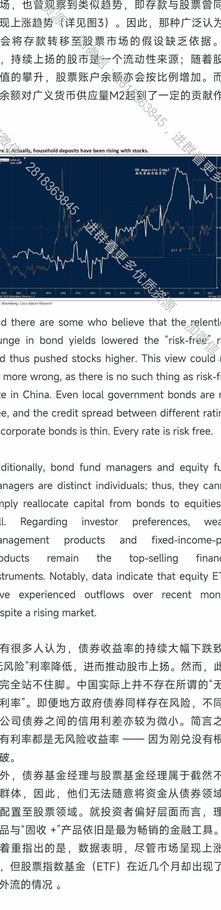
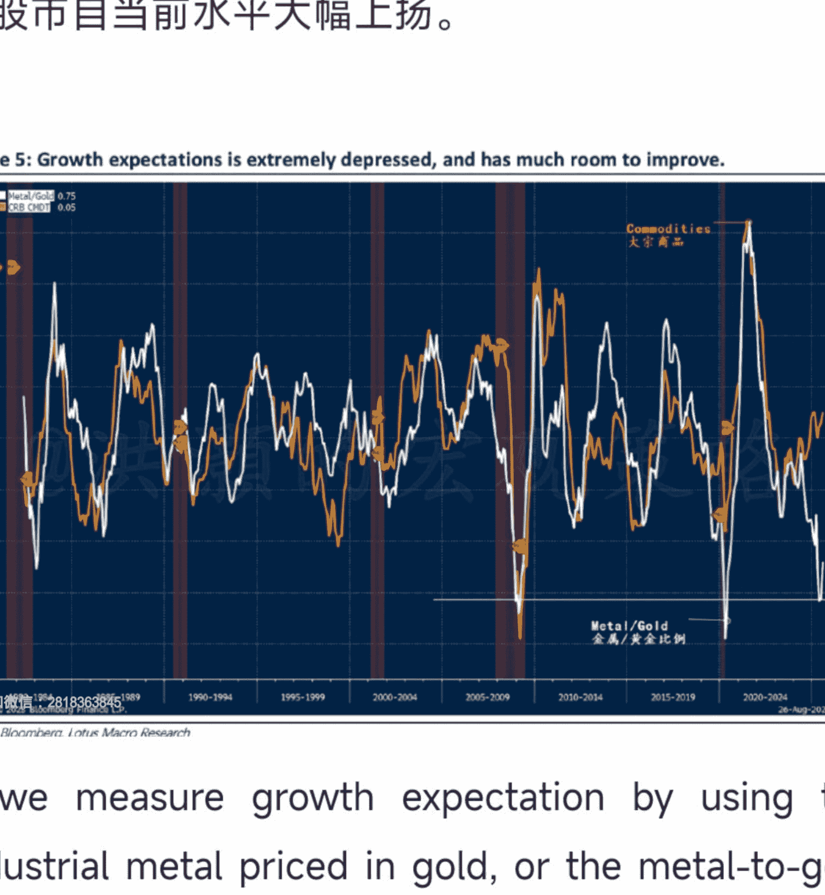

# 政策的困境：是否有反转可能？

2023-07-27
尽管政策面临困境，但反转真的可能吗？
对于美联储来说，它正面临着一个日益严峻的困境。美联储的政策……

# Depots Moving Into Stocks Not a Cause of a Bull

After a short and after a crash, the Shanghai Composite is hovering near 3400, a former level not remembered by most people. In David Powell's article titled '4000 is not enough', he argues that the depots moving into stocks are not a bull market but rather a short-term technical rally.

I have been invited to explain why the shift in China's bond market is a more significant de-fensive trend than the move into stocks.

In our previous report titled 'China's Anti-Inflation Trade', we discussed the current rally and the divergence between economic performance and financial growth. 

Japan's property market during the 1990s shows that China's deleveraging is in its early stages. The pattern leading to Japan's property bubble in the 1990s looks similar to what we see today.

Despite these efforts, indicators have not been able to signal the end of the bull market.

It is commonly noted that the shift of savings from stocks to bonds is a concern. However, this inflation deflation may correlate with consumption.

Our data demonstrates that household holdings have been increasing in parallel with stock holdings over the past two years. Similar trends have been seen in Europe and the US.

Furthermore, if the assumption that move into stocks is unfounded, then an inflationary deflationary balance account allocation will also increase these proportions relative to the total bond market supply.

Individual funds and bond funds are distinct industries; they differ in how they respond to interest rates. Regarding market performance, equity funds and product-linked funds remain the top selection investment. Note that ETFs have outperformed over recent months despite the bearish market.

# The Beijing Pivot

In our previous report titled 'China's Anti-Inflation Trade', we explained the fearing 'Yuan devalued' over the aggressive deflation policy as an important part of China's anti-inflation strategy. This could not mean that the market has changed, but it was reflected in key players in offshore sectors.

Although, the threat of deflation was somewhat diminished. The initiation of anti-inflation signal shows how the market may have changed, including which types of bonds and equities are expected to give into high-risk exposure.

在最近七月的政治工作会议中，政府再次强调要扩大经济的活力，并要采取更加积极的政策来提振需求。这反映了政府政策思路的转变。

在这一次，对于关注中国政策的投资者来说，更加积极的政策将增强信心，同时也释放了通胀回归的信号。这可能是市场反转的关键点。

然而，通胀回归的信号，并不意味着通胀已经到来了。

教学：281338345，深入学习知识，看要优化政策意的转变可能成为当前首的因素。关注其中一项长期政策，并且其重要性未获得市场的充分关注，在市场中的重视相对较少，所以它很可能作为牛的关键驱动因素。随着预期的逐渐减缓，当前首牛可能持续增长

If we measure growth expectation using the industrial metal priced, or the metal-to-gold ratio, we can see that the growth expectation is close to all time to, and around a level seen in the severe recessions during 2008 and 2020 (**Figure 5**). Given the Chinese economic cycle is such, and the market is in forward growth, I believe that such depressed growth expectation is excessive, indicates a contrarian trend for the bulls.

以黄金价格的工业金属价格，或者工业金属与黄金的比重衡量长期趋势，我们发现预期增长已与历史接近持平，并且处于2008年和2020年衰退期接近的时期（见图5）。鉴于中国经济周期处于阶段以及市场对未来增长的定性模型，我们认为这种增速的预期过于乐观。对于多头而言，这反映了反向趋势，相反了当前的交易氛围。

# Conclusion

We discussed the outlook of the bull market at Morgan Stanley Best Conference with our Chief Economist Chetan Ahya. We believe that the consensus view about how the bull market was initiated by household savings moving into stocks and falling bond yield has completely missed the point. Our data analysis and experience in the market do not support views.

在摩根士利中国峰会上，我们与我们的首席亚洲经济学家Chetan Ahya就当前前景进行了深入探讨。认为市场对通胀态度的转向是一个误解，这种误解引起了关于讨论的牛市。如果通胀压力有效，即使是短暂的，昂贵的增长将变得更加昂贵，与通胀性贸易相一致。中国市场的结构性转型可能会超出之外的预期。

Indeed, Beijing's pivot in its attitude towards the deflation trend is a misunderstanding and discussed the cause of the bull market. If the efforts are effective even for a brief period, expensive growth stocks will get even more expensive, consistent with a reflationary trade.

此外，市场对政策转向的理解尚未完全理解，对于此次市场上涨的诸多误导观点在广泛传播。这样的市场环境对于进一步而言，政策转向所产生的影响尚有限，市场尚未充分吸收。在本次行情中，我们将不会受到某些性波动的干扰，并将坚持站在增长立场，以换取更为广阔的上涨空间。

2021年6月
