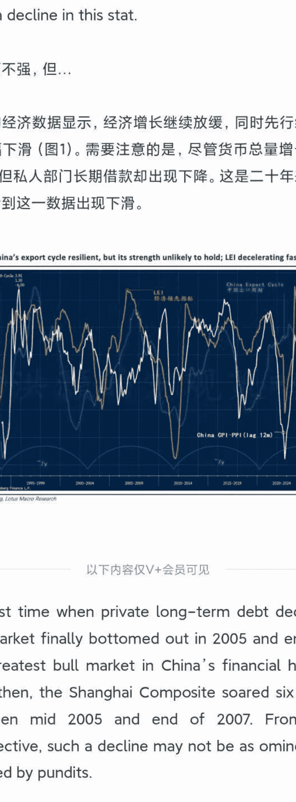
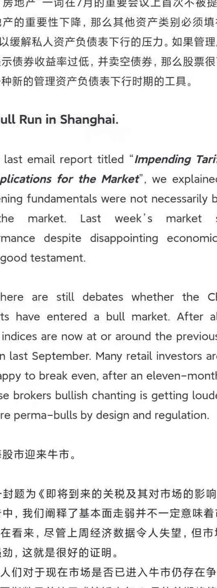
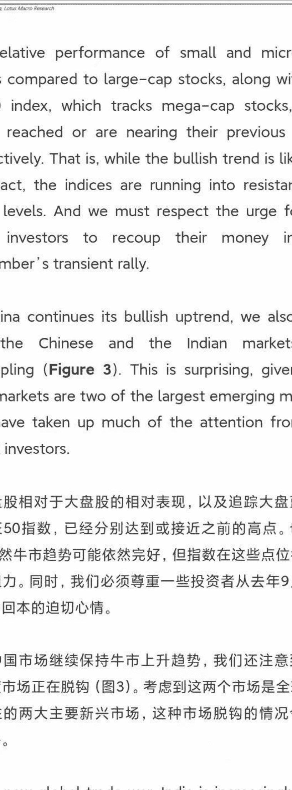

# 领先的上海股市

2023-8月24日

作者：沈锋

尽管中国股市一直处于低迷，但由于一系列政策的刺激，股市开始反弹。在过去几周内，股市经历了一轮强劲的反弹，这种反弹更多源于政策的利好。

# Weakening Fundamentals, But

最近的数据显示中国经济增长放缓，且领先指标（图 1）也处于低位。在这种背景下，股市的强劲反弹是出乎意料的。这是过去几个月来我们第一次看到这样的行情。

图 1：中国与印度股市表现对比（指数）

尽管基本面持续恶化，但市场自 2005 年以来一直是中国金融市场上表现最好的时期。

中国股市的领先指标（图 2）

从 2005 年到 2007 年期间，我们从未见过这样的行情，即在基本面恶化的情况下股市出现这种反弹。

出口周期的持续维持和贸易复苏是支撑股市的另一个重要因素。在 2008 年金融危机期间，中国实施了刺激政策后，这种反弹立即显现。直到 2009 年底，这种反弹才开始停止。

# Bull Run in Shanghai?

在过去几周内，我们看到中国股市进入了牛市，但基本面并没有好转。最近的数据显示中国经济增长放缓，这解释了为什么股市会出现如此强劲的反弹。

在 9 月底，我们是否会看到股市进入了牛市？这种牛市会持续多久？

# Conclusion
