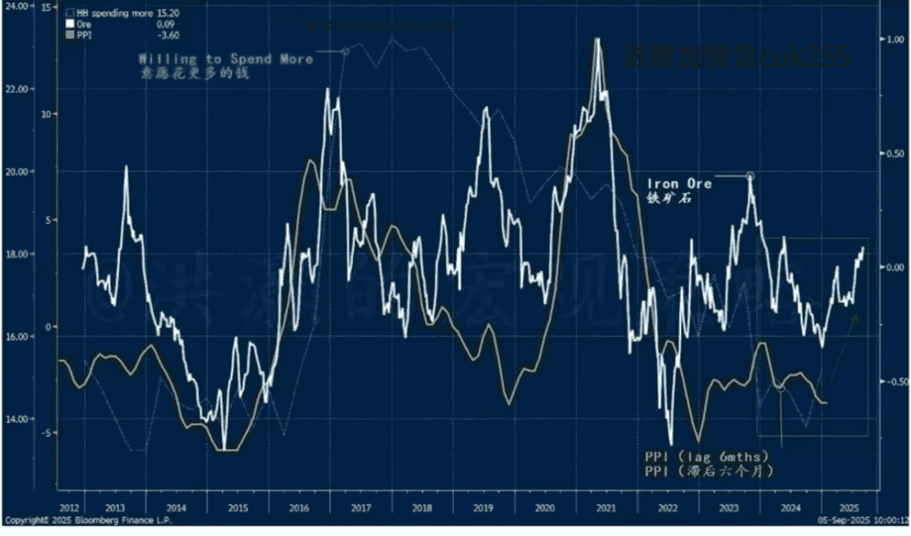
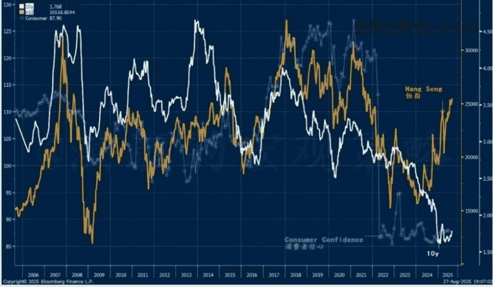
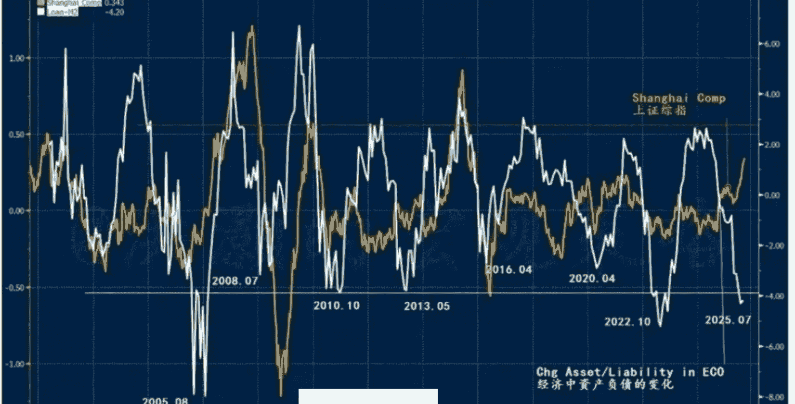

# 洪灏：中国资产负债周期多股市（单篇付费）

已付费 原创 经济学学家洪灏 洪灏的宏观策略

2025年09月22日 08:31 中国香港 1人

☆ 星标

## 前言

这个鲜为人知的周期看多中国市场。

过去两周，我们深入中国内地开展实地调研，与国内投资者进行了广泛交流。这段行程收获颇丰，我们亲身感受到近期股市上涨对消费与市场情绪的提振作用：客户增长明显回升，但北京社零售同比下降接近9%。越来越多投资者开始论股票，由于我们十六年前华尔街回归后在中国市场积累的研判经验和历史成绩，也有越来越多的投资者向我咨询。市场上即将来将出的利好因素也不绝于此。加微信cuk。

与此时，经济数据与股市表现形成明显反差。民间借贷增长虽近年来来收窄，若不是官方融资活动活跃，八月社会融资总量呈现增长。多城房地产销量和价格持续线下，房地产投资亦同步走弱。部分重点二线城市房价比偏软，我们在广东某些边缘地区目睹二手房价格八成却无人问津的。

这些房子的持有者弥漫着悲观的情绪——他们可能仅在数年前为投资或家庭储蓄配置而购买这些资产。

如今这些房产年收益仅万万许。正如股市大涨，这类不动产储蓄已迅速转化为股票投资。

进群微信cuk255

随着经济数据缓趋势日益明朗，市场共识普遍将其解读为经济刺激的前兆。正如我们此前报告所述，有关部门的工作重心已从风险管理转向刺激，从容忍通缩转向经济再通胀。

七月公布的雅越超级工程明确释放了政策转向信号（参见我们七月二十六日发布的报告《洪澜：雅鲁藏布牛》和九月一日发布的报告《洪澜：政策的拐点——牛市还能跑多远》）。若没有这种部门方向的转变，疲弱数据的本身只能反映现状，而不能自动化为经济引发——这正是我们的预判和市场共识的分歧所在（图表）。

值得注意的是，八月M2和M0增速差距进一步扩大。虽然两者皆属流动性指标，但中长期和短期货币量之间不断扩大的裂隙暗示风险偏好有所回归。正如我们前所周知，中国消费者信心依然徘于疫情以来的最低水平。这种匮乏引发效应导致中国市场物种已蛰伏多时，若没有政策引导难以再次复苏（图表二）。

虽然M2与M0增速差异一直是中国经济的领先指标，但需要注意这两项指标实侧量银行负债端，反映的是银行业体系内内存水平及其增长。鉴于中国正推进负债去杠杆，仅分析银行负债端意义有限。我们更应审视银行业产与负债端的比率，又或者是信贷与负债比率。

当我们用银行信贷资产调整其负债端数据后，有一个有趣的现象浮现（图表三）：中国行业资产-负债比例每次跌至历史低点时，都标志着重要市场底部来临。此时，中国市场往往出现强势反弹。这一周期的低谷与中国多次大底部基本吻合。

这是一个逆向的经济与市场的前瞻性指标。若信贷资产持续萎缩，资产收缩速度快于负债或货币供给增长，表明经济风险极高。在债务沉重的社会体系中，货币供给增加意味着债务扩张而非资产加速。当投资依赖债务驱动时，经济需要越来越依赖债务来支持资产与实体增长。

尽管房地产投资2021年达到高点，但目前正面临萎缩。这种房地产投资的下降，揭示了这正是我们的预判和市场共识的分歧所在。有关部门的工作重心已从风险管理转向刺激，从容忍通缩转向经济再通胀。若没有这种部门方向的转变，疲弱数据的本身只能反映现状，而不能自动化为经济引发——这正是我们的预判和市场共识的分歧所在。

## 结论

这是一个逆向的经济与市场的前瞻性指标。若信贷资产持续萎缩，资产收缩速度快于负债或货币供给增长，表明经济风险极高。在债务沉重的社会体系中，货币供给增加意味着债务扩张而非资产加速。当投资依赖债务驱动时，经济需要越来越依赖债务来支持资产与实体增长。
