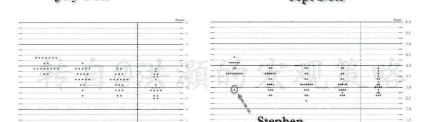
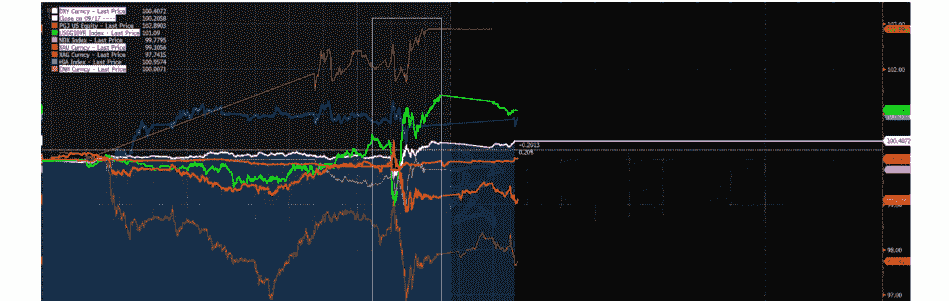
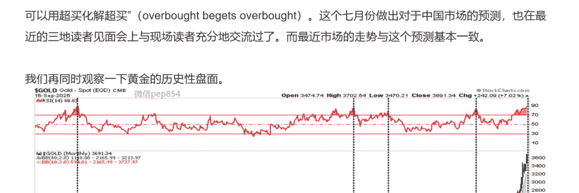
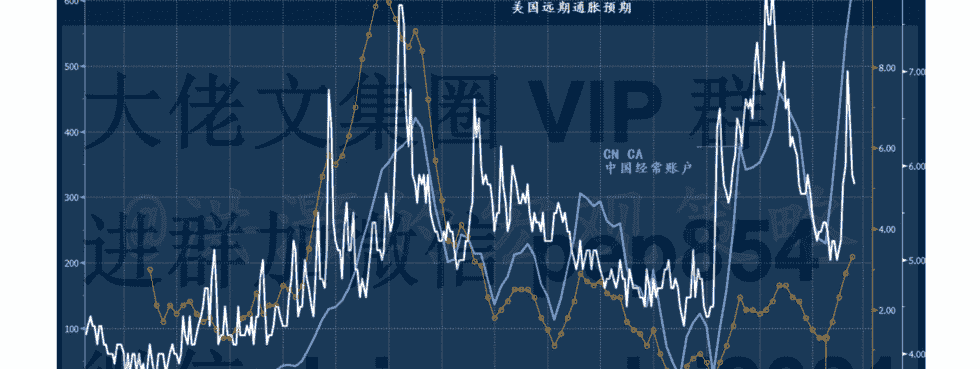

# 洪潮：宽欢吹起泡沫

洪潮的宏观策略 09-18 12:17

美联储宽松吹起泡沫。

昨夜，美联储如期降息25个基点。这是今年以来美联储第一次下降，也是近30年来美联储第一次在核心通胀依然维持在2.9%的情况下下降，也是我记忆中30年来美联储第一次在通胀历史高位附近的下降。

简单地说，这一次巨大的降幅充分满足了预期。在这次会议上，美联储调高了通胀预期和长期指引，但在降低了失业率预期的同时讨论了就业的下行风险。同时，上次会议有6位委员支持降息，本次会议支持降息的委员达到了9位。

点头委员的认为是，今年将下降50个基点，而特朗普籍“时”任命的新委员米兰（Miran）认为本次会议应该下降50个基点，并认为未来两次会议预计还需要下降五次。这个美联储货币政策转变将为特朗普的目标扫清阻碍。

大哥集团VIP群专属分享，付费加微信pep854 微信daizongdai2021

在会议上，赢钧或认为这些预测是矛盾的。对于通胀和就业率的预测，“现在并没有很多人支持这0个观点，你们应该把这次会议是一次风险管理型的预测”。从增长和通胀预测来看，这次预测是矛盾重重的。美国的美国ISM指数的价格指数依然在上升，而就业却在下降，一边通胀的面面的画面。是，在增长将好可能是通胀压力存在的情况下，也让市场莱夜的走势出现规律性的反弹。

可以看到，在美联储辟息25点后的美元、黄金和白银的下跌，美元的压力极其严重。在鲍息决的影响下，收益率也出现了短暂的暴跌。但是这些资产价格的走势很快就修复了（如黄金），甚至是转跌了（美元、美债）。有关中国的四个月里93%的时间都在超预期的期间，比如纳斯达克的中国股市表现表现。

我们将注意到主要资产类。例如黄金和资金，出现的这些长期资产的历史性面和概率的价格表现，那么美联储的辟息以及资本市场的反复意味着下一步的投资布局意义依然然。

经历了四月解放日的历史性暴跌和修复后，美股的指数再次迈入历史新高。如果现在的我们看到我们在过去的四个月里93%的时间都在超买区域的概率，大约是10000个交易日出现4天，或者，是每年都出现一次。这是一个极小概率事件。

当然，虽然我们的研究报告者说，我知道最近对于中国市场的预测，市场确实可能牛市我们，我们可以用超级泡沫解决（overbought oversight）这七个月份出了对于中国市场的预测，在最近的三个市场会面与访访者充分交流了。而在最近的市场的走势与这个预测基本一致。

我们一同复盘一下黄金的历史性局面。

黄金最近的走势已经超过了近几个月的平均跨度五、六五个，进入了历史的买卖区间。黄金再次引起关注，黄金的走势趋势出现了比此历史离均移动跨度更大的情况，由于离均幅度大约是历史的十分二。可以说，在地球几十年的历史里，这样的场面只出现过几次。

实际历史上，在布雷森森林体系建立后，黄金出现离均历史移动跨度加速增长的情况，只出现过几次：1980、2008、2011和2020。每次类似的领首，黄金就会出现加速增长的情况。这次黄金接近剧烈交易，黄金离近几个月平均移动跨度的幅度，远超过了前四次。我们以前在400年前左右就离场，在交易上留下了300美元的利息。

因此，黄金在现在的走势中是最近几个月移动跨度之后这一次历史性的转换。我们在上周期的《共震：以金银重构全球货币体系》报告中，讨论了这种模式的历史性得益。一个新的以金银和货币为挂钩的货币体系在快速增长。即便如此，我们还需要时间。

中美贸易对远期的影响来看，我们认为美国的通胀预期将居不下。这个观点，我们在读者面对会上已经反复讨论过，这是最近几个月债券市场收益率回升的原因之一。

在刚上任美联储的时候，他把美联储的货币政策推进了。美联储货币的目标是维持稳定（通胀），但美联储的工作还需要引导其控制收益率。我们都知道，美联储只能控制短端，长端是由市场决定的。当然，美联储并非唯一的下场。通过增加股市，中国也购买了这么多年。这些者在长端使得，长端的收益率不再完全反映经济增长。如此，对于资产配置意义已经然了。极端收益率很难涨，或者，对于投资者的机会已经开始了。投资者需要用长期的资产来替代。而对于银的成长，我们还没有看到市场份额扩大。这样的资产配置，其价值尚低。在投资者的组合中应该适当增加，这个很好，符合了黄金的历史规律和目前的几个月趋势，以及中国为科技创新的逻辑。大类资产，持续进行加微历史不会简单重复，但往往会重复。

# 大豪VIP 群（原价300，限时费249）包含以下全部内容送历史友：

- 吃瓜群众备时绘图实时群（原价365 元/年）
- 子明私享（会）（原价568 元/年）
- 政事室（子颜明）付费内选子明辑
- 米联储见【作者糯】（原价599 元/年）
- 欧洲会员专属文章（原价328 元/年）
- 砖瓦厂内部文档（原价400 元/年）
- 卢文青读书专属文章（原价699 元/年）
- 董赛财经奶奶知识星球（原价3310 元/年）
- 猫的视界知识星球（原价299 元/年）
- 大财周刊【独家新闻】原价1498 元/年）
- 杨世在钱榜（原价2200 元/年）
- 森森财经知识星球（原价1600 元/年）
- 凛洋译谈付费文章和全书藏版无割（原价2.3 万）
- 司马兰解读深度全选视频（民国史、帝国齿轮、不被理解的 MAO）（原价599 元）
- 卢克知识星球文章（原价268 元/年）
- 额外再送：闲新博专栏、村西里老王、三花九莉树

定期更新（更多资源写去了...）：
- 守人司令知识星球、拨响牛魔知识星球、生有财知识星球
- 创始笔记、达达演讲知识星球、成财财富君、雪花老刀头等
- A视野、大树义语、江初好、咏咩戏、上海学生等付费文集
- 西风付费文章、老溪、滚在八小时之外、局外的视界、升值计、老A体制内等等付费文章（每月不低于100 元的付费文章）

大豪集团 VIP综合群，原价300 元，现在仅需 249 元，包含以上所有内容：

大豪集团VIP专属文章，付费进加微信pepb854 免费优惠加微信daizongdai2021

daizongdai2021
大豪集团（微信不...
官方客服

长按识别二维码

微信信号号码（微信不
微信pepb854

长按识别二维码

