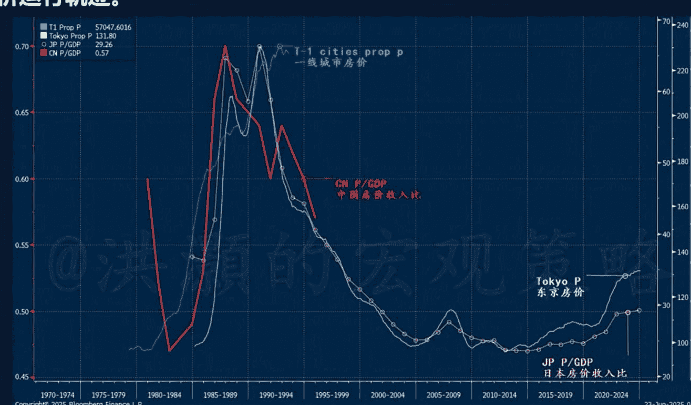
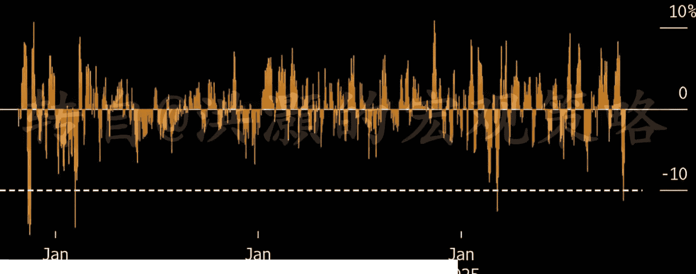
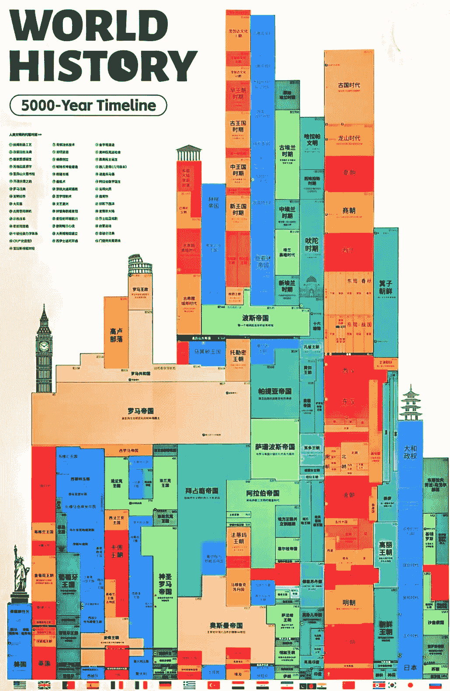

> alice 提问: 灏总，投资小白一枚，感谢灏总的这几年的黄金投资建议，把资产配置做了一部分分散投资，手上还有二三线城市5-6套砖头被套，灏总能否给个建议需要低位处理吗还是等待反弹？

作者：洪灏

摘录：洪灏的宏观策略

> 房价下跌的趋势大概率还没有结束（如图），但是每个地方的房价都有自己的特点，因此不能一概而论。比如这几年上海、北京、香港的房价比广州的房价坚挺得多。核心地段的房价比其它地段的房价坚挺得多。

一般来说来说，一个家庭三套房子就可以了，多余的卖掉。尤其是如果有更好的投资机会可以回本。我知道这个答案不是您想要的…… 祝顺利。

作者：洪灏
摘要：洪灏的宏观策略

深度视野VIP群 人工追踪50+大V 付费进群加微信cuk255 微信chp5568

## 中日房价运行轨迹。

资料来源：SAFE; PBOC; Bloomberg

> 全球黄金ETF SPDR Gold Trust持仓量为1046.98吨，较前一个交易日减少5.44吨。相信其它黄金ETF也会有不同程度的减持。

全球最大白银ETF--iShares Silver Trust持仓较上一交易日减少49.39吨，当前持仓量为15419.81吨。

本周是高价势能策略遭遇大幅回撤的一周，最显著的是黄金白银金属的价格趋势崩盘。洪潮：对于金银贵金属崩盘最权威的解读（单篇付费）。到10月10日，规模200亿美元的文艺艺术复兴股票基金损失了15%。其它多空策略基金本月回撤1.7%，但是美股本周上涨。

在我最近的付费专属报告洪潮：利暴潮再起，中国先声夺人中，我分享了我的量化模型测量出市场风格从成长到价值的转变。看来东西方概莫能免。

作者：洪潮
췌自：洪潮的宏观策略

深度视野VIP群 人工追踪50+大V 付费群加微信cuk255 微信chps568

> 本周，价格势能因子崩塌。一个多空策略基金一周就回撤了11%。但从过去三年的数据来看，这种势能的崩塌，如2022年10底和今年四月，却往往伴随着市场见底的行情。

作者：洪灏
摘自：洪灏的宏观策略

深度视野VIP群 人工追踪50+大V 付费进群加微信cuk255 微信chp5568

# Momentum Factor Suffers Big Losses

One pair trade slid more than 11% over the five days ending Wednesday

Morgan Stanley Momentum Long-Short Basket - 5-Day % Change

Source: Morgan Stanley
Bloomberg

## 洪灏的主题

2025/10/26 上午 8:08

中美会谈“非常有建设性”（外媒体报道）

美方表示，马来西亚贸易谈判的第一天后，讨论“非常建设性”。当前的“贸易停火协议”11月10日到期。

> 来自：洪灏的宏观策略
洪灏 创建；4300+ 人都在这里交流

> 不觉提问：洪总你好，有点疑惑。在你这里解惑：如果市场在3950处见底，这不会与管理层的慢牛相悖，这个还会不会显得有点高？或者市场见底前还有一次极速寻底过程呢？近期A的成交量持续萎缩，周五在对会议符合预期解读的基础上，当天涨了27个点，指数也新高，虽然当天增量3000多亿，但总量却不到2万亿，这样的量价背离是见底的信号吗？谢谢！

作者：洪灏
摘要：洪灏的宏观策略

深度视野VIP群 人工追踪50+大V 付费进群加微信cuk255 微信chp5568

> 我今天早上讲的是美股价格势能崩塌，往往伴随着市场低位的情况。其实，A股早在几周前就开始价格势能崩塌了。比如之前创新新药跌跌不休。慢牛是一个美好的愿景，但是中国市场很少出现慢牛。同时，价量背离这个技术信号回测的胜率其实并并不高（如图，下面打红圈的时候），更不能以单一的指标来判断涨跌的依据。反而，RSI背离信号在更高阶的时间窗口里胜率可达到60%以上。

现在的市场显然是以宏观主导的。

作者：洪灏
摘录：洪灏的宏观策略
深度视野VIP群 人工追踪50+大V 付费进群加微信cuk255 微信chp5568

# SSE50 Index

3045.816 18.912 0.62% At 10/24/25
Price Chart 1Y 10/24/25 Period: 1D
- Start 26683.250
- High on 10/24/25 3052.819
- Change 362.4910 (13.5%)
- Low on 04/07/25 2457.0800

- Volume 5.12B
- SMA(15) 2836B

深度视野VIP群 人工追踪50+大V 付费群加微信cuk255 微信ch558

> 中美会谈“非常有建设性”（外媒报道）美方表示，马来西亚贸易谈判的第一天后，讨论“非常有建设性”。当前的“贸易停火协议”11月10日到。

作者：洪灏
摘要：洪灏的宏观策略

深度视野VIP群 人工追踪50+大V 付费群加微信cuk255 微信ch556

看来突破了。本周线需确认，但应是大概率。本周确认后，第一目标到达略低于1400。

作者：洪灏
摘录：洪灏的宏观策略

深度视野VIP群 人工追踪50+大V 付费群加微信cuk255 微信ch556

> 5000年世界历史：华夏文明似乎内敛，并没有吞并其它文明，而是东亚文明似乎都是自我为中心。西方文明更具有侵略性，罗马、拜占庭、阿拉伯和奥斯曼帝国，都横跨几个文明

作者：洪灏
摘录：洪灏的宏观策略

VIP50+大V 付费群加微信cuk255 微信ch556

# WORLD HISTORY
# 5000-Year Timeline

- 公前5000年
- 公前4000年
- 公前3000年
- 公前2000年
- 公前1000年
- 公前500年
- 公元0
- 公元500年
- 公元1000年
- 公元1500年
- 公元2000年
- 公元2500年
- 公元3000年
- 公元3500年
- 公元4000年
- 人类文明的起源
- 旧石器时代
- 新石器时代
- 青铜器时代
- 铁器时代
- 农耕文明
- 游牧文明
- 古代文明时期
- 中世纪时期
- 近代时期
- 大航海时期
- 工业革命时期
- 现代时期
- 数字化时代
- 古希腊文明
- 美索不达亚文明
- 苏米尔文明
- 古埃及文明
- 古印度河流域文明
- 古中国文明
- 古希腊时期
- 古罗马时期
- 古波斯文明
- 阿斯兰文明
- 亚历山大帝国
- 罗马帝国
- 拜占庭帝国
- 阿斯兰黄金时代

美索不达亚
- 古埃及时时期
- 夏朝时期
- 商朝时期
- 西周时期
- 春秦时期
- 汉时期
- 三国时期
- 古希腊
- 古罗马时期
- 罗马帝国
- 阿斯王朝
- 唐朝
- 五代十国
- 宋时期
- 北宋时期
- 南宋时期
- 元朝
- 明朝
- 清朝
- 现代时期
- 古欧洲时期
- 中世纪欧洲
- 阿斯兰时期
- 阿拔王朝
- 塞尔柱帝国
- 奥斯曼帝国
- 俄罗斯帝国
- 莫卧王朝
- 印度帝国
- 哥伦王朝
- 大英帝国
- 现代时期

> fhingwei 提问：洪总您好！目前中国的房价是否已经调整差不多了，如果还没有到位，下行的空间还有多少？之前你文章中提到从图表看，国内房价有走跟日本相似的形态，我想在福建厦门买一套房子，是自自住。不知道目前时间点是否合适？还是再等一两年。谢谢

作者：洪灏
摘录：洪灏的宏观策略

深度视野VIP群 人工追踪50+大V 付费进群加微信cuk255 微信chp5568

> 厦门房价还在下行趋势中（如图）。地缘政治也会显著影响房价的走势。如果有一笔钱

作者：洪灏
摘录：洪灏的宏观策略

> 洪潮：利湿再起

我今天早上讲的是美股价格势能崩塌 往往往往伴随着市场低位的情况。其实，A股早在几周前就开始价格势能崩塌了。比如之前创新新药跌跌不休。慢牛是一个美好的愿景，但是中国市场很少出现慢牛。同时，价量背离这个技术信号回测的胜率其实并并不高

>

- 公前5000年
- 公前4000年
- 公前3000年
- 公前2000年
- 公前1000年
- 公前500年
- 公元0
- 公元500年
- 公元1000年
- 公元1500年
- 公元2000年
- 公元2500年
- 公元3000年
- 公元3500年
- 公元4000年
- 人类文明的起源
- 旧石器时代
- 新石器时代
- 青铜器时代
- 铁器时代
- 农耕文明
- 游牧文明
- 古代文明时期
- 中世纪时期
- 近代时期
- 大航海时期
- 工业革命时期
- 现代时期
- 数字化时代
- 古希腊文明
- 美索不达亚文明
- 苏米尔文明
- 古埃及文明
- 古印度河流域文明
- 古中国文明
- 古希腊时期
- 古罗马时期
- 古波斯文明
- 阿斯兰文明
- 亚历山大帝国
- 罗马帝国
- 拜占庭帝国
- 阿斯兰黄金时代

- 美索不达亚
- 古埃及时时期
- 夏朝时期
- 商朝时期
- 西周时期
- 春秦时期
- 汉时期
- 三国时期
- 古希腊
- 古罗马时期
- 罗马帝国
- 阿斯王朝
- 唐朝
- 五代十国
- 宋时期
- 北宋时期
- 南宋时期
- 元朝
- 明朝
- 清朝
- 现代时期
- 古欧洲时期
- 中世纪欧洲
- 阿斯兰时期
- 阿拔王朝
- 塞尔柱帝国
- 奥斯曼帝国
- 俄罗斯帝国
- 莫卧王朝
- 印度帝国
- 哥伦王朝
- 大英帝国
- 现代时期

## 深度视野VIP群 人工追踪50+大V 付费群加微信cuk255微信chps568

## 深度视野VIP群 人工追踪50+大V 付费进群加微信cuk255 微信chp5568

## 深度视野VIP群 人工追踪50+大V 付费进群加微信cuk255 微信chp5568

## 深度视野VIP群 人工追踪50+大V 付费群加微信cuk255 微信ch5568

## 深度视野VIP群 人工追踪50+大V 付费群加微信cuk255 微信ch556

## 深度视野VIP群 人工追踪50+大V 付费群加微信cuk255 微信ch556-8

## 深度视野VIP群 人工追踪50+大V 付费群加微信cuk255 微信ch556

## 深度视野VIP群 人工追踪50+大V 付费群加微信cuk255 微信ch556

## 深度视野VIP群 人工追踪50+大V 付费群加微信cuk255 微信ch556

## 深度视野VIP群 人工追踪50+大V 付费群加微信cuk255 微信ch556

## 深度视野VIP群 人工追踪50+大V 付费群加微信cuk255 微信ch556

## 深度视野VIP群 人工追踪50+大V 付费群加微信cuk255 微信ch556

## 深度视野VIP群 人工追踪50+大V 付费群加微信cuk255 微信ch556

## 深度视野VIP群 人工追踪50+大V 付费群加微信cuk255 微信ch556

## 深度视野VIP群 人工追踪50+大V 付费群加微信cuk255 微信ch556

## 深度视野VIP群 人工追踪50+大V 付费群加微信cuk255 微信ch556

## 深度视野VIP群 人工追踪50+大V 付费群加微信cuk255 微信ch556

## 深度视野VIP群 人工追踪50+大V 付费群加微信cuk255 微信ch556

## 深度视野VIP群 人工追踪50+大V 付费群加微信cuk255 微信ch556

## 深度视野VIP群 人工追踪50+大V 付费群加微信cuk255 微信ch556

## 深度视野VIP群 人工追踪50+大V 付费群加微信cuk255 微信ch556

## 深度视野VIP群 人工追踪50+大V 付费群加微信cuk255 微信ch556

## 深度视野VIP群 人工追踪50+大V 付费群加微信cuk255 微信ch556

## 深度视野VIP群 人工追踪50+大V 付费群加微信cuk255 微信ch556

## 深度视野VIP群 人工追踪50+大V 付费群加微信cuk255 微信ch556

## 深度视野VIP群 人工追踪50+大V 付费群加微信cuk255 微信ch556

## 深度视野VIP群 人工追踪50+大V 付费群加微信cuk255 微信ch556

## 深度视野VIP群 人工追踪50+大V 付费群加微信cuk255 微信ch556

## 深度视野VIP群 人工追踪50+大V 付费群加微信cuk255 微信ch556

## 深度视野VIP群 人工追踪50+大V 付费群加微信cuk255 微信ch556

## 深度视野VIP群 人工追踪50+大V 付费群加微信cuk255 微信ch556

## 深度视野VIP群 人工追踪50+大V 付费群加微信cuk255 微信ch556

## 深度视野VIP群 人工追踪50+大V 付费群加微信cuk255 微信ch556
