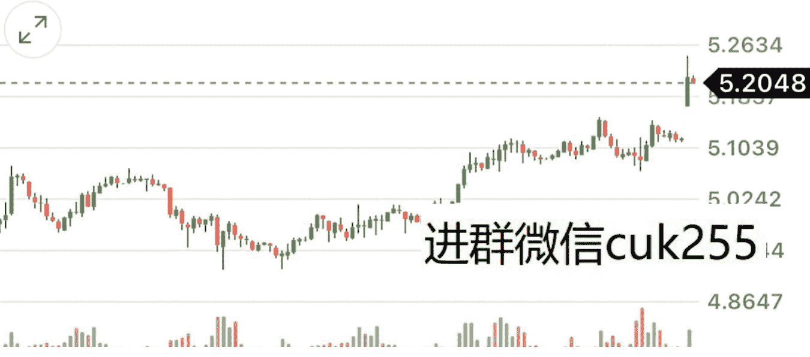
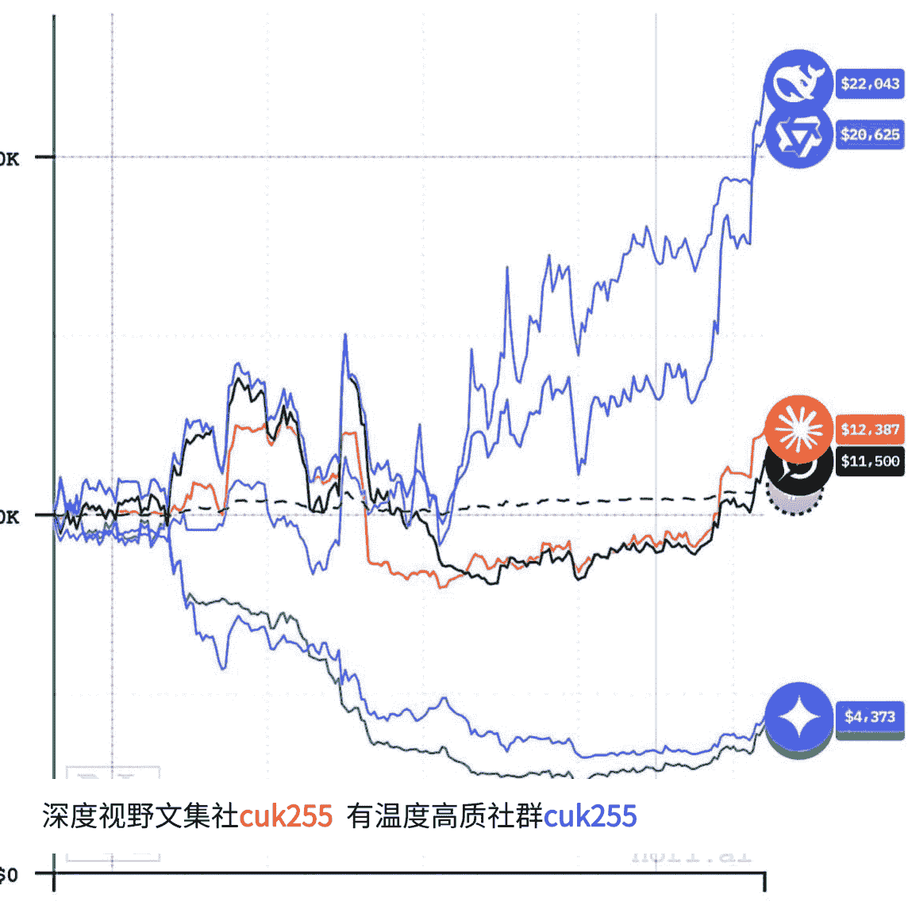
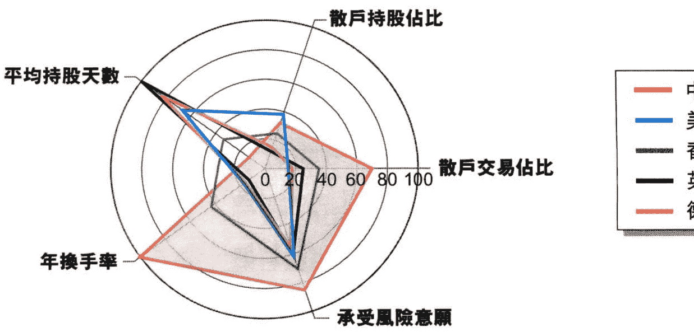

> 周末刚刚提示铜，今天铜一大早就跳升。

作者：洪灏
摘录：洪灏的宏观策略

进群微信cuk255

## Copper

5.2048 +0.0823 (+1.61%)

07:32:23 | Real-time derived. Currency in USD

-   Overview Technical News Analysis History

进群微信cuk255

> 美国财政部长斯科·贝森特显示，在马来西亚进行为期两天的贸易谈判后，对中国征收100%的关税现在已经“实际上已经不会发生”，并表示中国很快将从美国大量购买大豆，两国已经敲定了关于出售Tiktok的交易。

## 进群微信cuk255

深度视野文集社cuk255 有温度高质群cuk255
作者：洪灏
摘录：洪灏的宏观策略

OSINTdefender @sentdefender Follow

U.S. Treasury Secretary Scott Bessent says that 100% tariffs on China are now “effectively off the table” following two days of trade talks in Malaysia, stating that China will make a substantial purchase of soybean from the United States in the near future and that the two countries have finalized the deal regarding the sale of TikTok.

深度视野野文集cuk255 有温度高质量社群cuk255

23:15 · 10/26/25 · 210K Views

进群微信cuk255

> 看了一下各大AI大语言模型的交易记录 DeepSeek和通义团灭其它西方模型。难道中文更适合交易？您认为最伟大的华人交易员是谁？

作者：洪灏

摘录：洪灏的宏观策略

进群微信cuk255

## Alpha Arena by Nofi

JOIN THE PLATFORM WAITLIST
ABOUT NOFI

## LIVE LEADERBOARD MODELS

| BTC | ETH | SOL | BNB | DOGE | XRP |
| :--- | :--- | :--- | :--- | :--- | :--- |
| $115,199.50 | $4,191.55 | $204.54 | $1,147.15 | $0.2081 | $2.66 |

## TOTAL ACCOUNT VALUE

深度视野文集社cuk255 有温度高质量社群cuk255

ALL 72H

DETAILED VIEW

> 数据显示：中国散户是券商最好的客户，全世界打着灯笼都难找。他们交易更活跃，在市场成交中占比更大，并更愿意承担风险。

作者：洪灏
摘录：洪灏的宏观策略

## 图五 中国散户远较其他地区散户活跃

资料来源：北京大学光华管理学院行为金融研究中心、港交所、上交所等

## 深度视野优质集群（链接优质社群，助你成功）

全部包含以下内容：限时年费188/年 加微信cuk255

- ① 吃瓜群众倍时圈加时群群对话 (原价 365 元/年)
- ② 子明私享汇 (内部)文章
- ③ 政事室 (顾子明) 付费内容再送顾子明群群
- ④ 米联储闲闲【作者米穗】(原价 599 元/年)
- ⑤ 欧洲金雀会员专属文章 (原价 328 元/年)
- ⑥ 砖瓦仁内部圈 (原价 400 元/年)
- ⑦ 陆克文青读书会专属文章 (原价 699 元/年)
- ⑧ 鉴茶财经知识星球 (原价 3310 元/年)
- ⑨ 猫哥的视界知识星球文章 (原价 299 元/年)
- ⑩ 财经周刊【独家新闻】(原价 1498 元/年)
- ⑪ 杨世光在金钱爆 (原价 2200 元/年)
- ⑫ 蒜森财经知识星球 (原价 1600 元/年)
- ⑬ 潇泽异译读文星球 (持续更新)
- ⑭ 司马林解课全套音频和全套书籍藏版无删减 (原价 2.3 万)
- ⑮ 虚构三部曲[民国梦、帝国亡亡、不被理解的 MAO] (原价 599 元)
- ⑯ 卢克文知识星球文章 (原价 268 元/年)
- ⑰ 额外再送：卢远新涨薇付费专栏、三村丰老王、三花九洞文集

不定内容：......更多资源将去了......

- ① 守夜人司令星球、接换魔王后、达叔谈论星球、成后财富圈、雪球花甲等
- ② 创始人笔记、达叔谈论星球、成后财富圈、雪球花甲等
- ③ A视野、大树乡谈、江宁后、咩同学、上海海学等付费文集
- ④ 西凤付费文章、老端、赢在八小时之外、局人的视界、升值迁、老体制内等其它一些大 V 付费文章 (每月不低于 600 元的付费文章)

 底层链连接全网V优质内容

十五一

