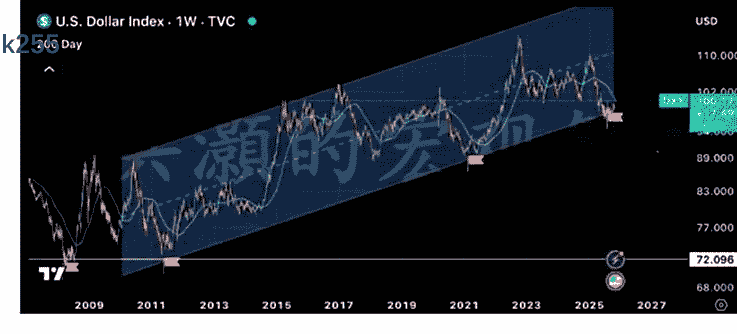
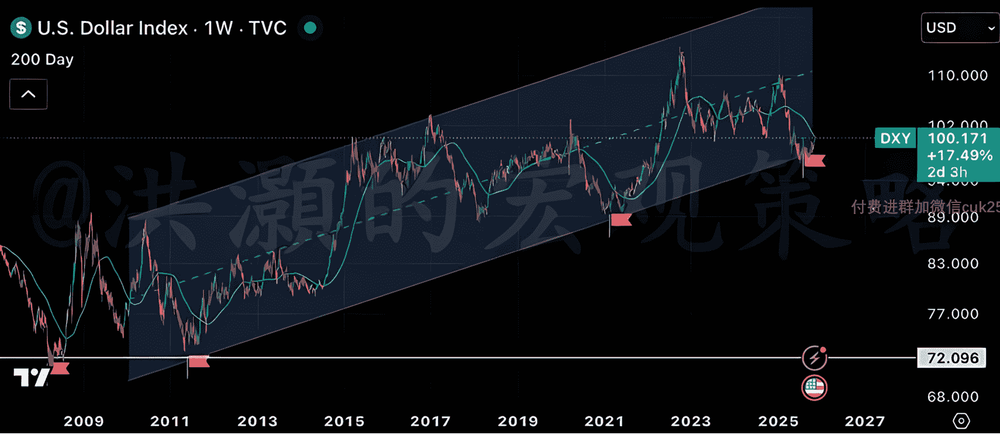

# 洪灏 星土
2025/11/06 05:14

美元指数破百，并无限接近200天线。突破是大概率事件，且是年末行情的重要指标之一。

付费进微信群cuk255

指月淼：洪帅真早

杨晓龙：洪帅早上好[得意]

Patrick.Ch*: 哇，沙发，哈哈

公羽添心宾*: 句子牛哥*:早上好

尼古拉斯.唐：洪老师，早上好

魔术师：洪帅这是深夜盘呢，还是就起床呢[抱拳]

Alyxxxx：你好，请问后市是否可以理解为伴随美元指数突破扼杀一波短线流动性，释放美股估值风险的同时，将彻底一步到位到位，随后将跟随停止缩表，甚至扩表

魔术师：黄金也不甘示弱

更多优质内容：微信cuk255

## U.S. Dollar Index · 1W · TVC

200 Day

更多优质内容：微信cuk255

## 美国最高法院对特朗普全球关税的合法性表示怀疑。如判定非法，可能引发超过1000亿美元的退款。对等关税和芬太税有60%的概率被视为非法（彭博社报道）

补充解读：这是因为特朗普引发国际紧急经济法案、绕过国会立法而征关税，没有通过正式程序而是通过总统命令开启关税。但是美国的贸易赤字并没有造成“经济紧急情况”。同时，如此滥用行政权力对全球征关税，那么同样的逻辑也可以让特朗普单对外宣战。但是宣战的唯一权力在于美国国会。

阿白：真呆[太阳]

芒果果茶里：政府都关门了，为了不退款概率不会遇到违法

Alex: 我明白这是为了保持法律的合法性公正性或者告诉全球投资者 美国依旧是最

## 深度视野优质集圈（链接优质社群，助你成功

全部包含以下内容：限时年费188/年 加微信cuk255

- 1 吃群众粉丝倍时文档加时群聊对话（原价 365 元/年）
- 2 子明私享汇（含）内部文章（原价 568 元/年）
- 3 政事室（顾子明）财经内容加送顾子明群
- 4 米联储闲【作者米栖】（原价 599 元/年）
- 5 欧洲金雀会员专属文章（原价 328 元/年）
- 6 砖夺瓦内部文档（原价 400 元/年）
- 7 卢克青文读书会专属文章（原价 699 元/年）
- 8 鉴茶财经知识星球（原价 3310 元/年）
- 9 猫哥的视界知识星球（原价 299 元/年）
- 10 十财经周刊【刘家刚】（原价 1498 元/年）
- 11 杨世光在金钱树（原价 2200 元/年）
- 12 森淼财经知识星球（持续更新）
- 13 潇译译付文星球（持续更新）
- 14 司马林解读全套音频和全套书籍珍版无割（原价 2.3 万）
- 15 虚虚三部曲[民国梦、帝国争霸、不被理解的MAO](原价 599 元）
- 16 卢克文知识星球文章（原价 268 元/年）
- 17 额外再送：卢祺元新浪微博付费专栏、三村丰老王、三花九树文集

不定期内容：—————（更多资源不写下去了……）

- ① 守夜人司令知识星球、接换魔王知识星球、成术付财富、雪花柯老头
- ② 创始人笔记、达叔谈论星球、成术付财富、雪花柯老头
- ③ A 视野、大树树、江江后、泮咩说、上海家学等付费文集
