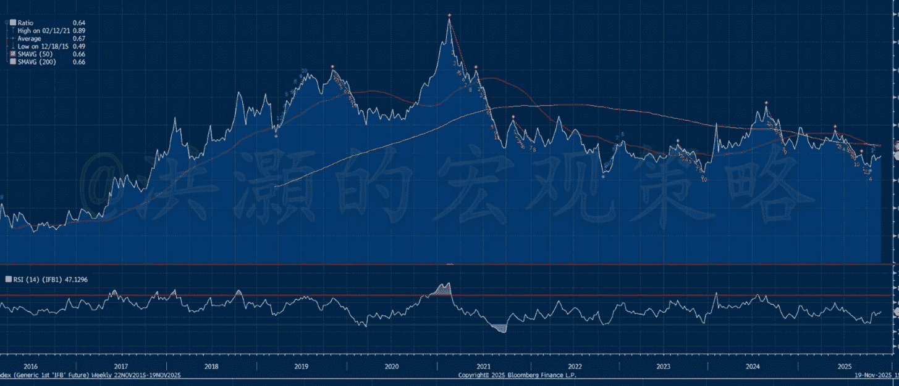
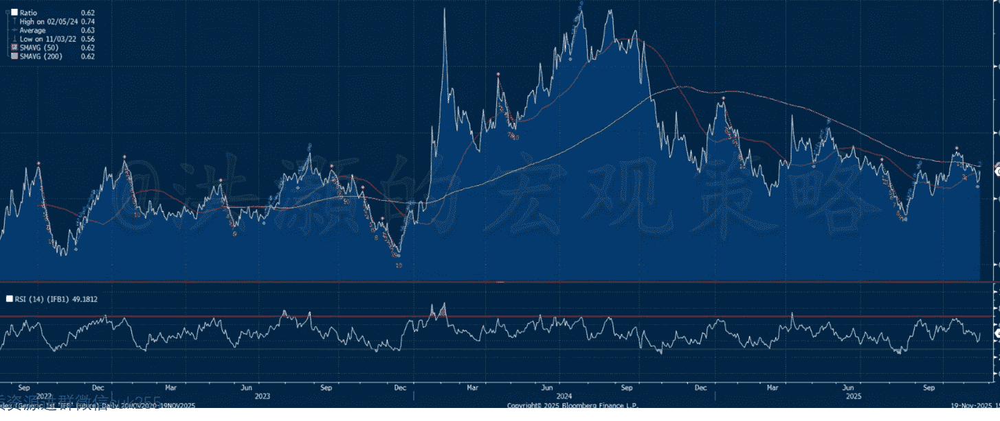
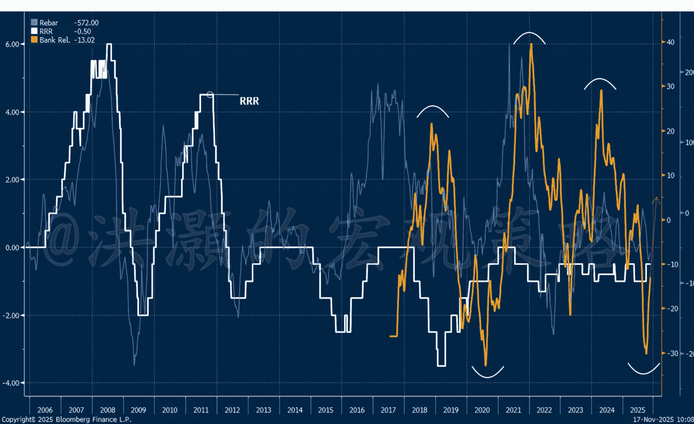
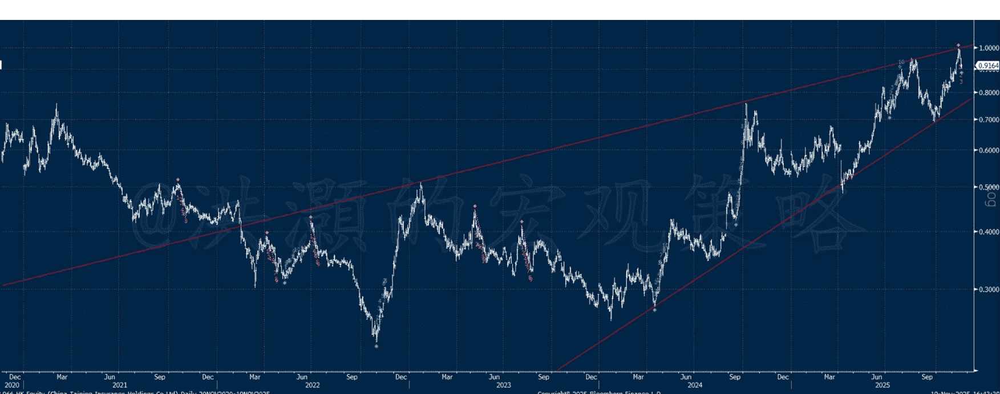

> 中国加快了购买美豆，结束了之前的暂停，履行上上个月达成的贸易休战协议。（彭博社）

作者：洪灏
摘录：洪灏的宏观策略

> 昨天，比特币一度跌破9万，从高点回调了30%。自2017年以来，比特币经历过：
- 10多次25%以上的暴跌；
- 6次50%以上的暴跌；
- 3次75%以上的暴跌。

作者：洪灏
摘录：洪灏的宏观策略

> 300/500、300/1000 都是从弱势开始修复的，从成长到价值的轮动依然在进行着。

作者：洪灏
摘录：洪灏的宏观策略

# 市场的宏观策略

Copyright ©2025 Bloomberg Finance L.P.

# 市场的宏观策略

Copyright ©2025 Bloomberg Finance L.P.

> 向价值板块的轮动依然在进行中。

作者：洪灏
摘录：洪灏的宏观策略

一手优质资源进群微信cuk255

> 保险板块的估值修复依然在继续。

作者：洪灏
摘录：洪灏的宏观策略

一手优质资源进群微信cuk255

## 深度视野优质集团（链接优质社群，助你成功）

全部包含以下内容：限时年费188/年 加微信cuk255

- ① 吃瓜群众倍帝星球圈加时群群（原价365 元/年）
- ② 子明私享汇（内部）优秀文章
- ③ 政事室（顾子明）付费内容加送随子明群
- ④ 米联锦暇【作者米穗】（原价599 元/年）
- ⑤ 欧洲金雀会员专属文章（原价328 元/年）
- ⑥ 砖瓦仁内部圈（原价400 元/年）
- ⑦ 卢克青文读书会专属文章（原价699 元/年）
- ⑧ 鉴茶财经知识星球（原价 3310 元/年）
- ⑨ 猫哥的视界知识星球文章（原价299 元/年）
- ⑩ 财新周刊【独家新闻】（原价1498 元/年）
- 十 杨世光在金钱坝（原价2200 元/年）
- ⑫ 蒜森财经知识星球（原价1600 元/年）
- ⑬ 潇泽异译付费文章（持续更新）
- ⑭ 司马林解读课全套音频和全套书籍版权无删减（原价 2.3 万）
- ⑮ 虚构三部曲民国梦、帝国争亡、不被理解的 MAO（原价 599 元）
- ⑯ 卢克知识星球文章（原价 268 元/年）
- 额外再送：卢麒元新微博付费专栏、三村丰老王、三花九树文集

不定期内容：（更多资源写不下了）......

- ① 守护人司令知识星球、接换魔王知识星球、成术开财富、雪球花甲头等
- ② 创始人笔记、达叔谈论星球、成术开财富、雪球花甲头等
- ③ A 视野、大树乡谈、江初序、咩说、财上海家学等付费文集
- ④ 西风付费文章、老端、赢在小时之外、局外人的视界、升值、老A体制内等其它一些V付费（每月不超过600 元的付费文集）

限时年费188/年

## 深度视野文集进群微信cuk255

深度视野（付费文集）

## 底层链接连接全网V优质内容
