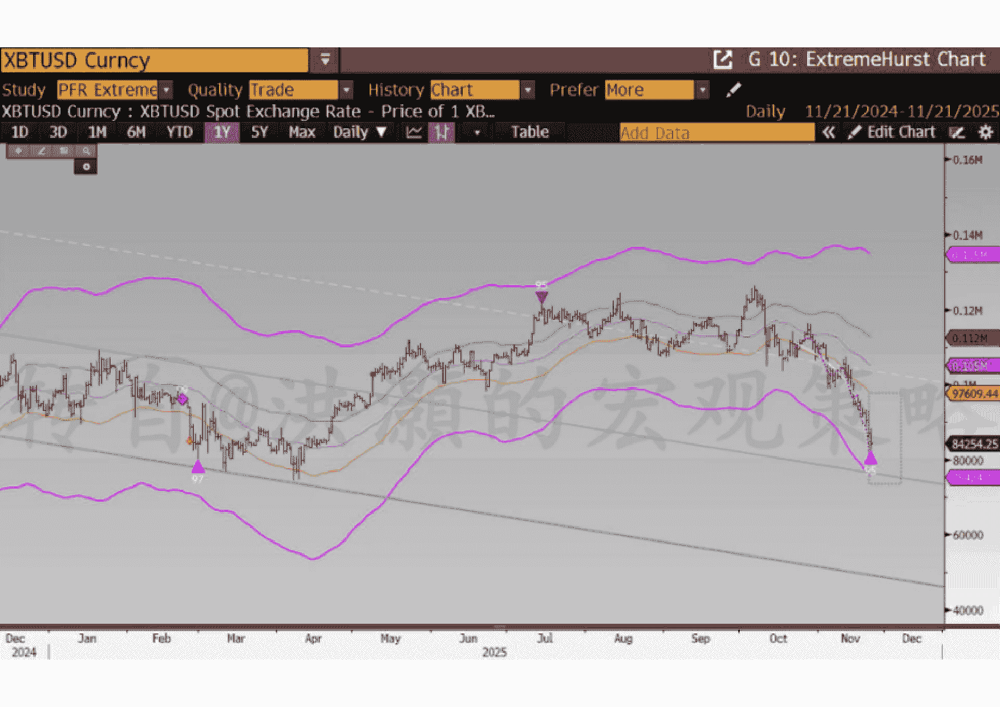
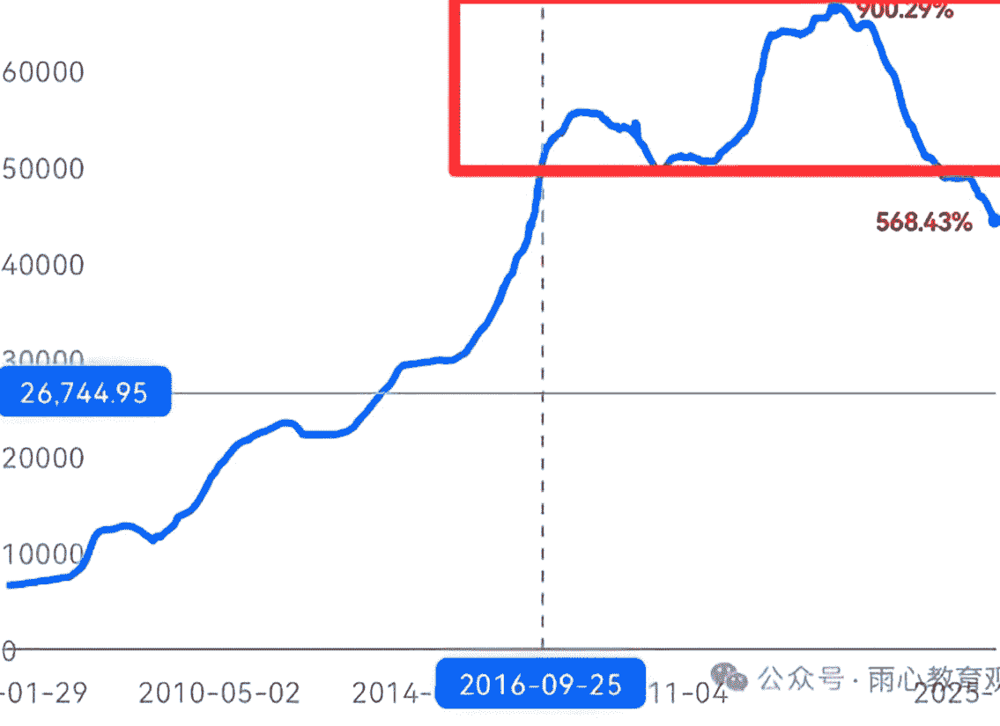

> 比特币在这个位置应该开始技术反弹。

作者：洪灏
摘录：洪灏的宏观策略

# 上海房价走势图

作者：洪灏
摘录：洪灏的宏观策略

# 上海冰山成交指数 2025.10.19

49857 排名 9 成交量 -- 议价率 9.2%
+2568 4.9% 年同比 44% 量比 -- 换手率 16%
总涨幅 650% 反弹 0% 冰山分 --

+ 周报 月报 1年 3年 6年 全部

均线

# 深度视野优质集群（链接优质社群，助你成功）

全部包含以下内容：限时年费188/年 加微信cuk255

- ① 吃瓜群众倍时圈加时群群对话（原价 365 元/年）
- ② 子明享汇（内部）文章（原价 568 元/年）
- ③ 政事室（顾子明）付费内容再送顾子明群聊
- ④ 米联储闲闲【作者米穗（原价 599 元/年）
- ⑤ 欧洲金雀会员专属文章（原价 328 元/年）
- ⑥ 砖瓦斥内部圈文（原价 400 元/年）
- ⑦ 卢克文青学读书会专属文章（原价 699 元/年）
- ⑧ 鉴茶财经知识星球（原价 3310 元/年）
- ⑨ 猫哥的视界知识星球文章（原价 299 元/年）
- ⑩ 财新周刊【独家新闻】（原价 1498 元/年）
- ⑪ 扬世光在金钱爆发（原价 2200 元/年）
- ⑫ 莱森财经知识星球（原价 1600 元/年）
- ⑬ 潇源异译付费文集（持续更新）
- ⑭ 司马林解读课全套音频和全套书籍收藏版无损减（原价 2.3 万）
- ⑮ 虚构三部曲[民国梦、帝国争合、不被理解的 MAO]（原价 599 元优）
- ⑗ 克星球（原价 268 元/年）
- ⑰ 额外再送：卢薛新浪薇捞付费文专栏、三村丰老王、三花九术文集

不定内容：......（更多资源将下去了......

- ① 守夜人司令知识星球、接换魔王星球、成后财富圈
- ② 创始人笔记、达越谈论星球、成后财富圈、雪花披甲头部等
- ③ A 视野、大树乡谈、江初优、咩咩说、上海海家等付费文集
- ④ 西凤付费文章、老端、赢在八小时之外、局外的视界、升值、老A体制内等其它一些 V 付费文章（每月不超过 600 元的付费文集）

# 深度视野文集
进微信cuk255

深度视野（付费文集）

# 限时年费188/年 底部链接全网V优质内容
