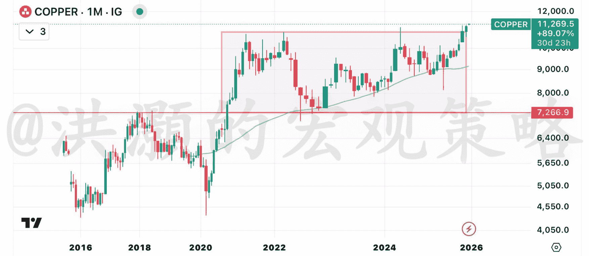
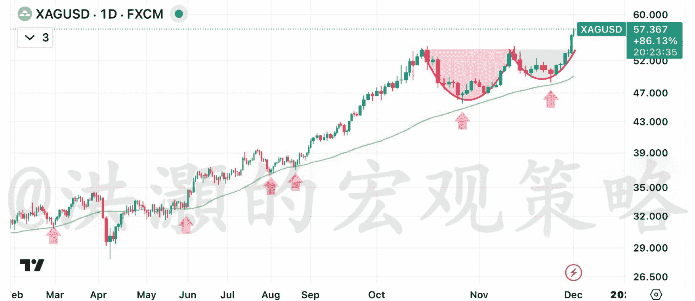
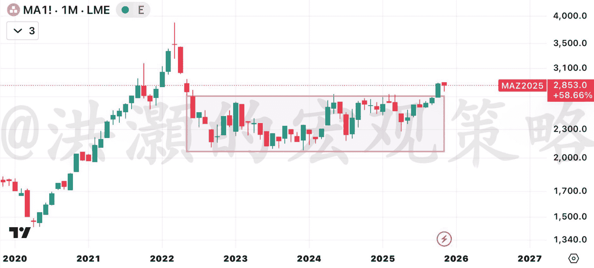

# 顶级的网球巨星Roger Federer

杰·费德勒用一项统计数据网上刷疯了。这个统计数据将改变你如何看待生活和交易中的每一次挫折：1,526场单打比赛，赢了80%；20个大满贯、108个冠军。

那么您认为费德勒在整个职业生涯的总得分的亮点是多少？

其实，只有54%。换言之，24年的职业生涯中，费德勒几乎就是赢一分。这个胜率，几乎技术分析的概率大致一致。那么，如此低的亮点，究竟如何能够成为网球冠军、交易高手、人生赢家？

对此，费德勒如此评论：

> “网球场上不存在完美。当你平均两分就要丢一分，要学会这样告诉我：不是一个双赢，就丢一分而已；不是上网被突破了，就输一分而已；就连那记入选十球的暴力扣杀，到底也只是赢了一分。

所以当你在这一分拼搏时，必须视如鸿璧之珍。而这一分负已的瞬间——就其轨迹难以追……这种的心态让你获得了内心的宁静，能够全神贯注投入下一分、再一分的拼搏。

一个冠军的真正标志，并非百胜不输，每分必赢。而在冠军经历一次又一次失败之后，最终学会了如何与其共处，如何逆流而驰。

能量总量是亘息之耗。若需之时，大可哭泪崩溃，尽情释放。然后，别忘了让自己嘴角微微扬扬。之后，我们砥砺前行，持志不屈，随机应变，不断成长。既要竭尽心，也要吸收教训，运筹帷幄。最终，让人脱颖拔而出。”

洪源
作者：洪源
来源：洪源的宏观策略

# 铜月线突破了。历史新高。

作者：洪灏
摘录：洪灏的宏观策略

> “白银在我们上周讨论了其‘杯柄形态’之后继续突破。历史新高。”

作者：洪灏
摘录：洪灏的宏观策略

> 沪深300上涨，江铜领涨。

作者：洪灏
摘录：洪灏的宏观策略

> 铝的月线也突破了。今天有色非常强势。

作者：洪灏
摘录：洪灏的宏观策略

# 深度视野优质社群（链接优质社群，助你成功）

全部包含以下内容：限时年费188/年 加微信cuk255

- ① 吃瓜群众倍帝时文加时群聊对话（原价 365 元/年）
- ② 子明私享汇（含）内部文章（原价 568 元/年）
- ③ 政事室（顾子明）内含额外加送顾子明群聊
- ④ 米联储顶级【作者米穗】（原价 599 元/年）
- ⑤ 欧洲金雀会员专属文章（原价 328 元/年）
- ⑥ 砖瓦斥内部圈（原价 400 元/年）
- ⑦ 卢克文青读书会专属文章（原价 699 元/年）
- ⑧ 鉴茶财经知识星球（原价 3310 元/年）
- ⑨ 猫哥的视界知识星球文章（原价 299 元/年）
- ⑩ 财经周【独家新闻】（原价 1498 元/年）
- ⑪ 杨世光在金钱塔（原价 2200 元/年）
- ⑫ 森淼财经知识星球（原价 1600 元/年）
- ⑬ 激源译译付费文章（持续更新）
- 十四 司马林解读全套音频和全套书籍珍藏版无删减（原价 2.3 万）
- 十五 虚构三部曲[民国梦、帝国争霸、不被理解的 MAO]（原价 599 元）
- 十六 卢克优星球文章（原价 268 元/年）
- 十七 额外再送：卢祺元新浪微博付费专栏、三村丰老王、三花九树文集

不定期内容：......（更多资源不下去了......）

- ① 守夜人司令星球、接换魔王知识星球、成术财富圈、雪花甲老头
- ② 创始小妮、达叔泛论星球、成术财富圈、雪花甲老头
- ③ A视野、大树乡谈、江宁后、泮咩说、上海海家学等付费文集
- ④ 西凤付费文章、老端、高在八小时之外、局人的视界、升值、老体制内等等大V付费文集（每月不超过600元的付费文集）
