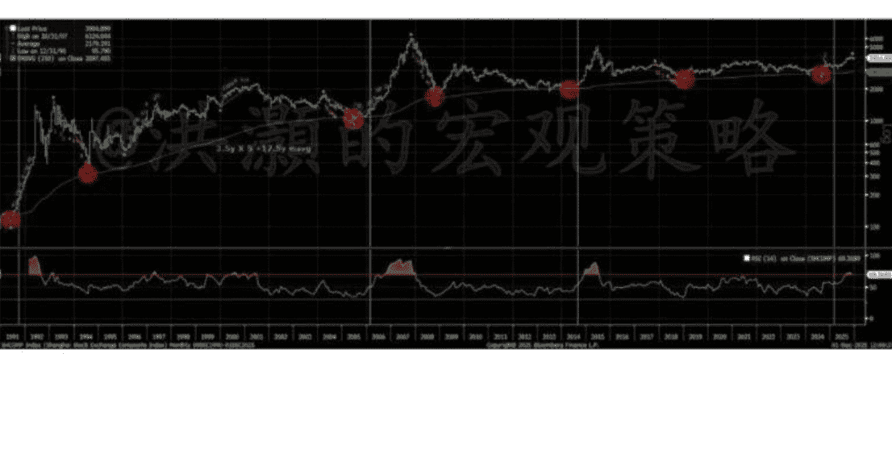
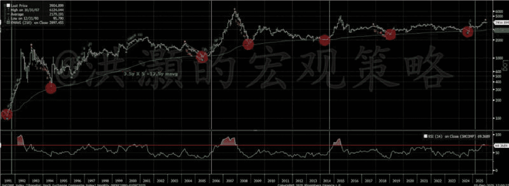

> 狗蛋提问：洪总您好，过去几年的年度展望好像都给出了上证的波动区间，但这次2026年展望里并没有有。是忘记了，还是说您认为上证已经突破了过去的十多年的震荡区间，走出了一个超级大牛市，从而无法估算出上证的高点的呢

作者：洪灏
摘录：洪灏的宏观策略

感谢你的提问，其实呢，我没有忘记，那么这一次呢，其实的你讲的原因是因为一部分的原因，那么我觉得呢，如果这个趋势已经走出来了，那么你就不要有一个特别别的一个目标价，因为说实话，谁要告诉你一个目标价，在任何时候其实它都是有一定的拍脑袋的成分的，我以前目标价的确定是用我以前那个eyeb的模型来算的，那么因为呢，整个股市的指数也好，也是超额收益率也，它都是在一个比较确定的一个区间里头。对吧？

所以呢，你可以倒推出来，你用这个模型呢，你可以倒推出来，股市大概会到上什么位置，它应该是一个合理的区间，但是我们现在看到，等一下我给你发一个图回去回答这个问题。你会看到呢？有几个明显的趋势，向上的特征，一个呢，就是说上证的这一次，在去年九月份的时候，它其实是从五个3.5年的移动平均线开始反弹的，它一个非常大的周期，17.5年的大周期。

比如说美元的周期，对吧？美国的这个常规账户周期，黄金的周期等，它都是17.5年的；一个标普的周期35年，半个周期17.5年等等，所以呢，这是一个非常重要的周期。那第二呢，你你会看到呢，在这个周期开始的时候呢，往往会出现，就是由于牛市的 price momentum，就是价格势能非常的强，对吧？

所以呢，在牛市初期的时候，市场似乎哈哈不断的出现超买的现象，但是市场在牛市里头呢，是以超买来化解超买的。那同时呢，你你会看到呢，每一次在 17.5 年均线开始反弹，以及呢，超买现象出现的时候，都是大牛市的开始。

# 上证35年月线纯技术图形走势。基本面原因

阅读我的年度报：上篇 洪灏|展望2022 6：持而盈之（上篇，单篇付费）；下篇 洪灏|展望2026：持而盈之（下篇，单篇付费）

# 洪灏的宏观策略

# 深度视野优质集群（链接优质社群，助你成功）

全部包含以下内容：限时年费188/年 加微信cuk255

- ① 进粉丝粉丝圈文加时群聊对话（原价 365 元/年）
- ② 子明私享会（内部）文章（原价 568 元/年）
- ③ 政室（顾子明）付费内容加再送子明群聊
- ④ 米联锦顶【作者米穗】原价 599 元/年）
- ⑤ 欧洲金雀会员专属文章（原价 328 元/年）
- ⑥ 砖瓦斥内部文档（原价 400 元/年）
- ⑦ 卢克文青读书会专属文章（原价 699 元/年）
- ⑧ 鉴茶财经知识星球（原价 3310 元/年）
- ⑨ 猫哥的视界知识星球文章（原价 299 元/年）
- ⑩ 财新四周【独家新闻】（原价 1498 元/年）
- ⑪ 杨世在金钱圈（原价 2200 元/年）
- ⑫ 森淼财经知识星球（原价 1600 元/年）
- ⑬ 激源译付费文章（持续更新）
- ⑭ 司马林解读选题全套音频和全套书籍版权无损辑（原价 2.3 万）
- ⑮ 虚彦三部曲【民国梦、帝国战争、不被理解的 MAO】原价 599 元
- ⑱ 卢克知识星球文章（原价 268 元/年）
- ⑰ 额外再送：卢祺新微浪付费专栏、米村丰老王、三花九术文集

不定内容：……（更多资源不写下了……）
- ① 守夜人司令知识星球、交换魔王后星球、养成知识星球、
- ② 创始星球、达叔浅论星球、成就财富圈、雪花甲老头等
- ③ A视野、大树乡谈、江初符、泮说、上海家学等付费文集
- ④ 西风付费文章、老端、嘉在八小时之外、局人的视界、增长、老体制内等等其它一些大 V 付费文集

# 深度视野文集
进群微信cuk255

深度视野（付费文集）

