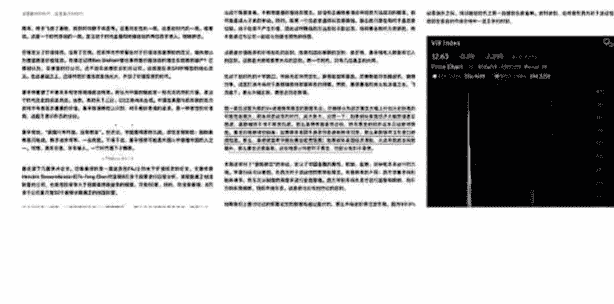
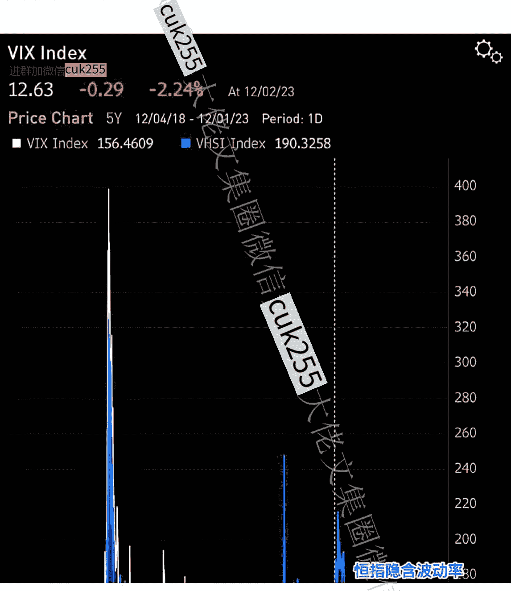
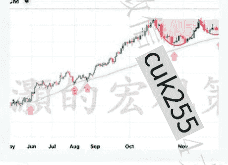

# 洪灏的宏观策略

洪灏 星
2025/12/06 09:27

年前的会员专属文章《黄金时代》。因为时效性已过，我在这里公开分享一下。那时，黄金才2000美元。

这篇文章，不仅预测了黄金未来两年的走势，还用一系列的隐喻和修辞指出了这个时代的主要矛盾。

洪灏：这是经典回顾，美文欣赏，而不是Call。今天是周末，还有60小时后货币市场才开盘。慢下来不好，不行吗？

淋漉：可以重新布局黄金了？

闷Sam：这就是最好的宏观策略，让那些短线的追涨杀跌毫无脸面！

韦：洪教主乃贵金属之王！

beth：现在是白银时代

琪：早两年没关注到洪灏总有点可惜，但今年

# 黄金时代

2023-12-03 阅读 251447

最好的时代，也是最坏的时代。

周末，终于飞离开了基地，找到暂时静下来思考。这是历史的一周，这是划时代的一周。或者说，这是一个时代终结的一周。定义这个时代金融和地缘政治的两位百岁老人，相继辞世。

格雷姆定义了价值，没有了格雷姆，巴菲特仍然留在对价值投资原始的定义上，偏执地认为便宜就是价值投资。你还记得Benjamin Graham经理通过价值投资的理念买股票而破产吗？格雷姆认为便宜的垃圾，不如买合理的价值。这就是后来GARP模型的内核所在。在此基础上，巴菲特价值投资发扬光，创造了价值投资的时代。

格林重塑了中美关系和全球缘政治格局。他认为中国的崛起是一股无法抗拒的力量，是这个时代历史的浪潮。然而，天下三分，G2势力尚未出现。中国在美国与苏联的权力游戏中有着至关重要的地位。格林清晰地认识，对美好幸福的追求，是一种普世的价值追求，远超这种形态的差距。

格林说，“美国只有利益，没有朋友”。他还认为，中国或许持久，讲全局大局；国际格局如同闪电，棋手夺全局，一击而得。不得不说，格林很可能是外国人中最中国的人之一。或者，黄天下，未命人。一个时代落下了帷幕。

最近读了几篇学术论文。印象深刻的是一篇发表在FAJ上的关于价值投资的论文。文章作者Hendrik Bessembinder和Te-feng Chen对全球6万多股票进行回测分析，发现真正创造财富的公司，也就是回报率大于市值收益率的，只有50家。对，你没有错；6万个公司只有50个能长期增长创造财富的。

这个结论引人深思。如果真的有价值的公司万里挑一，那么价值投资究竟是运气，还是技术？即使是技术，它的表现和运气基本上有着太多的区别。同时，有效市场说认为的，长期跑赢市场只能靠运气——很可能大概就是这个意思——技术和运气其实有多大的差别。

> 以下内容V+会员可见

# 洪灏的宏观策略

如果一个投资者没有技术能力万一银行进行投资，那么他买垃圾股的概率就是99.9%。由于长期持有的信仰已经深入入心，那么投资者长期持有垃圾并跑市场的概率就是99.9%。不怪得，长来看，市场淘汰失败。

从这个角度看，不断增加投资价值，却没有正确地看清这种投资方法成功的概率，很可能是胆小的行为。同时，如果一个投资者选择交易赚钱，那么他只是在对手盘交易垃圾。由于垃圾不产生价值，这种赚钱的方法类似于割菜，纯粹靠击败对手而获胜，而不是通过公司与成长创造局性的局面。

这就是投资价值和投资机制的区别，围圈和国际策略的区别；差异化、肯哲人和群体其它的区别。这就是大师和大众的区别。而一个时代，只有真正的大师。

在这个时代的十字路口，市场在酝变化。美债收益率暴跌，竭尽可能负债顽抗，治理力试图打回市场对美联储很快即将要跌的预期。然而，美债暴涨的头却是得之水，飞流越来越。黄金崛起，黄金近历史新。实在在这里为V+读者推荐，并延续这次黄金大涨的可能性。现在是流动的态势，设想：如果美国经济大幅增长，美联储将平稳，那么美债收益率将会低，持有黄金的成本应该降低，黄金继续创新；如果美国不退，通胀回落，那么美联储没有压力；如果美国经济持续增长，大选遭遇政治，黄金将成为避风港。这些情景分析都有利于黄金，也有利于股市。

从字里可以看到，东方对于波动性的哲学有着不同的理念。西方依靠机制来调整，而东方则未雨绸缪，预防市场失灵。这是进化和世纪的区别。我们讨论过那篇论文和结论是可能的，那么市场定价失败，所有的垃圾。如果市场定价失败，认为有效市场假设和它系列，从谈起。当然，这是从哲学的角度来看，其中忽略了许多细节。

早在去年月底，港股与美股波动扬扬（如图）：港股高不下，美股却不断走低。很容易在一夜之间大幅升，如同ageddon一样。当下，市场在预期明年增长为10%左右，但同时预期经济放缓、美联储马上加息。这些预期总是一个错的。在股市飙升之际，将以前推拉时刻，东方对于波动性的信仰在各自价格中一览余。

# 洪灏的宏观策略

态，周遭再杂音只做自己。毕竟更多人就是喜欢的逻辑。

栗子：周末美欣赏[玫瑰][玫瑰]

洪灏
2025/12/06 06:45

现货白银近60美元，刷新历史新高

> 洪灏：白银在我们上周讨论了“杯形形态”之后继续突破。历史新高。

栗子：前排

Bobxu:早

栗子：早安波神[咖啡]

三：平常心：那接下来是另一个杯形形成吗？

月亮不在：帅

马斯克的SpaceX将出售一些内部股票，估值8000亿美元，比OpenAI500亿还高，成为估值最高的上市公司。SpaceX可能年底底上市。

最近，我在实名认证微博“洪灏的宏观策略”上转发了一段马斯克关于SpaceX的采访。采访中，他谈到了许多次失败让SpaceX几次徘徊在破产边缘，所有人都认为这个民间火箭计划不可能成功。

终于，他用了公司所有的资金，第一次发射成功。从那时起，SpaceX一路开挂，获得了一系列成功的发射和人们的认可。采访中，主持人问马斯克，“你有没有想过失败？”马斯克眼里闪烁着泪光，眼泪都溢出了眼角，回答：

> 是的，我不止一次地告知不可能成功。但是我永不放弃！”

Sunny Baby: 鸭汤算了，重点是内部出售，有什么原因吗？

洪灏
2025/12/06 05:59

奈飞将收购华纳兄弟，定价720亿美元。华纳兄弟是好莱坞最老牌、最显赫的电影公司，拥有哈利波特、权力游戏等著名系列和HBO频道。两个线上观影平台将共同拥有四亿五千万用户。

如果监管批准，这将是一个巨大的用户平台，充满了巨大的商机，比如增加用户之间的交流互动，开发社交功能，等等。虽然华尔街不看好这个交易，并认为这是奈飞增长遇到瓶颈的表现，但是这年头谁可以获得观众的注意和时间，谁就可以获利。

奈飞收跌5%。

牛牛牛：以前经常以用户增长作为奈飞涨跌的前置指标
否泰：来：猫宁
王皓凯：大众误判，往往有超额收益。
栗子：早早，洪总周末愉快

根据BEA经济分析局的数据，美国消费者支出在9月份几乎没有变化。核心个人消费支出PCE价格指数比8月份上涨0.2%，比上年上涨2.8%。

洪灏：白银在我们上周讨论了“杯形形态”之后继续突破。历史新高。（如图所示）

# 洪灏的宏观策略

以下内容V+会员可见

- 深度视野文集
- 深度视野（付费文集）
- 深度视野进群微信cuk255
