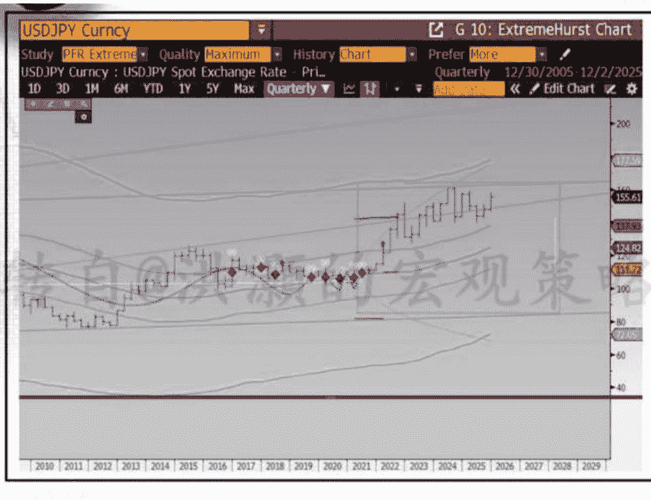
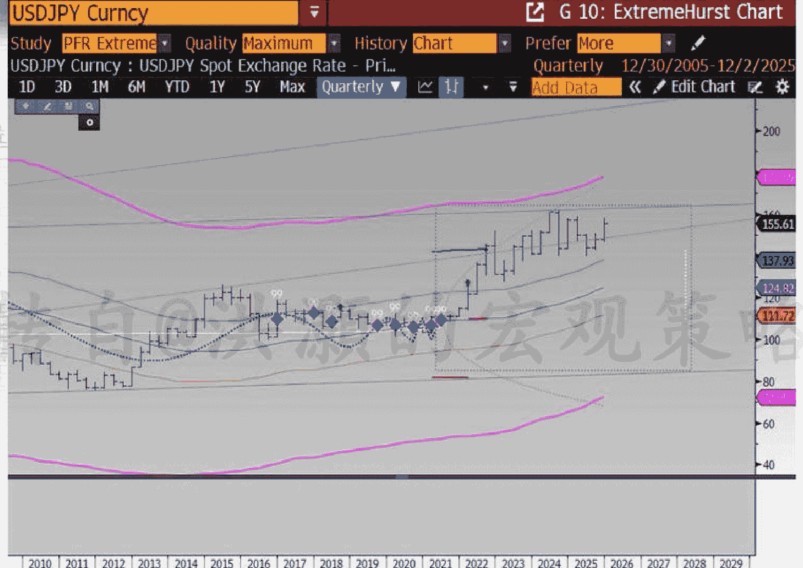
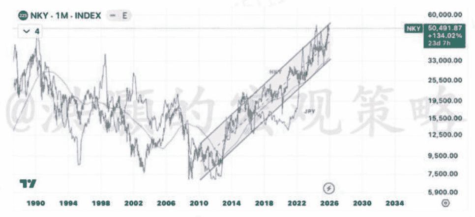
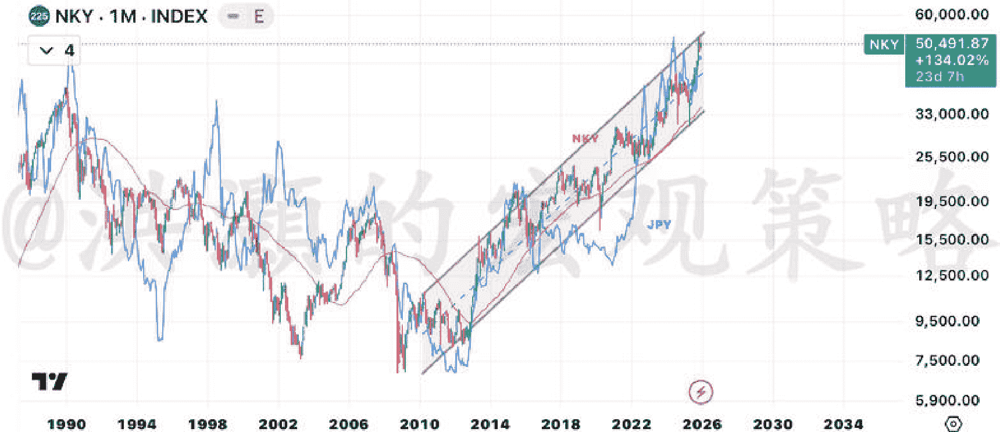

# 洪灏宏观策略

洪灏 冕主
2025/12/07 12:23

日元的贬值趋势（粉红色趋势上沿）具体成因在前面两个问答中已详细讨论：

洪灏 冕主
2025/12/07 12:15

Ben 提问：洪帅，得益于您对后市场的判断，以及“不要看他的票赚了多少”，要看他有没有重仓，我在这波回调即买到重仓，后续在回调时不断加仓。目前已经买到了心里仓位。谢谢您的提问

# USDJPY Currency

# 洪灏 星主
2025/12/07 12:25

日元 vs 日经。具体成因在前面两个问答中已详细讨论。

# 洪灏 星主
2025/12/07 12:24

日元 vs 十年美债收益率。具体成因两个问答中已详细讨论。

> 今天更新结束。下午出席财经中国年会。

作者：洪灏
摘录：洪灏的宏观策略

# 深度视野优质集群（链接优质群，助你成功）

全部包含以下内容：限时优惠188/年 加微信cuk255

- ① 吃瓜群众包帝圈加微信时群对话（原价 365 元/年）
- ② 子明私享汇（含）内部文章
- ③ 政事室（顾子明）付费内容再送顾子明群聊
- ④ 米联锦闲【作者米穗】（原价 599 元/年）
- ⑤ 欧洲金铂会员专属文章（原价 328 元/年）
- ⑥ 砖瓦斥内部图文（原价 400 元/年）
- ⑦ 卢克青文读书会专属文章（原价 699 元/年）
- ⑧ 鉴茶财经知识星球（原价 3310 元/年）
- ⑨ 猫哥的视界知识星球文章（原价 299 元/年）
- 10 财经周刊【独家新闻】（原价 1498 元/年）
- 11 杨世光在金钱爆（原价 2200 元/年）
- 12 森淼财经知识星球（原价 1600 元/年）
- 13 潇游异译付费文章（持续更新）
- 14 司马林解读课全套音频和全套书籍收藏版无割减（原价 2.3 万）
- 15 虚构三部[民国梦、帝国争合、不被理解的DAO]（原价 599 元）
- 16 卢克知识星球文章（原价 268 元/年）
- ⑰ 额外再送：卢澜新浪微博付费专栏、三村丰老王、三花九涯文集

不定内容：......（更多资源不下去了）

- ① 守夜人才知识星球、接换魔王知识星球、达叔谈论星球、成术财富圈、雪球花甲老头等
- ② 创始人笔记、达叔谈论星球、成术财富圈、雪球花甲老头等（此处文字被截断）
- ③ A视野、大树乡谈、江初优、咩咩说、上海海家学等付费文集
- ④ 西风付费文章、老端、赢在八小时之外、局人的视界、升值优、老A体制内等其它一些大 V 付费文章

限时优惠188/年

# 底层链接连接全网V优质内容

深度视野文集
深度视野（付费文集）
