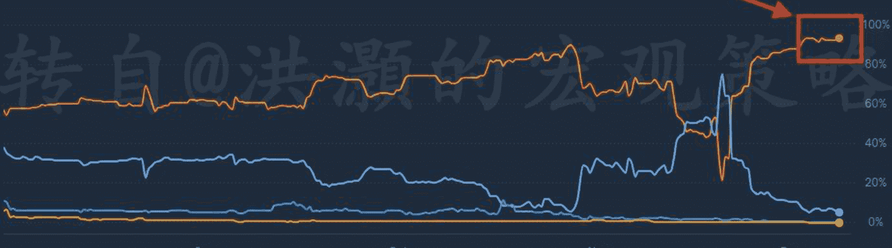

> “预测市场定价本周美联储降息概率=94%

作者：洪灏

摘录：洪灏的宏观策略

# Fed decision in December?

$290,981,175 Vol.

- Past Dec 10 Jan 28, 2026 Mar 18, 2026 Apr 29, 2026
- 25 bps decrease 94% No change 6% 50+ bps decrease <1% 25+ bps increase <1%

> 英伟达将被允许将其H200芯片出口到中国，25%的销售额归美国政府。AMD和英特尔将得到同样的待遇。特朗普还认为，中国将购买的大豆将超过合约约定。（彭博社）

作者：洪灏
摘录：洪灏的宏观策略

# 深度视野优质文集团（链接优质社群，助你成功）

全部包含以下内容：限时年费188/年 加微信cuk255

- ① 吃瓜群众倍帝时圈加时群群对话（原价 365 元/年）
- ② 子明私享汇（内部）文章
- ③ 政事室（子明优）付费内容再送顾子明群倾
- ④ 米联储闲闲【作者米穗】（原价 599 元/年）
- ⑤ 欧洲金获会员专属文章（原价 328 元/年）
- ⑥ 砖瓦斥内部圈（原价 400 元/年）
- ⑦ 卢克文青读书会专属文章（原价 699 元/年）
- ⑧ 鉴茶财经知识星球（原价 3310 元/年）
- ⑨ 猫哥的视界知识星球文章（原价 299 元/年）
- ⑩ 直财经周刊【独家新闻】（原价 1498 元/年）
- ⑪ 杨世光在金钱爆（原价 2200 元/年）
- ⑫ 森淼财经知识星球（原价 1600 元/年）
- ⑬ 潇源异译付费文章（持续更新）
- ⑭ 司马林解课毛选全套音频和全套书籍版权无损删减（原价 2.3 万）
- ⑮ 虚构三部曲[民国、帝国争合、不被理解的 MAO]（原价 599 元）
- ⑯ 克文知识星球文章（原价 268 元/年）
- ⑰ 额外再送：卢薛元新浪微博付费专栏、三村丰老王、三花九树文集

不定内容：......（更多资源写下了......）

- ① 守夜人才知识星球、接换魔王知识星球、成败财富圈
- ② 创创始笔记、达叔谈论星球、成败财富圈、雪花劫甲头部等
- ③ A 视野、大树乡谈、江初优、咩咩说、上海海家学等付费文集
- ④ 西风付费文章、老端、赢在八小时之外、局人的视界、升值、老体制内等等其它一些大 V付费文章

限时年费188/年 底部链接全网V优质内容

# 深度视野文集
进群微信cuk255
深度视野（付费文集）

