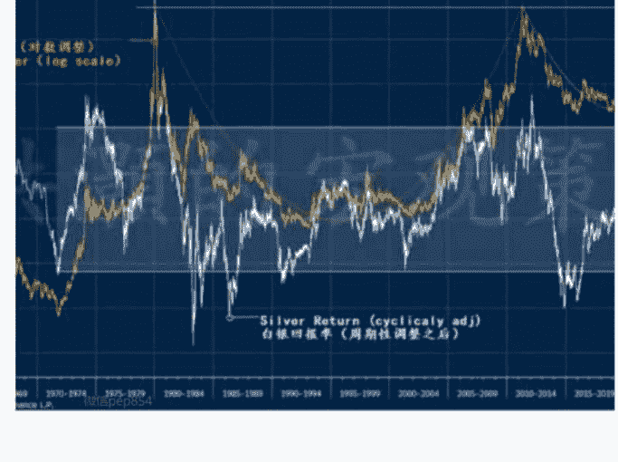

美联储主席候选人哈塞特表示，“足够的空间”降息超过四分之一之一。

降息超过四分之一之一。特朗普说，下任美联储主席必须愿意迅速降息，这将是他选择下任美联储主席的最重要的考核。我们在这里反复讨论了美联储将非常快降息并重启QE。

作者：洪灏
摘录：洪灏的宏观策略

# 洪灏的宏观策略

最新 等我回答 精华 只看星主

白银巨幅突破，飙升近5%，创历新高61。我在这里反复讨论了白银的机会。虽然最近被黑到变变形，但是看到自己预测的兑现和大家大赚，感觉自己吃的这点苦又算什么。看到大家大赚是让我最开心的事情。

洪灏：有读者问问，是否有更大的杯柄结构？是的，请看图。这就是我一直反复说的，白银的史诗级杯柄。...

欧阳：感谢，感谢，感谢 👍👍👍
如水心灵导师- Sa*:洪总怕有人错过，真的是反反复强调，而且还用了“史诗级”这个词儿，太贴心了[爱心][爱心][爱心][玫瑰][玫瑰][玫瑰]

骏奇：支持洪总！
楷睿：又看了一遍
栗子：感谢总耐心反复提醒，昨天勇加仓了

# 深度视野优质社群（链接优质社群，助你成功）

全部包含以下内容：限时年费188/年 加微信cuk255

- ① 吃瓜群众包帝时圈加时群群对话（原价 365 元/年）
- ② 子明享汇（内部）文章
- ③ 政事室（顾子明）付费内容加再送顾子明群聊
- ④ 米储锦闲【作者米栖】（原价 599 元/年）
- ⑤ 欧洲金获会员专属文章（原价 328 元/年）
- ⑥ 钨瓦内部画圈（原价 400 元/年）
- ⑦ 陆文青读书会专属文章（原价 699 元/年）
- ⑧ 鉴茶财经知识星球（原价 3310 元/年）
- ⑨ 猫哥的视界知识星球文章（原价 299 元/年）
- 十 财新周刊【独家新闻】（原价 1498 元/年）
- 十一 杨世光在金钱爆（原价 2200 元/年）
- ⑫ 森莱财经知识星球（原价 1600 元/年）
- ⑬ 潇源异译付费文章（持续更新）
- ⑭ 司马林解读毛选全套音频和全套书籍版权无削减（原价 2.3 万）
- ⑮ 虚构三部[国民梦、帝国亡亡、不被理解的 MAO]（原价 599 元/年）
- 十六 克文知识星球文章（原价 268 元/年）
- 十七 额外再送：卢薛元新浪微博付费专栏、三村丰老王、三花九术文集

不定期内容：......更多资源将下去了）......

- ① 守夜人司令知识星球、接换魔王后星球
- ② 创始人笔记、达叔浅谈论星球、成就财富、雪球花甲老头等
- ③ A视野、大树乡谈、江初序、咩咩说、上海海家等付费文集
- ④ 西风付费文章、老端、赢在八小时之外、局人的视界、升值、老A体制内等等其它一些大V付费文章

# 底层链接全网V优质内容

限时年费188/年
