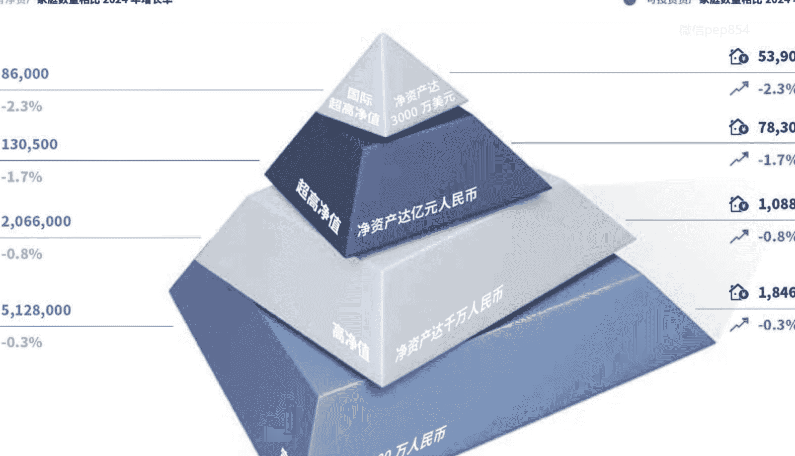

# 万通×胡润2025白皮书：高净值人群群资产配置新趋势

中国财富家庭整体数量微降，4个资产阶段

- 600万人民币净资产：富裕家庭，同比降0.3%，减少了1.4万至512.8万户；
- 1000万人民币净资产：高净值家庭，同比降0.8%，减少了1.7万至206.6万户；
- 1亿元人民币净资产：超高净值家庭，同比降1.7%，减少了2,200户至13.1万户；
- 3000万美元净资产：国际超高净值家庭，同比降2.3%，减少了2,000户至8.6万户。

摘要自：万通×胡润2025白皮书：高净值人群资产配置新趋势
作者：洪灏 
摘录：洪灏的宏观策略

## 中国财富家庭规模（单位：户）

| 中国拥有净资产家庭数量 | 中国拥有可投资资产家庭数量 | 净资产家庭数量相比 2024 年增长率 | 可投资资产家庭数量相比 2024 年增长率 |
| :--- | :--- | :--- | :--- |
| 86,000 | 53,900 | -2.3% | -2.3% |
| 130,500 | 78,300 | -1.7% | -1.7% |
| 2,066,000 | 1,088,900 | -0.8% | -0.8% |
| 5,128,000 | 1,846,000 | -0.3% | -0.3% |

国际超高净值: 净资产达3000万美元
净资产达亿元人民币
净资产达千万人民币
净资产达600万人民币
一手优质资源进群微信cuk255

> *本报告“中国”包括中国内地和香港、澳门、台湾数据来源：胡润研究院

> 美联储降息25个基点，这是连续第三次降息，并继续认为明年将只降息一次。同时，美联储表示，从12月12日开始，它将开始每月购买400亿美元的短期美债。

特朗普非常不满，认为“本可以翻倍降息”。事实上，明年如果特朗普的哈塞上任，这个降息一次的预测就可以做废了。

一个月前，在市场共认为降息概率只有不到30%的时候，我反复讨论了美联储将不得不马上上升降息扩表。现在，美联储已经开始降息扩表了。

作者：洪灏
摘录：洪灏的宏观策略

## 香港金管局降息25个点。

作者：洪灏
摘录：洪灏的宏观策略

> 白银63了，再创历史新高。

作者：洪灏
摘录：洪灏宏观策略

## 深度视野优质集团（链接优质社群，助你成功）

全部包含以下内容：限时年费188/年 加微信cuk255

- ① 吃瓜群众倍时圈加时群群对话 (原价 365 元/年)
- ② 子明私享汇（会）内部文章
- ③ 政事室 (顾子明)付费内容加送顾子明群聊
- ④ 美联储闲闲【作者米栖】(原价 599 元/年)
- ⑤ 欧洲金雀会员专属文章 (原价 328 元/年)
- ⑥ 砖瓦斥内部圈 (原价 400 元/年)
- ⑦ 卢克文青读书会专属文章 (原价 699 元/年)
- ⑧ 鉴茶财经知识星球 (原价 3310 元/年)
- ⑨ 狮哥的视界知识星球 (原价 299 元/年)
- ⑩ 财新周刊【独家】(原价 1498 元/年)
- ⑪ 杨世在钱榜 (原价 2200 元/年)
- ⑫ 森淼财经星球 (原价 1600 元/年)
- ⑬ 潇泽异译付费文章 (持续更新)
- ⑭ 司马林解课全套音频和全套书籍无割 (原价 2.3 万)
- ⑮ 虚构三部曲民国梦、帝国争、不被理解的 MAO (原价 599 元)
- ⑯ 卢克知识星球文章 (原价 268 元/年)
- ⑱ 额外再送：卢薛元新浪薇付费专栏、三村丰老王、三花九洞文集

不定内容：(更多资源写不下......

- ① 守夜人司令星球、接魂魔王知识星球、跃达谈论星球、成后财富圈、雪球花甲老头等
- ② A 视野、大树乡谈、江宁后记、泮咩说、上海海学等付费文集
- ③ 西风付费文章、老端、赢在八小时之外、局外的视界、升值、老体制内等其它一些 V 付费文章(每月不超过600 元的付费文集)

## 限时年费188/年 内部链接下载全网V优质内容

