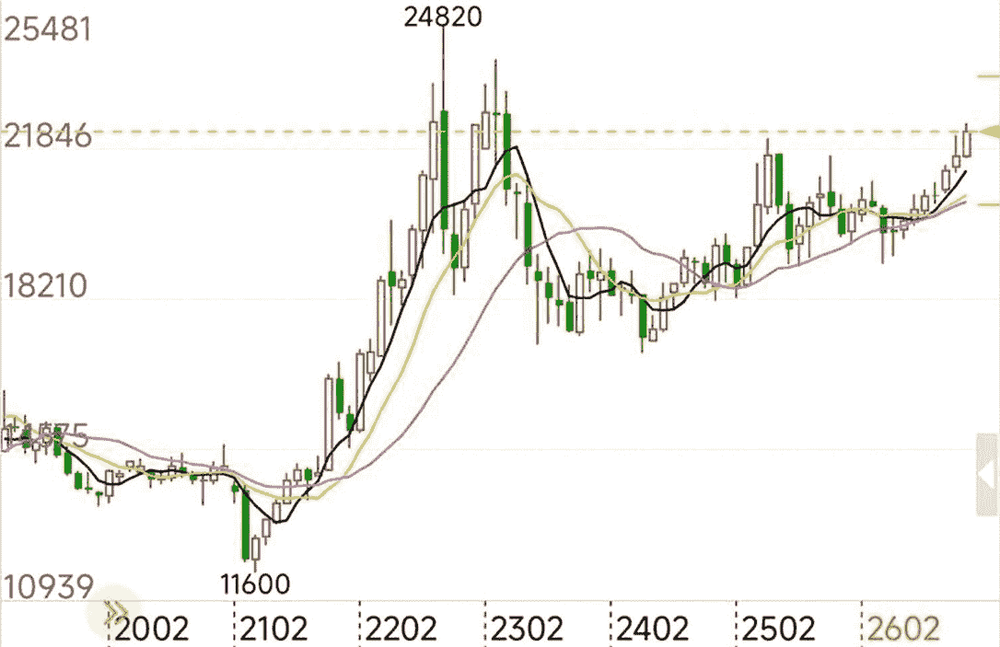
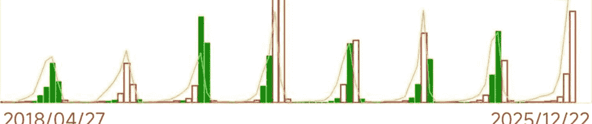
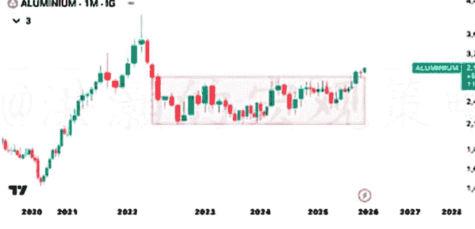
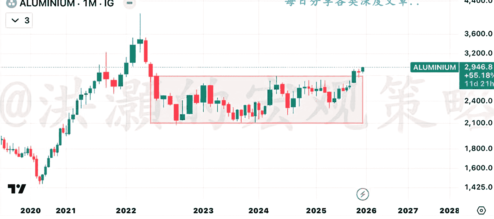
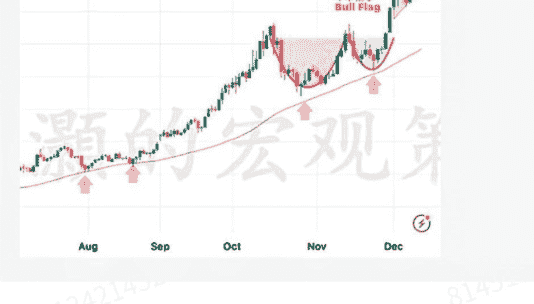
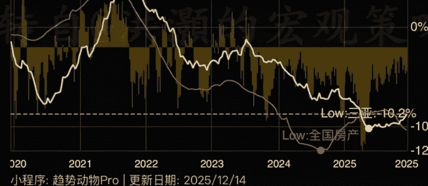

# 洪灏 星宇宙
2025/12/20 11:59

爱念海 提问：洪总您好，我是北京线下策略会的粉丝，在您的建议下白银已收获满满，感谢！

以下这段是见面手册里您写的内容
（一般来说，在经济周期的下半场，我们会观察到黄金、白银、贵金属的价格上涨。因为这时经济流动性最好、经济基本面最扎实但即将转弱的时刻。简言之，黄金白银的价格的历史性飙升预示着市场巨大波动将面临。随后，我们应该将观察到的贵金属的价格势能开始蔓延到有色金属，如铜、铅等）。根据您的提示我关注到铝的月线，是否也走出了类似的杯柄形态？或者说现在铝的机会比较好，谢谢您的回答

## 沪铝2602(al2602)

| 项目 | 数值 |
| :--- | :--- |
| 今开 | 22245 |
| 昨收盘 | 22295 |
| 成交量 | 22040 |
| 最高 | 22365 |
| 结算 | -- |
| 成交额 | 123.12亿 |
| 涨跌幅 | 0.93% |
| 波动 | 205 |
| 最低 | 22200 |
| 持仓 | 32.1万 |
| 日增仓 | 5412 |

当前为非交易时间 详情>>

分时 1m 5m 30m 1h 日 K 月 K

均线 MA5:212322↑ 20:205553↑

24820
25481
21846
18210
10939
11600
2002 2102 2202 2302 2402 2502 2602

成交/持仓~ 成交量:2983497↑ 持仓量:320505↑
459万

2018/04/27 2025/12/22

感谢提问。您的这张图的确是杯柄形形态，但是略有瑕疵(如最左端边缘有点高).. ..我用Bloomberg终端和Tradingview都无法重做您的这张图。

但如一个月前所讨论的，铜铝都是月线箱突破的结构。自那时以来，铜历史新高，铝历史新高。因此，无论是“略有瑕疵的杯柄”还是“箱体突破”，走势都是看涨的。这也是一个活生生的例子，说明技术分析更像是一门艺术。

正确答案：周末快乐

狗猥骚：洪帅男神[鼓掌][鼓掌][鼓掌]

东郊小张：这么说的话，黄金现货儿像[偷笑]

爆爆：我总觉得铜在犹豫豫，甩掉不稳定的人后会大的[偷笑]

## 付费进群+V: cuk255

人工追踪50+大V付费文……每日分享各美深度文章..

ALUMINIUM · 1M · IG

4,400.0
3,600.0
3,200.0

ALUMINIUM 2,946.8 +55.18% 11d 21

2,100.0
1,800.0
1,600.0
1,425.0

2020
2021
2022
2023
2024
2025
2026
2027
2028

## 隔夜，白银飙升近4%创历史新高

67.6... 真的是史诗级行情。

感谢洪总您好，对我最信服的经济学家，数据显示，白银趋势依然持续，下行趋势中，每一个反弹都是出货；相反，上行趋势中，每一次下跌都是买入。

洪灏：白银日线继续出现了“杯柄”形态，又出现了“牛市旗形”的技术形态。

感谢哄[太阳][月亮]
票子：洪总早安！收获满满
水镜：开始做空健康快乐
Xhenho.:感谢洪总[捂笑]
Bill:洪总的研究真的棒
海海扬：洪总早安！收获满满！

老师提问：洪总您好，对我最信服的经济学家，特别是价格势能的解释。我有一个问题，在目前的市场中，由于个人原因，以后不会去了，您认为现在是卖出的时机还是再等？

## 付费进群+V: cuk255

人工追踪50+大V付费文...每日分享各类深度文章..

## 说明

2025/12/14 最新价格

| 品种 | 趋势 | 租金收益率 | 月同比 | 月环比 |
| :--- | :--- | :--- | :--- | :--- |
| 三亚 | 趋势强度 | 74 | +1% | -0.4% |
| 全国产 | 趋势温度 | - | -8.8% | -1.4% |
| 三亚 | 趋势相对 | - | 7.4% | 0% |
| 全国产 | 趋势对比 | - | -8.8% | -0.4% |
| 三亚 | High | - | -4.9% | 0% |
| 全国产 | Low | - | -10.3% | -12% |

2020 2021 2022 2023 2024 2025
小程序: 趋势Pro | 更新日期:2025/12/14

付费群+V: cuk255人工客服50+加V付费...每日分享深度干货...

## 深度优质圈，链接社群，助你成功

全部包含以下内容：时年费188/年 加微信cuk255

- 吃瓜群众含时圈群对话（原价365 元年）
- 子明私享（会）内部文章（原价568 元年）
- 政事堂（原子明）付费内容再送群聊
- 米联储闲【作者米糕】（原价599 元年）
- 欧洲金会员专属文章（原价328 元年）
- 铸五厂内部圈（原价400 元年）
- 卢克文青读书会专属文章（原价699 元年）
- 鉴茶财经知识星球（原价3310 元年）
- 猫哥的视界知识星球（原价299 元年）
- 财经新周【独新闻】（原价1498 元年）
- 杨世光在金钱（原价2200 元年）
- 森森财经知识星球（原价1600 元年）
- 源译译付费文章集（持续更新）

## 深度视野文集进群微信cuk255

- 司马林解读毛选全套音频和全套书籍珍藏版无删（原价2.3 万）
- 虚虚三部曲【民国梦、帝国战争、不被理解的MAO】（原价599 元）
- 卢克文知识星球文章（原价268 元年）
- 额外再送：卢旷元新微博付费专栏；三村屯老王、三九九文集

不定期内容：（更多资源将下去了...）：
① 守夜人司令知识星球、接鸽魔王知识星球、生有术知识星球...
② 创始笔记、达沃译论星球、付费财富圈、雪花花甲老头等
③ A视野、大树乡谈、江初知道、咩闲说、上海海学等付费文集
④ 西风付费文章、老端、赢在小时之外、局人的视界、升值、老A体制内等等其它一些大V付费文章
