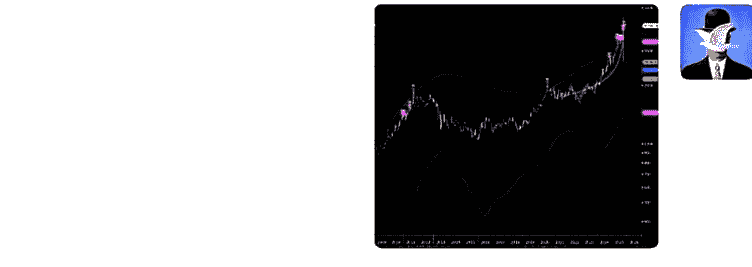
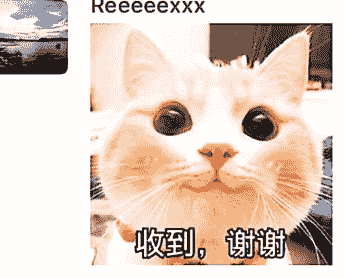

> 我2025/10/17在读者群里预测黄金技术上基本到位（那时没有星球），将出现历史性的暴跌。那天，黄金几天之内从4400暴跌到38xx。然后，我最近反复强调黄金是“一切估值的错”，虽然还会上涨但是空间没有其它贵金属大。而事实的确如如此。
我几年前Call买的时候黄金才一千，现在翻了几乎三倍。然后，这里居然有人要我“承认Call黄金错了”。真的是呵呵呵呵呵呀哒。

作者：洪灏
摘录：洪灏的宏观策略

# 洪灏读者见面会-上海站(441)

10月17日 17:21

黄金基本也是技术到位了。交易接下来的利润就是运气好了

夏几
谢谢洪总 🙏🙏

大琳

Reeeeeexxx

收到。洪总

付子军
谢谢洪总 🌹🌹🌹🌹🌹🌹

Evelyn
谢谢洪总！

夏几
世界需要习惯我们说话

## 深度视野优质集圈，链接优质群，助你成功

全部包含以下内容：限时年费188/年 加微信cuk255

- 1 吃瓜群众倍时圈加微信时群对话（原价 365 元/年）
- 2 子明私享（含）内部文章（原价 568 元/年）
- 3 政事堂（原子明）付费内容需随原子明群聊
- 4 米联储闲【作者米穗](原价 599 元/年）
- 5 欧洲金雀会员专属文章（原价 328 元/年）
- 6 鸽妥厂内部文档（原价 400 元/年）
- 7 卢克文青读书会专属文章（原价 699 元/年）
- 8 鉴茶财经知识星球（原价 3310 元/年）
- 9 猫哥的视界知识星球（原价 299 元/年）
- 10 财新周刊【独家新闻】原价 1498 元/年）
- 11 杨世光在金钱（原价 2200 元/年）
- 12 森森财经知识星球（原价 1600 元/年）
- 13 源译译付费文章集（持续更新）

## 深度视野文集
群微微信cuk255

- 14 司马林解读毛选全套音频和全套书籍珍藏版无割（原价 2.3 万）
- 15 虚走三部曲[民国梦、帝国亡、不被理解的 MAO]（原价 599 元）
- 16 卢克文知识星球文章（原价 268 元/年）
- 17 额外再送：卢阡新源涨薇付费专栏、三村边老王、三花九树文集

定期内容：（更多资源不写下去了……）

- ① 守夜人司令星球、接魂魔王知识星球、自有知识星球、
- ② 创始人笔记、达沃译论星球、成付财富圈、雪花桃花老头等
- ③ A 视野、大树乡谈、江初响、咩咩说、上海海学等付费文集
- ④ 西风付费文章、老端、赢在小时之外、局外的视界、升值、老体制内等其它一些大V付费文章（每月不超过600 元的付费文集）

限时年费188/年 低成本链接全网大V优质内容
