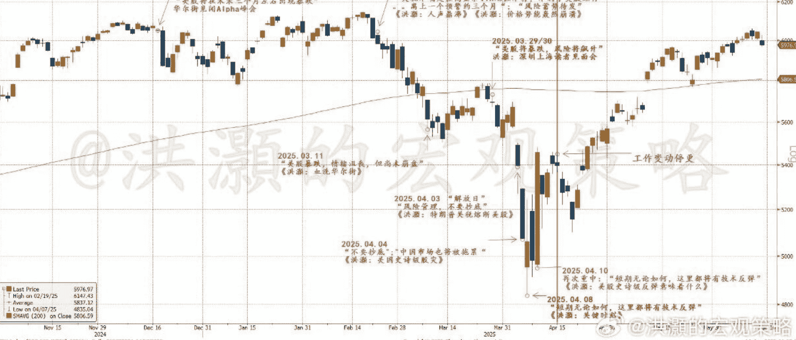
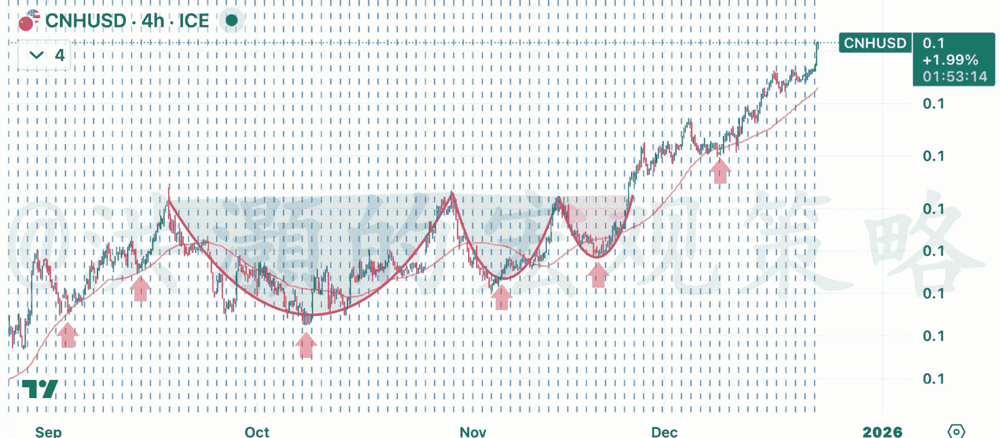

> 标普连续第八个月上涨，无视人工智能的担忧。随着地缘政治紧张局势的加剧，石油上升，而黄金和白银继续创下历史新高。

作者：洪灏
摘录：洪灏的宏观策略

> 伦铜逼近12000美元，继续历史新高。

作者：洪灏
摘录：洪灏的宏观策略

> 今年美股年初的66天是美国历史上第四差的开年66天，名列前五最差的开年份：1932、1939、2020、2025、2001。也就是，大萧条、疫情、恐袭和贸易战。在2024年12月的会议展望2025年，我们逆共识预测未来三个月左右，美股将出现历史性波动。美股于今年二月见顶，开始了向特朗“解放日”的历史性暴跌。在四月八日“解放日”美股历史性暴跌中，我预测在那个位置“无论如何都会技术崩”。所有的趋势都是从技术反弹开始的。反弹成功，此则趋势逆转。如今，圣老老人戏正在徐徐展开。今年的Call，远不止黄金白银。追踪一个分析师，需要连续观察他长期以来的观点，尤其是在拐点附近的观点如何发生变化。只有拐点才能改变人生，只有与众不同、并被反复验证的预测才能真正为投资者增加价值。最近被黑到变形，请允许我凡赛一下。今年是一个充满波动的一年。然而，正如熊彼特所言，“波动就是进步”。祝贺各位读者今年收获丰满，并愿大家明年一起，再接再厉。

作者：洪灏
摘要：洪灏的宏观策略

2024.12.17/
“股票将在未来三个月左右见反底”
华尔街见闻Alpha协会

2025.02.24
“关键不确定性导致VIX指数高企，不考虑风险运行高上三个月，风险定价将持续”
《决策：VIX指数将触底部结束”

2025.03.29/30
“美股市将调整，风险将回升”
《决策：深圳上海将重现局面》

2025.03.11
“暴跌继续，情绪还没涨，但尚未反底”
《决策：血洗华尔街》

2025.04.03
“解放日”
“风险空底，不要下探”
《决策：旧时期将无尽终结》

2025.04.04
“不要抄底”“中国市场或将底部反弹”
《决策：英国股市诗级反弹》

2025.04.10
“再次重心，无论如何，这都将没有技术反弹”
《决策：美股市诗级反弹意味着什么？》

2025.04.08
“短期内无论如何，这股市将没有技术反弹”
《决策：关键时期将》

| Metric | Value |
| :--- | :--- |
| Last Price | 5976.97 |
| High on 02/19/25 | 6147.43 |
| Average | 5873.13 |
| Low on 04/07/25 | 4835.04 |
| SMAE (200) on Close | 5806.59 |

> 人民币突破7.02，快速逼近7.01。
人民币小时线出现罕见的“杯柄结构”。人民币被严重低估、人民币汇率升值是我们今年的主要预测之一。在在我们今年11月发布展望报告时，人民币还在7.12附近。这升值的速度，钢钢铁地。

## 技术分析 ## 人民币

作者：洪灏
摘录：洪灏的宏观策略

# 深度视野文集优质圈，全部包含以下内容：限时年费188/年 加微信255

- 1 吃瓜粉丝倍时对话（原价365/年）
- 2 子子私享会（原价568/年）
- 3 政事堂原子明（再送顺子）
- 4 米储诸间【独家】原价599/年）
- 5 欧洲金准专属文章（原价328/年）
- 6 铸五厂内部圈（原价400/年）
- 7 卢克文读书会专属文章（原价699/年）
- 8 鉴茶财经知识星球（原价3310/年）
- 9 猫哥的视野知识星球（原价299/年）
- 10 财新周刊【独家】原价1498/年）
- 11 杨世光在钱牌（原价2200/年）
- 12 森森财经知识星球（原价1600/年）
- 13 源泽异付费文集（持续更新）

深度视野（野付费文集）

14 司马林解读毛选全套音频和全套书籍珍藏版无删减（原价2.3万）

15 虚吾三部曲[民国梦、帝国争亡、不被理解的MAO]（原价599元）

16 卢克文知识星球文章（原价268/年）

17 额外再送：卢幽元新浪播付费专栏、西村边老王、三花九洞文集

不定期内容：（更多资源将下去……

① 守夜人司令知识星球、接魂魔王知识星球、生有术知识星球、创始笔记、达沃译论星球、成付财富圈、雪雪花甲老头等、A视野、大树乡谈、江宁访访、泮说、上海海家学等付费文集、西风付费文章、老端、汪在八小时之外、局外人的视角、升值、老A体制内等其它一些大V付费文集（每月不超过600元的付费文集）
