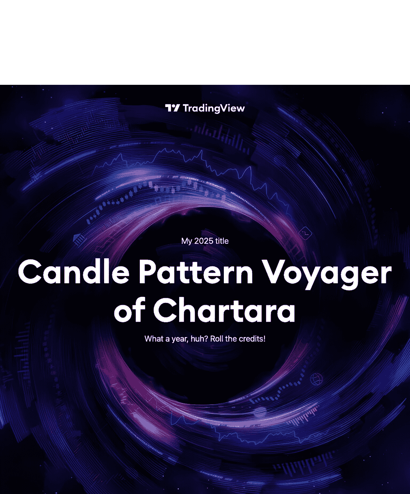

> 白银飙升突破74，不断历史新高。

作者：洪灏
摘录：洪灏宏观策略

--- 

# 《巴伦周刊》公布2026年美股十十大首选（转）

作者：洪灏
摘录：洪灏的宏观策略

| Company / Ticker | Recent Price | YTD Change | Market Value (billion) | 2026E P/E | Dividend Yield |
| --- | --- | --- | --- | --- | --- |
| Amazon.com / AMZN | $231.78 | 5.6% | $2,478 | 29.0 | None |
| Bristol Myers Squibb / BMY | 51.21 | -9.5 | 104 | 8.5 | 4.9% |
| Comcast / CMCSA | 27.58 | -26.5 | 100 | 6.7 | 4.8 |
| Exxon Mobil / XOM | 119.54 | 11.1 | 504 | 16.4 | 3.4 |
| Fairfax Financial Holdings / FRFHF | 1,768.67 | 27.3 | 42 | 10.2 | 0.9 |
| Flutter Entertainment / FLUT | 218.34 | -15.5 | 38 | 21.5 | None |
| Madison Square Garden Sports / MSGS | 224.17 | -0.7 | 5 | N/A | None |
| SL Green Realty / SLG | 44.23 | -34.9 | 3 | 9.0* | 7.0 |
| Visa / V | 325.73 | 3.1 | 637 | 25.5** | 0.8 |
| Walt Disney / DIS | 108.83 | -2.3 | 194 | 16.5** | 1.4 |

> “今天用TradingView的时候，它给了我今年11月以来的总结：重心在期货，最擅用蜡烛图、11月写代码大爆发，一个月就增加了四十多个自有指标（TradingView可以自己写代码做指标，非常给力）。我分享的图基本上都是TradingView和彭博终端做的。TradingView的做图和图形细节能力超强，完成一张图大约需要大半小时到一小时左右。在我回答问题的时候，基本上每个问题都体会附上一张图，用图形和数据佐证我的观点。”

作者：洪灏
摘录：洪灏的宏观策略

# Futures market

was your main mission zone — that's 26% of all symbols you explored in 2025.

## TradingView

### My 2025 title

### Candle Pattern Voyager of Chartara

What a year, huh? Roll the credits!

## TradingView

### November

your coding supernova, your most active month. This was your brightest point in the Pine-galaxy, when you added indicators 41 times.

> “贵金属市场集体爆发！现货白银、黄金齐创新高，纽约期铜日内涨超4%，美股贵金属盘前集体上扬，科尔薛伦矿业涨近5%，泛美白银涨近4%，南方铜业涨超3%，Barrick Mining涨超1%；2倍做多白银ETF盘前大涨近9%，2倍做多黄金ETF涨近近2%。（转）

作者：洪灏
摘录：洪灏的宏观策略

# 深度视野优质文集·链接优质社群，助你成功

全部包含以下内容：限时年费188/年 加微信cuk255

- 1 吃群众倍信圈文加时群群对话（原价 365 元/年）
- 2 子明私享（会）内部文章（原价 568 元/年）
- 3 政事堂（原子明）费内容内加送顺子明群聊
- 4 米联锦间【作者米糕】原价 599 元/年）
- 5 欧洲金雀会员专属文章（原价 328 元/年）
- 6 传五厂内部圈（原价 400 元/年）
- 7 卢克文青读书书会专属文章（原价 699 元/年）
- 8 鉴茶财经知识星球（原价 3310 元/年）
- 9 猫哥的视界知识星球（原价 299 元/年）
- 10 财新周刊【独家新闻】原价 1498 元/年
- 11 杨世光在钱（原价 2200 元/年）
- 12 森森财经知识星球（原价 1600 元/年）
- 13 源译许付费文集（持续更新）

# 深度视野文集
群微微信cuk255

- 14 司马林解读毛选全套音频和全套书籍珍藏版无割（原价 2.3 万）
- 15 虚走三部曲【民国梦、帝国争亡、不被理解的 MAO（原价 599 元）
- 16 卢克文知识星球文章（原价 268 元/年）
- 17 额外再送：卢盟元新浪微博付费文专栏；三村丰老王、三花九树文集

不定期内容：（更多资源将去了...

- ① 守夜人司令知识星球、拯救鸽魔王知识星球、生有财富知识星球
- ② 创始笔记、达沃译论星球、成付财富圈、雪花花甲老头等
- ③ A视野、大树乡谈、江宁后、泮咩说、上海海学等等付费文集
- ④ 西风付费文章、老端、赢在八小时之外、局人的视界、升值、老体制内等等其它大 V 付费文集（每月不超过 600 元的付费文集）

# 限时年费188/年 低成本链接全网V优质内容
