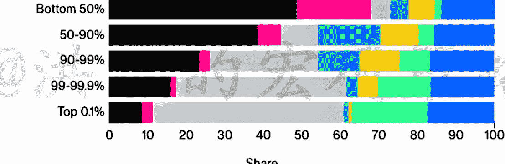
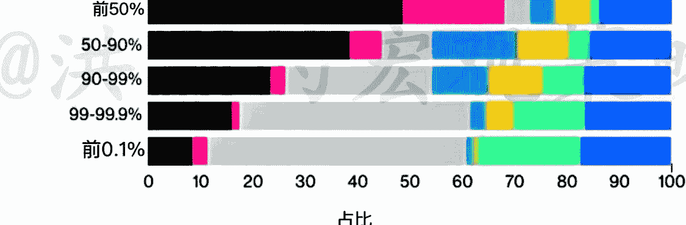

> 隔夜，白银80。这是给大家最好的圣诞新年礼物🎁

作者：洪灏

摘录：洪灏的宏观策略

> 黄金4500美元；一年前，国际大行的2025年目标集中在每盎司2,900美元至3,000美元的区域。高盛预测约为2,900美元-2,973美元；大通士摩根的目标价在2,900美元到3,000美元。一年前的那时，黄金继续是我的重点推荐。那时我说，“黄金白银的涨幅将超越共识的认知”。

作者：洪灏
摘录：洪灏的宏观策略

> 美国不同财富人群持有资产占比图。越富有，持有的房地产和耐用消费品（车）占比越少，持有股票、有价证券和PE越多#大类资产配置# #美国经济#

作者：洪灏
摘录：洪灏的宏观策略

# How Wealth Groups Hold Assets in America

Wealthy hold larger share of assets in equities and private businesses

- Real estate, Consumer durable goods, Corporate equities and mutual fund shares
- Defined benefit pension, Defined contribution pension, Private businesses, Other

Wealth component

Source: Federal Reserve

# 美国财富群体如何持有资产

富裕阶层在股票和私营企业中持有更大比例的资产

- 房地产、消费耐用品、企业股票和共同基金份额
- 确定收益养老金、确定贡献养老金、私营企业、其他

财富组成部分

来源：美联储

# 深度视野优质文圈，链接优质群，助你成功

全部包含以下内容：限时年费188/年 加微信cuk255

- 1 吃瓜群众倍时文圈加时群对话（原价 365 元/年）
- 2 子明私享（含）内部文章
- 3 政事堂（原子明）付费内容再送顺子明群聊
- 4 米联储间【作者米穗】原价 599 元/年）
- 5 欧洲金雀会员专属文章（原价 328 元/年）
- 6 咕五厂内部圈（原价 400 元/年）
- 7 卢克文青读书会专属文章（原价 699 元/年）
- 8 鉴茶财经知识星球（原价 3310 元/年）
- 9 猫哥的视界知识星球（原价 299 元/年）
- 10 财经周刊【独家新闻】原价 1498 元/年
- 11 杨世光在金钱（原价 2200 元/年）
- 12 森森财经知识星球（原价 1600 元/年）
- 13 源译译付费文章集（持续更新）
- 14 司马林解读毛选全套音频和全书珍藏版无割减（原价 2.3 万）
- 15 虚虚三部曲[民国梦、帝国战争、不被理解的MAO](原价 599 元）
- 16 卢克文再送：卢克文星球文章（原价 268 元/年）
- 17 额外再送：卢麟元新浪爆虾付费专栏、三村丰老王、三花九洞文集

不定内容：（更多资源不下去了……）

- ① 守夜人司令知识星球、接鸽魔王知识星球、生财有知识星球、
- ② 创始人笔记、达叔译论知识星球、成付财富圈、雪花甲老头等
- ③ A视野、大树仿谈、江衍说、咩同学、上海海家学等付费文集
- ④ 西凤付费文章、老端、赢在八小时之外、局人的视界、升值、老体制内等等其它大V付费文集（每月不超过600 元的付费文集）

# 深度视野文集

# 群微微信cuk255

深度视野（付费文集）

限时年费188/年

# 低成本链接全网大V优质内容
