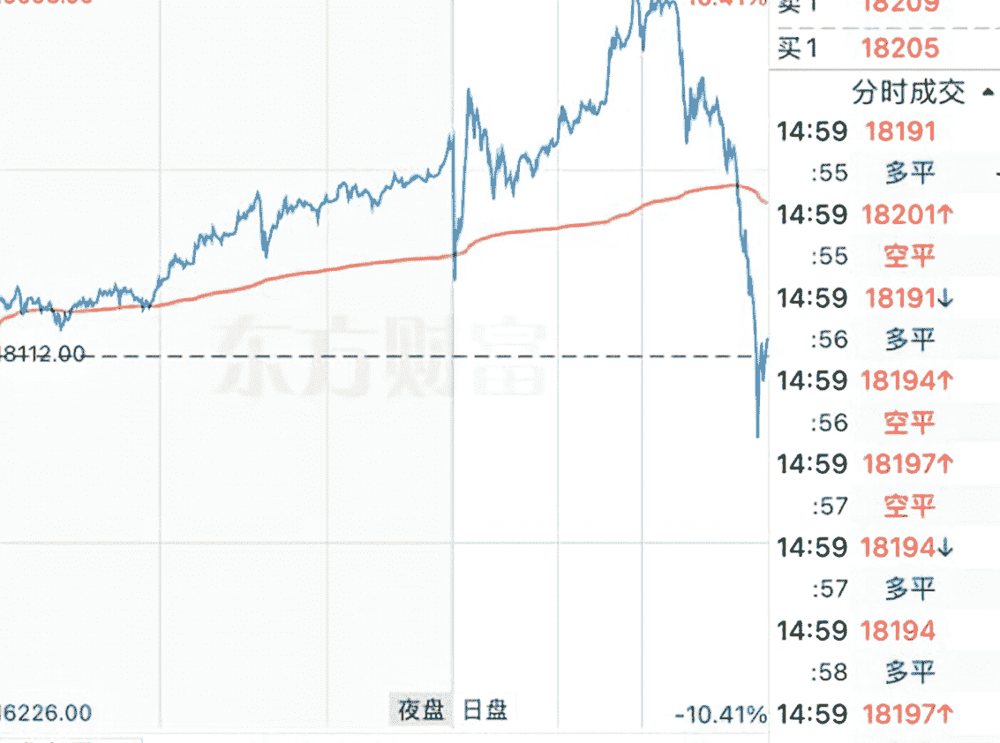

> 持而盈之，不如其已。
功成身退，天之道也。

《道德经》里老子这句话的含义，其实网上搜索一下即可。令人欣慰的是，绝大多数读者领悟了。今天早上四点起来对于模型数据进行全面更新的工作，没有白费。

作者：洪灏
摘录: 洪灏的宏观策略

持而盈之，不如其已出自《老子·第九章》，意思是事情到圆满满溢（盈），就应该适时停止（已），不要再继续追求或表现，否则物极必反，反而会招致损失或祸，他强调的是“成功身退”的智慧，如水满则溢、刀刃锐易折，体现了老子“知止不殆”、“见小日明”的辩证思想和谦逊保身之道。

## 详细解释

- 持而盈之：执执持（或追求）事物达到圆满、极致（盈）的状态。
- 如其已：不如适可而止（已/止）。
- 引申意义：
    - 生活智慧：杯子水满了再溢出，不如停住；锋利的刀刃锤打得太利，反而容易折断。
    - 处世原则：成功了就应该成功身退，避免骄傲自满，否则会招致灾祸。
    - 天道自然：这是大自然循环的规律，月有圆缺，日中则移，应效法这种适收敛、含藏的智慧。

## 核心思想

这句话告诉世人，在达到顶峰时，要懂得收手，保持谦冲，不要过度贪求，这才是长久自保、趋吉避凶的根本之道。

> 《中国基金报》：现货白银今天一度开盘冲高到历史新高8后开始暴跌，盘中失守75美元/盎司；截至中国基金报发稿，碳酸锂主力合约一度触及跌停，钡主力合约跌停，跌幅达10%，铂主力合约跌停。

作者：洪灏
摘录：洪灏的宏观策略

## 沪银连运

| 项目 | 数值 |
| :--- | :--- |
| 代码 | 18205 |
| 今开 | 18210 |
| 最高 | 19998 |
| 最低 | 17500 |
| 涨跌 | 0.51% |
| 总手 | 93 |
| 持仓 | 144.3万 |
| 日增 | 22.59万 |
| 结算 | -53733 |
| 昨结 | 18887 |
| 当前 | 18112 |

当前沪银主力合约约沪银 2602(ag2602) 详情>

分时 五日 日K 周K 月K 更多

均价: 18887 最新: 18205 93 0.51%

| 卖 | 价格 | 均量 |
| :--- | :--- | :--- |
| 卖1 | 18209 | 118 |
| 买 | 18205 | 19 |
| 分时成交 | | |
| 14:59 | 18191 | 99 |
| 14:55 | 多平 | -42 |
| 14:59 | 18201 | 81 |
| 14:55 | 空平 | -7 |
| 14:59 | 18191 | 63 |
| 14:56 | 多平 | -17 |
| 14:59 | 18194 | 40 |
| 14:56 | 空平 | -7 |
| 14:59 | 18197 | 35 |
| 14:57 | 空平 | -2 |
| 14:59 | 18194 | 24 |
| 14:57 | 多平 | -9 |
| 14:59 | 18194 | 27 |
| 14:58 | 多平 | -6 |
| 14:59 | 18197 | 98 |
| 14:58 | 多平 | -23 |

成交量 144.3万 持仓 22.59万 日增 -53733

## 深度视野

全部包含以下内容：

- 1 深度子（原价365 元）
- 2 进享（原价599 元）
- 3 政事（原价400 元）
- 4 欧洲金（原价328 元）
- 5 卢雀（原价599 元）
- 6 卢克文读书（原价699 元）
- 7 鉴茶财经（原价3310 元）
- 8 猫哥的视界（原价299 元）
- 9 财新周（原价1498 元）
- 10 杨世光在钱（原价2200 元）
- 11 森森财经（原价1600 元）

## 深度视野文集

- 14 司马林解读毛选全套音频和全书珍藏版无删减（原价2.3万）
- 15 虚走三部曲【民国梦、帝国争亡、不被理解的MAO】（原价599 元）
- 16 卢克文（原价268 元）

- 17 额外再送：卢麟元新微博付费专栏、村西边老王、三花九洞文集不定期内容（更多资源将持续……）

- ① 守夜人司令星球、接魂魔王知识星球、生财有知识星球、
- ② 创始人笔记、达沃译论星球、成交财富圈、雪花甲老头等
- ③ A视野、大树乡谈、江宁后、泮咩说、上海海学等付费文集
- ④ 西风付费文章、老端、赢在八小时之外、局外的视野、升值迁、老
- A 体制内等及其它大V付费文章（每月不超过600 元的付费文集）
