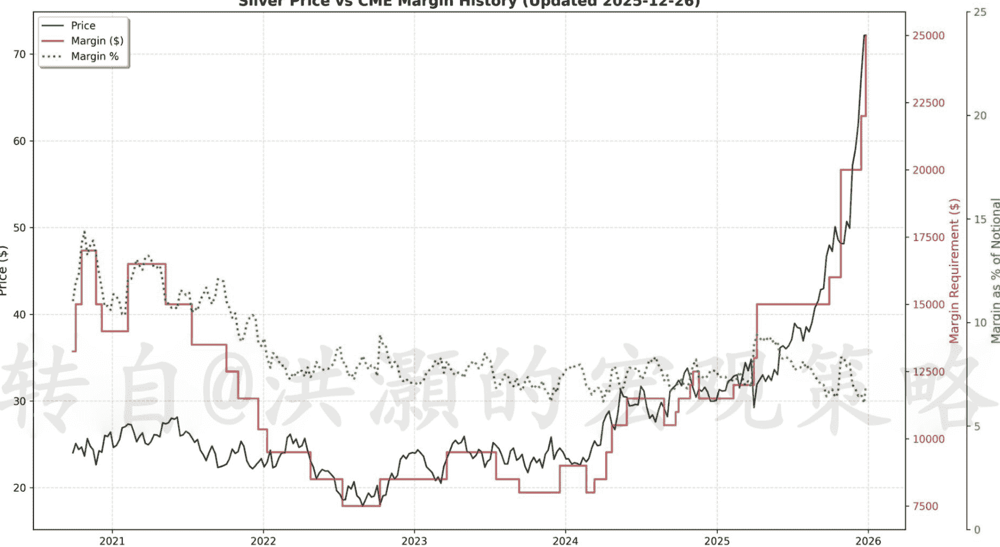
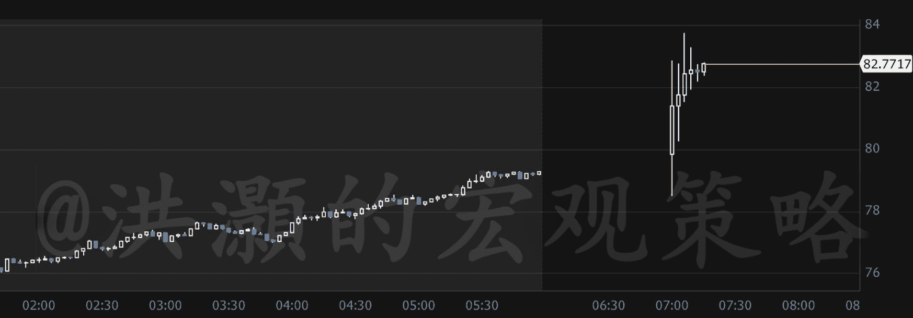

# 中国释放信号 将在2026持续提供财政支持以促进经济增长

彭博新闻社报道

【彭博】-- 中国承诺在2026年扩大财政支出，这表明政府将持续支持经济增长，以应对充满挑战的外部环境。

根据财政部周日发布的公告，中国将扩大对新质生产力、人的全面发展等重点领域的投资。本周末财政部召开了年终工作会议，制定了明年的财政政策重点。

一手 优 质 资源加微信：cuk255

> 白银的期权 vs 价格。一目了然。

作者：洪灏
摘录：洪灏的宏观策略

> 继上周五飙升一天10%之后，白银开盘继续飙升近5%到83。我们十一月见面会的时候定的第一目标价格 —— 80+已经到达。

作者：洪灏
摘录：洪灏的宏观策略

# Silver Price vs CME Margin History (Updated 2025-12-26)

| Price | Margin ($) | Margin % |
| :--- | :--- | :--- |
| | | |

一手 优 质 资源加微信：cuk255

# XAG Currency 82.8837 3.6129 4.56% At 07:16:13

Price Chart 12/27 01:32 - 12/29 08:22 Period: 3m

- Start 76.17887 Change 6.5930 (8.65%) High on 12/29 07:06 83.7677 Low on 12/27 01:39 75.8808

一手 优 质 资源加微信：cuk255

> 白银月线，疯狂的程度堪比80年的历史性逼空行情。白银十二月的这根蜡烛比80年的还要长，白银月线已经拉出大阳，历史上从未有过。
> 白银月线已经拉出大阳，历史上从未有过。
> 这种行情是诗级的，我们正在见证历史的。

作者：洪灏
摘录：洪灏的宏观策略

一手 优 质 资源加微信：cuk255

> 现货白银突破45关口。

作者：洪灏
摘录：洪灏的宏观策略

# 深度视野文集
包含以下内容：限时年费188/年 加微信cuk255

- 1 粉丝（原价365 元/年）
- 2 付享会（原价599 元/年）
- 3 内部米（原价328 元/年）
- 4 钛五（原价400 元/年）
- 5 卢克文读书会（原价699 元/年）
- 6 鉴茶财经（原价3310 元/年）
- 7 猫哥的视野（原价299 元/年）
- 8 杨世光在钱（原价2200 元/年）
- 9 森森财经（原价1600 元/年）
- 10 进阶星球（原价1500 元/年）
- 11 源泽异付费文章（持续更新）
- 12 （此处对应原文编号断层）
- 13 司马林解读毛选全套音频和全套书籍珍藏版（原价2.3 万）
- 14 虚虚三部曲[民国梦、帝国争亡、不被理解的MAO](原价599 元）
- 15 卢克文再送：卢克文星球文章（原价268 元/年）
- 16 额外再送：卢麟元新涨薇付费专栏、三村西屯老王、三花九涯文集

不定期内容：（更多资源将下去了……）

- 守夜人司令知识星球、接魂魔王知识星球、生财有知识星球、创始笔记、达越译论星球、成付财富圈、雪花花甲老头
- A视野、大树乡谈、江初知道、泮咩说、上海海学等付费文集
- 西风付费文章、老端、赢在小时之外、局外人的视野、升值、老A体制内等一切其它大V付费文章（每月不超过600 元的付费文集）
