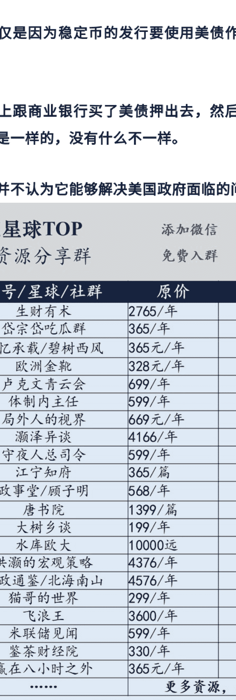

# 在犹豫中离开

在犹豫中离开，也许是因为我发现自己还没准备好面对这种改变，这也是一个我无法面对的理由。

后悔，现在才后悔，我列出了无数个理由：

“5-10%的年薪涨幅就是我留的理由，因为我不够勇敢。”

“对未知的恐惧。”

现在看来，金钱已经是我最无法拒绝的理由了。

这已经无法挽回了，我的身体已经付诸行动：

但是我还是在想，当我离开的那一刻，我真的准备了吗？

如果当年年薪还是5500万，我还会选择那次跳槽吗？

可是实话，金钱对我来说比放弃机会太重要了。

现在的我，压力大到真的快要把我窒息了。

如果当初没有离开现在的公司，现在的我会这么痛苦吗？

其实我没有选择，因为我根本无力拒绝那个巨大的机会了。

现在的我，后悔吗？我后悔吗？

# 后悔离开的代价

我后悔当初的决定吗？

虽然现在很痛苦，但我并不后悔离开公司。

如果我离开了，我会更后悔了。

虽然现在很痛苦，但我并不后悔离开公司。

现在的年薪是5500万

我离开后是否获得了自由？

⭐⭐⭐后悔离开的代价 ⭐⭐⭐
